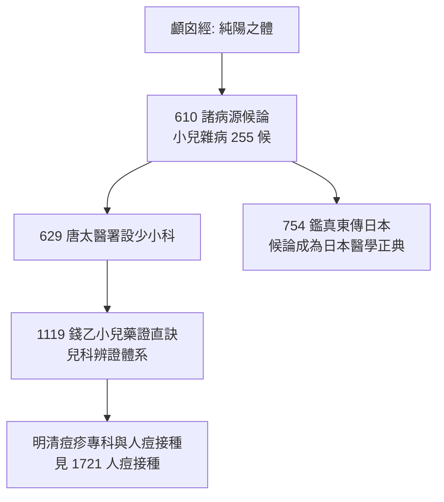

## 610 - 《諸病源候論》小兒雜病候（東方正典裡的兒科病案卷宗）

## 案件摘要

**本案偵破的是：在蓋倫正統遮蔽西方兒科的同一時代，東方醫學正典如何為兒童建立系統檔案？**

公元 610 年，隋煬帝敕令太醫博士巢元方主持編成《諸病源候論》五十卷，共 1739 論——中國第一部系統性病因症候學總綱。其中**卷四十五至卷五十為「小兒雜病諸候」，共 255 論**，佔全書近六分之一，是當時世界上最龐大的兒科症候學專卷：從新生兒臍瘡、鵝口瘡、變蒸，到驚候、疳候、痘瘡（天花）、麻疹樣發疹、解顱（腦積水）、夜啼、乳癖（消化不良團塊）。本案的重點在於：它以「候」（症候群）為單位為兒童疾病編目，等於建立了兒科的**ICD 雛形**——比西方第一本兒科教科書（Metlinger, 1473）早了 863 年。

## 前因 -- 為什麼會有這個案子

- **帝國敕編的知識動員**。隋統一南北後，朝廷有系統地整理醫籍；巢元方任太醫博士，領銜編纂國家級醫學標準——這是「國家為兒童疾病建檔」的行政行為，與希臘羅馬的自由執業模式根本不同。
- **前代的積累**。漢代《顱囟經》（託名上古、實為唐前著作）是中國最早的小兒科專書，提出小兒為「純陽之體」的理論；晉代王叔和脈學、陶弘景藥學提供了工具箱。
- **天花與發疹病的壓力**。4–6 世紀天花經絲路進入中國（葛洪《肘後方》約 340 年首記「虜瘡」），兒童為主要受害者；發疹病的鑑別成為剛需。
- **唐代兒科建制的直接前置**。《諸病源候論》問世後，唐代太醫署（629 年）正式設「少小科」為醫學四科/九科之一——中國兒科自此有官學編制，比歐洲早一千二百年。

## 線索與推理 -- 理論與文獻

**線索一：以「候」為單位的兒科分類系統。** 卷四十五起按系統為小兒疾病編目：

| 候（症候群） | 現代對應 | 臨床洞見 |
|---|---|---|
| 臍瘡候 | 新生兒臍炎/破傷風 | 「浴水不潔」致染——接觸傳染直覺 |
| 鵝口瘡候 | 口腔念珠菌感染 | 黏膜白屑可拭去復生，描述精準 |
| 變蒸候 | 生理性發育發熱 | 部分發燒為良性——避免過度治療的洞見 |
| 驚候/癇候 | 熱性驚厥、癲癇 | 區分發熱性與非發熱性抽搐 |
| 疳候 | 蛋白質-能量營養不良、寄生蟲病 | 「津液耗損」近於現代營養病理 |
| 解顱候 | 腦積水 | 顱縫不閉、頭大——形態學觀察 |
| 痘瘡諸候 | 天花 | 發疹分期與預後判斷 |

**線索二：「變蒸」理論的正面價值。** 變蒸說主張嬰兒每隔一段時間「蒸蒸而熱」、與生長發育相伴、**不藥自癒**：

$$ \text{發燒} \in \{\text{病理性}, \text{變蒸性}\} \quad\Rightarrow\quad \text{先觀察再用藥} $$

這是「發育性發熱」的最早系統敘述——雖然把生理性體溫波動附會到發育節律有其幻想成分，但其臨床效果是**降低對嬰兒的醫療干預**，在過度放血放瀉的古代反而救命。它與希波克拉底「兒童發育階段論」（見 `-0400-兒童不是小號的成人.md`）形成東西呼應。

**線索三：臍瘡與「浴水」的接觸傳染直覺。** 小兒臍瘡候明確指出浴盆水與臍帶護理不當是病因——在細菌學誕生前 1250 年，這是「環境傳播」的正確偵查方向；其解法（沸水晾溫洗浴、勤換護臍）正是現代新生兒破傷風與臍炎預防的樸素版。

**線索四：疳證的營養病理解讀。** 疳證候群（面黃、腹大、髮枯、生長遲滯）橫跨寄生蟲感染與營養不良。宋代以後發展出疳積專科與捏脊療法；以現代理論重寫，疳證是：

$$ \text{腸道寄生蟲} + \text{輔食失當} \Rightarrow \text{吸收不良} \cap \text{慢性炎症} \Rightarrow \text{生長遲滯 (stunting)} $$

《諸病源候論》沒有這個公式，但它把症狀群建檔，讓後世能逐步逼近病因——分類學是流行病學的前提。

## 結案 -- 後果與影響

- **東亞兒科的共同源頭**。《諸病源候論》經鑑真東渡傳入日本，成為日本醫學底本；朝鮮《鄉藥集成方》亦大量引錄——小兒 255 候成為整個東亞漢字醫學圈的兒科檔案庫。
- **兒科官學化**。唐宋以降「少小科→小方脈」的官制延續千年，使中國成為前近代世界兒科建制最完整的國家。
- **對後世兒科偵探的鋪路**。沒有候論的分類基礎，就沒有錢乙對驚、疳、痘疹的辨證革命（見 `1119-錢乙小兒藥證直訣.md`），也沒有明清痘疹科對天花人痘接種的臨床承接（見 `1721-人痘接種.md`）。
- **一句話結案**：巢元方做的事本質上是「為兒童疾病上戶口」——當一個帝國願意用官方編制給小兒的病建檔，兒科就取得了與成人醫學對話的制度身份。

## 關鍵人物與文獻

- **巢元方**——隋大業年間太醫博士；《諸病源候論》主持編纂者，生平記載極少，是醫學史上「制度作者」的典型。
- 原始文獻——巢元方《諸病源候論》，大業六年（610）成書；卷四十五至五十〈小兒雜病諸候〉一至六。
- **葛洪（283–343）**——《肘後備急方》首記天花（虜瘡），為候論痘瘡候的先聲。
- **鑑真（688–763）**——754 年東渡日本攜醫籍，間接使候論進入日本正典。
- 現代註腳——醫史學者（如馬堪溫、石田秀實）指出，小兒雜病諸候的規模使 7 世紀的中國成為「前近代世界兒科文獻密度最高的地方」。
