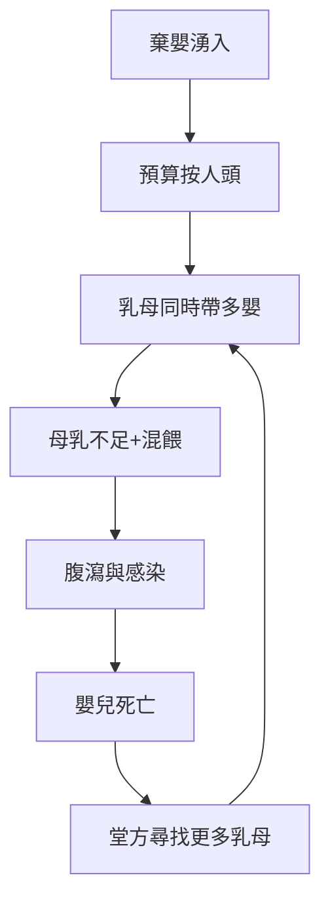

## 1196 - 育嬰堂與棄嬰輪盤（教會如何把「誰來養孩子」變成制度問題）

## 案件摘要

**本案偵破的是兒科史上第一個大型「兒童收容實驗」：教會收養棄嬰 700 年，為何嬰兒死亡率反而高得驚人？**

1198 年，教宗英諾森三世（Innocent III）下令在羅馬聖靈醫院（Santo Spirito in Sassia）設置**棄嬰輪盤**（ruota dei trovatelli）——牆上一個可旋轉的木桶，母親把嬰兒放進去、轉動鈴鐺、走人，不須露面。此制度席捲天主教歐洲：米蘭（1250s）、佛羅倫斯育嬰堂 Ospedale degli Innocenti（1445，文藝復興建築名作）、巴黎、倫敦（見 `1741-倫敦育嬰堂與嬰兒死亡率.md`）競相仿效。但悲劇性的數據是：19 世紀之前的育嬰堂，嬰兒 1 歲內死亡率常達 **50–90%**——有時比棄置街頭還高。本案要推理的正是這個悖論：善意為何殺人？

## 前因 -- 為什麼會有這個案子

- **棄嬰是古代的普遍制度**。羅馬的 expositio 合法且常見；古蘭與拜占庭法規亦見收養條款；貧窮、私生、姦生、殘疾都是棄嬰動機。
- **教會的意識形態轉向**。早期教會視殺嬰為謀殺（對比羅馬法），催生了「救嬰」義務；中世紀盛期的城市慈善（city-charity）大規模制度化。
- **乳母經濟的瓶頸**。嬰兒必須吃奶，育嬰堂唯一的解法是外包給鄉村乳母（wet-nursing）；支付極低（常低於乳母養自己孩子的報酬），乳母於是多奶頭混餵、稀釋乳品。
- **英諾森三世的傳說動機**。中世紀傳說：教宗見台伯河中漂著死嬰而震驚——故事未必真實，但反映了 12 世紀末羅馬棄嬰問題的嚴重。

## 線索與推理 -- 理論與文獻

**線索一：死亡率的數學。** 育嬰堂嬰兒死亡率的分解：

$$ MR_{\text{育嬰堂}} = MR_{\text{入院時已垂危}} + MR_{\text{集中群聚感染}} + MR_{\text{人工餵養}} $$

- **入院偏差**：輪盤收到的是最脆弱的嬰兒（早產、產傷、母親死亡）。
- **群聚感染**：數十名無免疫嬰兒密集共居，天花、痢疾、麻疹一入全滅——流行病學上的易感庫（susceptible pool）。
- **餵養技術落後**：沒有消毒、沒有配方奶的時代，人工餵養（milk pap）的嬰兒腸炎死亡率可達 90%——母乳不只是營養，更是被動免疫（見 `-0600-蘇斯魯塔與古代兒童照護.md` 的初乳理論）。

**線索二：外包乳母的賽局。** 育嬰堂按嬰兒付費給乳母 → 乳母有動機同時接多個嬰兒 → 每嬰母乳量不足 → 以粥水補充 → 營養不良與感染。這是一個制度設計造成惡性循環的教科書案例：

**線索三：善意的意外後果。** 佛羅倫斯檔案（Ospedale degli Innocenti 的入堂登記，1445 起連續數百年）顯示：城市棄嬰率與育嬰堂接收量**同向增長**——輪盤降低棄嬰的羞恥成本後，棄嬰總量不降反升。這是經濟學中的誘發需求（induced demand）：降低價格，需求增加。教會本想終結殺嬰（成功——街頭死嬰減少），卻意外擴大了棄嬰市場。

**線索四：意外的文化遺產**。育嬰堂成為文藝復興藝術的贊助人（Innocenti 的 della Robbia 陶磚嬰孩浮雕）、音樂教育者（威尼斯孤兒院音樂學校培養出 Vivaldi 的學生與樂團）、以及社會改革統計的實驗場——倫敦育嬰堂的病歷檔案後來成為嬰兒死亡率研究的原始數據（見 `1741-倫敦育嬰堂與嬰兒死亡率.md`）。

## 結案 -- 後果與影響

- **兒童福利制度的起點**。輪盤與育嬰堂是國家/教會承擔兒童照護的第一批建制，直接演化為 19 世紀孤兒院、寄養制度與 20 世紀兒童福利國家。
- **嬰兒餵養科學的黑暗前史**。育嬰堂的災難性數據逼出了 19 世紀的嬰兒食品科學：Budin 與 Tarnier 的巴黎產科嬰兒室、Leibig 嬰兒配方（1865）、乃至巴氏消毒——現代新生兒營養學部分是在育嬰堂屍體上學會的。
- **「去輪盤化」運動**。19 世紀末，兒科醫師與統計學家以死亡率數據抨擊匿名棄嬰制度；教廷與各國在 1860s–1920s 逐步關閉輪盤，改推母嬰同院與家庭補助。
- **一句話結案**：育嬰堂證明了兒科最殘酷的一課——孩子需要的不是屋頂，是母乳、免疫與一對一的照顧；善意沒有配上科學時，殺傷力可以超過惡意。

## 關鍵人物與文獻

- **英諾森三世（Innocent III，1160–1216）**——1198 年令聖靈醫院設棄嬰輪盤；中世紀教會兒童福利政策的定調者。
- **Ospedale degli Innocenti（佛羅倫斯）**——1445 年開業，由絲綢行會出資，Brunelleschi 設計迴廊；其入堂登記簿是歐洲最長的兒童人口學連續檔案之一。
- 原始文獻——Innocenti 檔案（Biblioteca degli Innocenti）；威尼斯 Pietà 孤兒院音樂檔案。
- **Vivaldi 與孤兒院樂團**——威尼斯 Ospedale della Pietà 的孤女樂團（figlie del coro）為 18 世紀歐洲音樂奇觀，韋瓦第在此任職近 30 年。
- 現代註腳——1990s 佛羅倫斯 Innocenti 成為 UNICEF Innocenti 研究中心，研究課題正是當年的老問題：全球兒童福祉與棄養。
