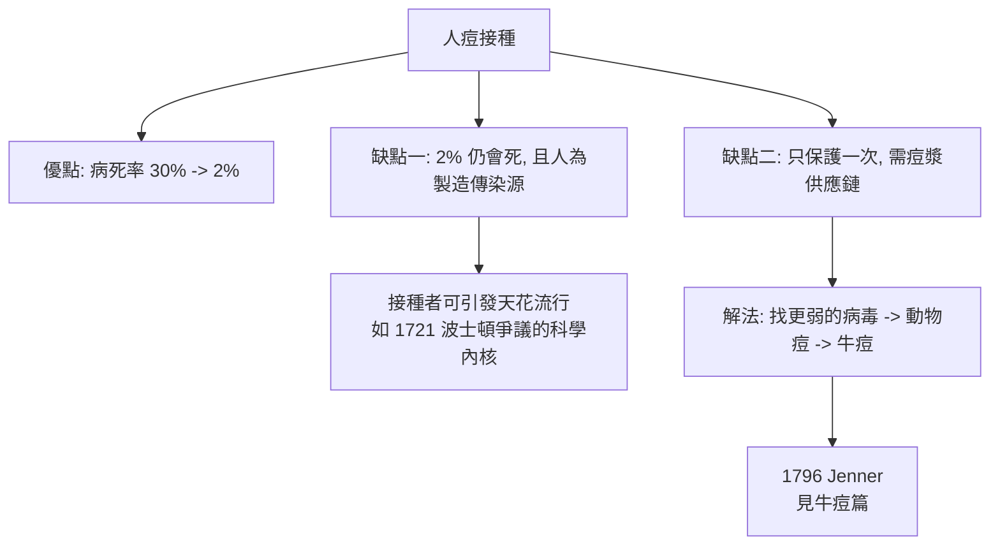

## 1721 - 人痘接種（天花、東方智慧與英國貴婦的偵探行動）

## 案件摘要

**本案偵破的是疫苗學史的第一件大案：在沒有病毒學的時代，人類如何發現「故意得一次輕症」可以防住絕症？**

1721 年 4 月，英國貴婦 Mary Wortley Montagu 在倫敦讓 4 歲女兒接受**人痘接種**（variolation/inoculation）——把天花病人的膿液劃入皮膚，人為引發可控的輕症。同時，波士頓的牧師 Cotton Mather 在天花疫情中，說服醫師 Zabdiel Boylston 給數百人接種。這是歐洲與北美第一次系統性的人痘接種實驗。它的技術源頭在中國與中東：中國明代已有人痘法（旱苗、水苗、痘衣、痘漿），經絲路與鄂圖曼帝國傳入歐洲。本案推理核心：人痘是**第一個以人口數據驗證的醫學干預**——波士頓 1721 年疫情的死亡率對比（接種者 ~2%、未接種 ~15%）是醫學史上最早的治療對照分析之一，比隨機對照試驗早了兩個世紀；而它也直接為 1796 年的牛痘革命鋪路（見 `1796-詹納牛痘.md`）。

## 前因 -- 為什麼會有這個案子

- **天花是兒科頭號殺手**。18 世紀歐洲每年約 40 萬人死於天花，死者多為兒童；倖存者 1/3 留下失明或麻臉。瑞典女王、法國路易十五皆死於此病。
- **中國的技術積累**。16–17 世紀中國痘醫發展出入痘四法（痘衣法、痘漿法、旱苗法、水苗法），清代官方在 1680s 為皇室推廣；俄國 1688 年曾派醫師赴華學習——技術經陸路西傳。
- **鄂圖曼的實踐**。伊斯坦堡民間流行接種（稱 inoculation），由老嫗操作；死亡率約 1–2%，遠低於自然感染的 20–30%。
- **Montagu 夫人的親身經歷**。1715 年她本人罹天花、面容毀損、弟弟死於此病；1717 年隨夫駐任君士坦丁堡，親見接種習俗，1718 年讓 5 歲兒子在當地接種。

## 線索與推理 -- 理論與文獻

**線索一：交叉免疫的經驗發現。** 人痘的理論基礎是「一次感染終身免疫」的觀察——天花患者痊癒後不再復染（天花病毒只有一個血清型，無抗原漂變）。人痘的本質是**以可控劑量與路徑購買免疫**：

$$ \text{自然感染: } D_{\text{病毒}} \text{ 經呼吸道, 病死率 } \sim 30\% $$
$$ \text{人痘: } D_{\text{病毒}}' \ll D \text{ 經皮膚劃痕, 病死率 } \sim 2\% \Rightarrow \text{終身免疫} $$

這是免疫記憶（immunological memory）在理論誕生前 170 年的工程化應用。

**線索二：波士頓 1721——第一場醫學數據戰。** 1721 年天花船帶來疫情，波士頓 11,000 人口中近半感染。Mather 從其黑奴 Onesimus 處學得接種知識（非洲西部的接種傳統是獨立起源），說服 Boylston 接種約 240 人。疫情結束後的數字：

| 組別 | 感染/人口 | 死亡 | 死亡率 |
|---|---|---|---|
| 自然感染 | ~5,759 | ~844 | ~14.7% |
| 接種者 | 240 (242) | 6 | ~2.5% |

當年波士頓的 James Franklin（《新英格蘭報》主人，富蘭克林之兄）帶頭痛罵接種為「散播毒物」；年輕的 Benjamin Franklin 後來（1736 年兒子死於天花）公開懺悔未接種——人痘之爭是史上第一場由報紙、教會與數據三方混戰的公共衛生辯論。

**線索三：英國的「皇家實驗」。** Montagu 夫人在倫敦接種女兒後，威爾斯親王妃 Caroline 授意於 1721 年以死刑犯（Newgate 六囚）做接種試驗：全部存活且獲釋。1722 年接種兩位公主。宮廷示範效應使接種在上層社會推開——「以罪犯與公主雙重試驗」的社會結構，本身就是一個制度偵探故事。

**線索四：風險與缺陷。** 人痘是活的、劇毒的天花病毒：

蘇格蘭醫師 Angus 之流的接種事故、以及接種者成為傳染源的事實，正是尋找「更安全毒株」的動力——疫苗學的每一次躍進都是對上一代疫苗缺點的偵查。

## 結案 -- 後果與影響

- **疫苗學的史前史完成**。人痘確立了「人工免疫可行」的先例與「接種—對照—統計」的方法論，使詹納的牛痘（見 `1796-詹納牛痘.md`）能一步跨入更安全的境界。
- **公共衛生立法的先聲**。人痘開啟了國家干預身體（強制接種）的立法先例，其爭議直接預演了 19 世紀強制牛痘接種的暴動與反疫苗運動。
- **歐亞技術網的確認**。中國—中東—非洲—歐洲的多點獨立起源，證明「人工免疫」是人類多文明在觀察中共同逼近的真理；歐洲中心敘事在疫苗史上不成立。
- **一句話結案**：人痘的偵探們用罪犯、公主與整座波士頓城做實驗，證明了「輕症換免疫」的買賣成立——剩下的問題只有一個：能不能找到更便宜、更安全的貨源？答案在母牛身上。

## 關鍵人物與文獻

- **Mary Wortley Montagu 夫人（1689–1762）**——作家與駐鄂圖曼大使夫人；1717 年書信向英國介紹接種（「這裡的老嫗有一套術語，天花在這裡不過是件小事」），1721 年在倫敦推廣；她毀容的臉是天花的活證據。
- **Cotton Mather（1663–1728）**——波士頓牧師、皇家學會通訊員；從黑奴 Onesimus 學得接種知識（「我買過的最好的服務」），推動北美首次接種運動；其住所曾被扔炸彈。
- **Zabdiel Boylston（1679–1766）**——波士頓醫師，北美首位執行接種者；1726 年在倫敦皇家學會發表數據，成為北美醫學登上國際舞台的標誌。
- **Onesimus**——被奴役的西非人，帶來非洲的接種傳統；疫苗史長期忽視的關鍵線人。
- 原始文獻——Montagu 夫人《土耳其書信》；Boylston, *Historical Account of the Small-Pox Inoculated in New-England*, 1726；中國《痘科金鏡賦集解》等痘醫文獻。
- 現代註腳——1980 年 WHO 宣布天花根除（見 `1963-麻疹減毒活疫苗.md` 的 EPI 脈絡），從人痘到根除用了 260 年；中國人痘的西傳路徑（經俄國與鄂圖曼）已由醫史學者以檔案逐步鎖定。
