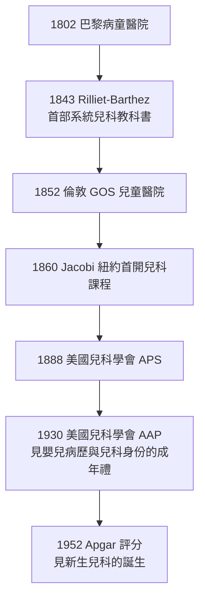

## 1860 - 雅可比與兒科獨立建科（德國難民醫師如何在紐約為「小孩的病」爭得病房）

## 案件摘要

**本案偵破的是兒科制度史的關鍵一役：兒科何時成為醫學院裡有名有姓的正式學科？**

1860 年，德國移民醫師 Abraham Jacobi 在紐約醫學院（New York Medical College）開設美國第一門兒科課程；1888 年，美國兒科學會（American Pediatric Society）成立，Jacobi 任首任會長——兒科在英語世界正式取得「專科」身份。Jacobi 著有《兒童疾病的治療》（*Therapeutics of Infancy and Childhood*, 1866），並以數百篇論文涵蓋白喉、小兒腸炎、營養與兒童醫院制度。本案推理核心：兒科的建科是一場「三線並進」的制度革命——(1) 歐洲兒童醫院的示範（巴黎 Hôpital des Enfants-Malades, 1802；倫敦 Great Ormond Street, 1852）；(2) 美國的教學與學會建制；(3) 統計學與微生物學為兒童疾病提供了「值得專科化」的證據。此前兩千年，「兒童不是小號的成人」只是少數人的直覺（見 `-0400-兒童不是小號的成人.md`），1860 年代它終於獲得學位、病房與學會。

## 前因 -- 為什麼會有這個案子

- **巴黎的示範效應**。1802 年巴黎 Hôpital des Enfants-Malades（病童醫院）開幕，是世界上第一所專治兒童的醫院；巴黎臨床學派在此訓練出 Bouchut、Trousseau 等兒科先驅；Rilliet 與 Barthez 的《兒童疾病論》（1843）成為首部系統兒科教科書。
- **倫敦的慈善—醫學聯姻**。1852 年倫敦 Great Ormond Street 兒童醫院（Charles West 創立）開業，以維多利亞慈善資金運作；其小兒外科（Trevor 與 Denis Browne）後來成為世界標杆。
- **德國移民潮的醫學資產**。1848 年革命失敗後，大批德國醫師移居美國；Jacobi（1830–1919）為 Bonn 大學醫學博士、因政治活動被囚 18 個月，1853 年抵紐約——他帶來的是德國的實驗醫學傳統與對「兒童的特殊性」的執念。
- **美國的嬰兒死亡危機**。19 世紀中葉紐約夏季腹瀉（「cholera infantum」）每年殺死數千嬰兒；乳品摻水與污染使嬰兒死亡率約 15–20%——兒科有明確的「待解案情」。

## 線索與推理 -- 理論與文獻

**線索一：Jacobi 的三重論證。** Jacobi 為兒科獨立辯護的邏輯（散見其演講與著作）：

1. **生理差異**：兒童的疾病譜、病程、藥物反應與成人系統性不同（「兒童不是縮小的男人與女人」）。
2. **治療工藝**：餵養、劑量、術式皆需專門訓練——無專科則無安全。
3. **社會回報**：嬰兒死亡率是城市文明的指標，下降它需要專業知識的制度化。

其中第 3 點是決定性的：兒科的身份不是來自「可愛」，而是來自**死亡率下降的可測量社會價值**（見 `1741-倫敦育嬰堂與嬰兒死亡率.md` 的統計遺產）。

**線索二：建科的時間表。**

**線索三：Jacobi 的臨床偵探學。** 他的代表貢獻皆為「把籠統症狀拆成疾病」：區分小兒白喉與偽膜性喉炎、界定小兒腸炎的病因學分類、研究兒童營養與人工餵養（直接接續育嬰堂的災難教訓，見 `1196-育嬰堂與棄嬰輪盤.md`）。其方法論是德國式的：**屍檢、培養、統計**三證合一——在 1880s Koch 細菌學興起後，兒科第一時間成為細菌學的應用戰場（見 `1894-白喉抗毒素.md`）。

**線索四：反對者的論點。** 「兒童的病就是成人的病的小樣本」派在 1880s 仍占多數；其反駁的核心是經濟（兒童付費能力低）與科學（兒科病例「不夠深刻」）。Jacobi 的回應兼顧了科學與政治：1889 年他出任紐約市衛生局首任兒科顧問，把兒科與公共衛生法規（牛奶供應、學校衛生）綁定——兒科藉**公衛義務**取得合法性，這是兒科與成人醫學分道揚鑣的制度秘密。

## 結案 -- 後果與影響

- **兒科全球建制化**。美國兒科委員會（1934）建立專科認證；各國兒科學會與兒童醫院在 1890–1930 間遍地開花；1910 年 Jacobi 被選為美國醫學會主席——兒科醫師第一次坐上醫學正典的大位。
- **新生兒科的伏筆**。兒科建科 90 年後，新生兒科才獨立成科（1950s–70s，見 `1881-早產兒保溫箱.md`、`1952-Apgar評分.md`）——「分科」是遞歸的：兒科內部再次長出以「日齡」為界的次專科。
- **兒童福利立法的醫學後盾**。Jacobi 一派推動牛奶檢查法、童工法、學校衛生——兒科從診室走進立法廳，奠定 20 世紀婦幼衛生行政。
- **一句話結案**：兒科建科的真相不是「大家終於愛小孩」，而是**證據鏈成熟**——統計學證明兒童死亡可測、細菌學證明兒童疾病可辨、兒童醫院證明兒科可經營；愛只是最後簽字的一方。

## 關鍵人物與文獻

- **Abraham Jacobi（1830–1919）**——德國波昂出身、紐約執業；美國兒科學會首任會長（1888）、AMA 主席（1910）；著述 400+ 篇，被尊為「美國兒科之父」；其妻 Mary Corinna Putnam Jacobi 亦是醫學史上的女性先驅。
- **Charles West（1816–1898）**——倫敦 Great Ormond Street 兒童醫院創辦人；《Lectures on the Diseases of Infancy and Childhood》（1848）為英語世界首部兒科講義。
- **Eugène Bouchut（1818–1891）**——巴黎病童醫院醫師；1858 年因氣管切開術在白喉窒息中的應用獲蒙蒂翁獎——兒科急症的先聲。
- 原始文獻——Jacobi, *Therapeutics of Infancy and Childhood*, 1866；West, *Lectures*, 1848；Rilliet & Barthez, *Traité clinique et pratique des maladies des enfants*, 1843。
- 現代註腳——1888 APS 首屆會議僅 20 名會員；今日美國兒科學會（AAP, 1930 自 APS 分立）會員逾 67,000——「小號成人的註腳」成長為美國最大的醫學專科學會之一。
