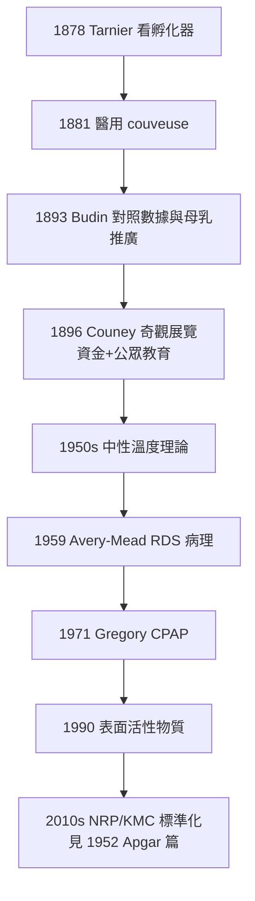

## 1881 - 早產兒保溫箱（從巴黎羊圈到嬰兒展覽會：新生兒科的搖籃是如何加熱的）

## 案件摘要

**本案偵破的是新生兒醫學的第一件設備案：為什麼「給嬰兒保暖」這件事，要靠婦產科醫師偷看雞窩才被發明？**

1881 年，巴黎婦產科醫師 Étienne Stéphane Tarnier 受禽類孵化器啟發，委託器械師 Odile Martin 製造出醫用**早產兒保溫箱**（couveuse）：金屬箱中以熱水隔層恆溫，嬰兒經玻璃觀察窗可被看護。巴黎 Maternité 醫院的統計顯示：使用保溫箱後，2,000 g 以下早產兒死亡率從約 66% 降至約 50% 以下、部分系列更低——這是人類第一次以設備干預體溫調節來拯救早產兒。1896 年，Tarnier 的學生 Alexandre Lion 與 Martin Couney 將保溫箱變成商業奇觀（柏林、倫敦、芝加哥、康尼島「嬰兒孵化器展覽」），意外地以門票收入餵養了數千名早產兒、並向公眾展示了新生兒照護的可能。本案推理核心：保溫箱的發明鏈條是「動物工程→產科統計→新生兒生理學→（意外的）馬戲團」，而它背後的科學是新生兒最脆弱的生理參數——**體溫調節與肺發育**。

## 前因 -- 為什麼會有這個案子

- **早產兒的死法：冷與餓**。19 世紀，2,000 g 以下早產兒幾乎全數死亡——死於低體溫（新生兒無褐色脂肪動員的代償弱、體表面積/體積比大、皮下脂肪薄）、餵養失敗與感染。醫學正典視早產兒為「註定失敗的懷孕」（見 `0150-蓋倫羅馬小兒觀.md` 的樣本偏差傳統）。
- **巴黎 Maternité 的統計基礎**。Tarnier 是產科流行病學家（產褥熱消毒的推行者之一），相信「以數字管理病房」；他要求器械按死亡分解逐項歸因——低體溫被鎖定為第一個可逆因素。
- **禽類孵化器的啟發**。巴黎家禽市場的孵化器（Odile Martin 為其製造商）已能恆溫孵蛋；Tarnier 的洞察：嬰兒的體溫問題與蛋的孵化問題同構——**恆溫是設備問題，不是道德問題**。
- **「算不算救」的倫理前史**。當時不少醫師與神學立場認為早產兒「未足月即夭折，救之徒勞」——保溫箱運動同時是一場對醫學正典的道德訴訟。

## 線索與推理 -- 理論與文獻

**線索一：新生兒熱生理學的量化。** 保溫箱的物理本質是熱平衡管理：

$$ Q_{\text{失}} = h A (T_{\text{皮}} - T_{\text{環境}}) + \epsilon\sigma A (T_{\text{皮}}^4 - T_{\text{壁}}^4) + H_{\text{蒸發}} $$

早產兒的 $A/V$ 比大、角質層未成熟（蒸發失水與失熱巨大），故**環境溫度必須遠高於成人病房**。Tarnier 與其學生 Pierre Budin 訂出梯度溫度表（體重越低、箱溫越高）；1950s 釐清「中性溫度（neutral thermal environment）」概念——新生兒科的第一塊理論基石不是藥，是熱力學。

**線索二：Tarnier–Budin 的數據閉環。** Tarnier 1878–83 年間以對照數據說服 Maternité；Budin 在其接續的 Clinique Baudelocque 建立系統追蹤，並出版《The Nursling》（*Le nourrisson*, 1900）——其中除了保溫，還推廣**母乳餵養與奶母管理**（呼應 `1196-育嬰堂與棄嬰輪盤.md` 的餵養災難）。Budin 的兩名學生：Adolphe Pinard 推廣產前照護、Edouard Rénon 赴美傳播保溫箱；這條法國血脈成為新生兒科的教科書正源。

**線索三：Couney 的奇觀經濟學。** Martin Couney（自稱 Lion 之徒）自 1896 年柏林工業展起，以「養育早產嬰的科學奇觀」收門票展覽保溫箱嬰兒，長達 40 年（康尼島至 1943）。看似離奇，實則完成三件正規醫療做不到的事：

1. **資金**：門票收入支付乳母與看護——保溫箱照護有錢養，而醫院沒有。
2. **技術迭代**：長期連續營運累積了餵養、消毒、體溫記錄的實務數據。
3. **公眾教育**：數百萬參觀者親眼確認「早產兒可以活」——觀念的社會傳播早於醫院的制度採納。

救活的嬰兒估計 6,000+ 人；但 Couney 亦被批評為「嬰兒馬戲團」——倫理與效果在這一案的卷宗裡始終糾纏。

**線索四：從箱溫到肺的接力。** 保溫箱解決了第一順位（體溫）後，早產兒死亡主因暴露為**呼吸窘迫症候群（RDS）**——表面活性物質缺乏（1959 Avery & Mead 的病理發現）；1970s 持續氣道正壓（CPAP）與 1990s 肺表面活性物質替代治療接力上場。新生兒科的成長史是一部「按致死率排序、逐項破案」的連續劇。

## 結案 -- 後果與影響

- **新生兒科的制度誕生**。保溫箱→新生兒病室→NICU（1960 首批，耶魯與多倫多）→新生兒科專科（1975 美國正式發證）——「日齡」成為醫學分科邊界的起點。
- **早產兒存活率的連續破案**。1,500 g 早產兒死亡率從 19 世紀末的 >70% 降至 2020s 的 <10%；存活早產兒的長期追蹤（視網膜病變 ROP、腦室周白質軟化）再開新的偵查卷宗。
- **「值得救嗎」的倫理卷宗**。從 19 世紀的徒勞論、到 Couney 的商業化、到 1960s 的救活極限日齡（22–24 週）——新生兒科的每一項技術進步都同步擴大倫理難題。
- **一句話結案**：保溫箱案的偵破證明，新生兒科的第一件武器不是藥，是一台加熱的箱子——而真正的發明是「早產兒是一個病人，不是一個遺憾」這個命題本身。

## 關鍵人物與文獻

- **Étienne Stéphane Tarnier（1828–1897）**——巴黎 Maternité 產科教授；產褥熱防治、骨盆測量與醫用保溫箱的發明者；以統計說服醫院文化。
- **Pierre-Constant Budin（1846–1907）**——Tarnier 學生；*Le nourrisson*（1900）作者；系統推廣保溫箱+母乳+產前照護三位一體，被尊為新生兒科奠基人。
- **Martin Couney（1870–1950）**——德裔企業家；康尼島「嬰兒孵化器展」經營者 40 年；1998 年之後的醫學史界為其平反——「馬戲團裡的新生兒科」。
- **Odile Martin**——家禽孵化器器械師，醫用保溫箱的第一位工程師。
- 原始文獻——Tarnier, *De la couveuse pour enfants*, 1885；Budin, *Le nourrisson: alimentation et hygiène*, 1900；Avery & Mead, *Surface properties in relation to atelectasis and hyaline membrane disease*, 1959。
- 現代註腳——2010s WHO 推動的「袋鼠式照護（KMC）」在資源受限地區部分取代昂貴保溫箱——母親的胸口是最古老的 couveuse；熱力學沒有變，變的只是誰來當恆溫器。
