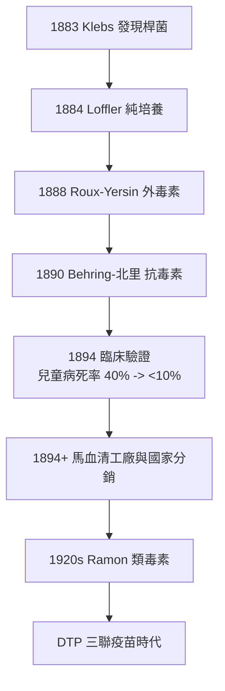

## 1894 - 白喉抗毒素（血清療法的誕生與第一個「救命工廠」）

## 案件摘要

**本案偵破的是：在抗生素出現前 40 年，一種殺死 1/4 患病兒童的喉部惡疾如何被「別的馬的血」馴服？**

19 世紀末，白喉（diphtheria）是兒科最恐怖的殺手之一：白喉桿菌在咽喉形成偽膜，剝離即大出血，或因外毒素引發心肌炎與神經麻痺——病死率在流行期可達 40%。1890 年，柏林的 Emil von Behring 與北里柴三郎證明：經減毒白喉/破傷風毒素免疫的動物，其血清可保護未免疫動物——**抗毒素（antitoxin）**問世。1893–1894 年，白喉抗毒素在柏林與巴黎兒童醫院完成臨床驗證：病死率從約 40% 暴跌至約 10% 以下。1901 年 Behring 獲首屆諾貝爾生理學或醫學獎。本案推理核心：這是體液免疫理論（Ehrlich 側鏈理論，見性病書 `../性病的歷史/1910-埃爾利希洒爾佛散606.md`）的第一場大規模臨床勝利，也是「馬血清工廠—國家分銷—兒科診斷與治療」這條現代疫苗產業鏈的起點。

## 前因 -- 為什麼會有這個案子

- **白喉的流行病學**。19 世紀工業城市人口密集，白喉以冬春流行反覆收割兒童；「勃艮第喉痛」「絞扼天使之喉」的舊名道盡其窒息的死狀。氣管切開術（1880s O'Dwyer 插管）只能救窒息、救不了毒素。
- **毒力與毒素的發現**。1883 年 Klebs 在偽膜中發現桿菌，1884 年 Löffler 純培養並證實致病；1888 年 Roux 與 Yersin 證明細菌本身不入血、**外毒素**才是兇手——這是「細菌致病但毒素殺人」的劃時代釐清。
- **免疫學的雙線並進**。Behring 在 Koch 研究所工作，接受 Ehrlich 的血清學訓練；Behring & 北里 1890 的論文證明抗毒素存在於血清——體液免疫的第一塊基石（細胞免疫由 Metchnikoff 同期提出，二人 1908 同獲諾獎）。
- **馬血清的產業化**。毒素需要大量中和物質——馬體型大、可反覆放血，成為「抗毒素生物反應器」；1894 年起德、法、美建立馬血清工廠。

## 線索與推理 -- 理論與文獻

**線索一：被動免疫的原理。** 抗毒素療法可形式化為中和反應：

$$ T(\text{毒素}) + Ab(\text{抗毒素}) \rightleftharpoons T{\cdot}Ab \quad,\quad \text{一旦 } [Ab] \text{ 過量} \Rightarrow T_{\text{游離}} \approx 0 $$

關鍵在時間：毒素一旦與組織受體結合即不可逆，故抗毒素必須在發病早期使用——**療效是時間的函數**，這一認知催生了早期診斷（喉拭子塗片鏡檢）與兒科急診的「白喉通道」。

**線索二：兩場標誌性臨床驗證。** (1) 柏林 1893：Behring 在 Kaiserin Auguste Victoria 兒科病房試用，病死率顯著下降。(2) 巴黎 1894：Roux 在 Hôpital des Enfants-Malades 的 448 例對照研究——早期使用抗毒素組病死率從 ~60% 降至 ~24%，後降至 <5%。這是兒科臨床試驗的早期範本：

```python
# Roux 1894 的核心邏輯(復原)
def mortality(severity, timing):
    baseline = {"輕": 0.2, "中": 0.4, "重": 0.7}
    if timing == "早期(發病<2日)":
        return baseline[severity] * 0.15   # 毒素未及結合
    elif timing == "中期":
        return baseline[severity] * 0.4
    else:  # 晚期: 毒素已與心肌/神經結合
        return baseline[severity] * 0.9    # 血清幾乎無能為力
```

**線索三：劑量標準化的難題。** 馬血清每批效價不同——必須建立**國際單位（IU）**：以標準抗毒素血清為參照，測定每毫升可中和多少毒素致死量。這是生物製品標準化的開端，直接催生 1921 年國際衛生聯盟的生物標準委員會、乃至今日 WHO 生物標準化體系——你今天打的每一針都有效價標籤，祖師爺是白喉抗毒素。

**線索四：從治療到預防——毒疫苗。** Behring 順勢發展主動免疫：1904 年以甲醛處理毒素得**類毒素（toxoid）**（他稱 T-A-Toxin）；1920s Ramon 在巴斯德研究所改進甲醛類毒素，與抗毒素混合成 TAT 被動-主動聯合；最終演化為白喉-破傷風-百日咳三聯疫苗 DTP（見 `1906-百日咳桿菌發現.md`）。免疫學的完整閉環——被動救急、主動防患——在白喉上首次全部打通。



## 結案 -- 後果與影響

- **兒科急症的第一次系統性逆轉**。白喉從「絞扼天使之喉」變成可防治之疾；1900–1930 年間歐美白喉死亡率下降 90% 以上（大部分功勞歸抗毒素+類毒素）。
- **生物製藥工業誕生**。Behring 與 Hoechst 合作（專利+生產）， Behringwerke 成為製藥業先驅；「血清工廠」模式延續到今天的免疫球蛋白血漿產業。
- **1901 首屆諾貝爾獎的爭議**。北里與 Roux 均未分享——諾獎史上最早的貢獻分配爭議之一；Behring 晚年刻意淡化北里的角色，成為科學史污點。
- **一句話結案**：白喉抗毒素證明了「別的動物的免疫經驗可以移植給人」——免疫治療從此從哲學問題變成供應鏈問題，而供應鏈的每一環（馬房、效價、冷鏈）都直接指向救不救得活那個喉嚨被堵住的孩子。

## 關鍵人物與文獻

- **Emil von Behring（1854–1915）**——Koch 研究所軍醫出身的免疫學家；1890 與北里共著抗毒素論文；1901 首屆諾貝爾生理學或醫學獎；被德皇封貴族（"von"由此而來）。
- **北里柴三郎（1852–1931）**——日本細菌學家、Koch 高足；破傷風抗毒素的共同發現者、白喉抗毒素關鍵合作者；歸國創設北里研究所（見性病書秦佐八郎一節，師門一脈）。
- **Émile Roux（1853–1933）**與**Alexandre Yersin（1863–1943）**——巴斯德研究所雙璧，證明外毒素；Roux 1894 的臨床驗證使抗毒素落地，並創立巴斯德血清分發體系。
- 原始文獻——Behring & Kitasato, *Über das Zustandekommen der Diphtherie-Immunität…*, Dtsch. med. Wschr., 1890；Roux, *Serumthérapie*, Congrès d'hygiène, Budapest, 1894。
- 現代註腳——白喉在疫苗覆蓋下降的地區（1990s 前蘇聯、2020s 戰亂地帶）會復燃，是「群體免疫需要持續維護」的教科書案例。
