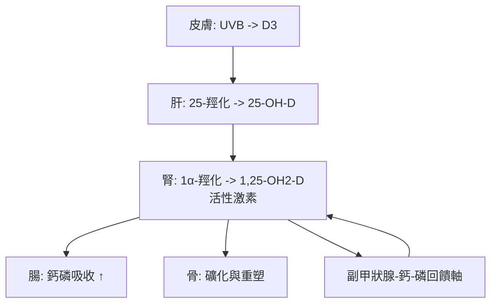

## 1919 - 佝僂病與維生素 D（從工業城市的骨架畸形到陽光維生素的偵破）

## 案件摘要

**本案偵破的是營養學史上最漂亮的連環案：一種讓兒童骨骼變形的病，兇手竟然是「缺少一種可以由陽光在皮膚合成的物質」。**

1919 年，兩組互相獨立的偵探同時破案：柏林的 Kurt Huldschinsky 證明以**石英汞燈紫外線**照射佝僂病兒童可治癒（無需任何飲食改變）；英國的 Edward Mellanby 證明以魚肝油可治癒犬隻佝僂病，1922 年 McCollum 命名其活性成分為**維生素 D**（抗佝僂病因子），並證明紫外線照射可令食物「活化」。三線合併的結論震撼醫學：佝僂病的病因既不是遺傳也不是感染，而是**營養素缺乏 + 陽光不足**——且同一物質可由皮膚光合合成，成為「維生素」概念的邊界案例。本案的社會背景：19 世紀工業城市的煙霧把孩子關進陰暗巷弄，佝僂病在格拉斯哥、倫敦貧民窟患病率可達 80%+——它是第一種被承認的「城市化疾病」。

## 前因 -- 為什麼會有這個案子

- **工業革命的黑肺天空**。煤煙遮蔽紫外線 + 高樓窄巷 + 童工與久室內生活，使 19 世紀英國城市兒童的陽光暴露崩塌；「rachitic（佝僂的）」成為格拉斯哥工人的日常形容詞。
- **臨床與病理的長期積累**。1650 年 Whistler、1660 年代 Glisson 的古典描述已刻畫顱骨軟化、串珠肋、O 型腿與骨盆畸形；1840s 起病理學確認骨樣組織礦化不全。
- **飲食線索**。19 世紀已知魚肝油「似乎」有效（1816 年 Scheutte、1848 年英國 Fish-cure Society 報告）；但作用機制不明，醫界將信將疑。
- **維生素學說的興起**。1897 年 Eijkman 的腳氣病米糠實驗（1929 諾獎）、1912 年 Funk 提出「vitamine」概念——營養缺乏病的偵探時代來臨。

## 線索與推理 -- 理論與文獻

**線索一：Huldschinsky 的光線對照。** 1918–19 年，Huldschinsky 在柏林以石英汞燈照射佝僂病兒，X 光證實骨礦化恢復。關鍵控制組驚喜：**只照射一側手臂，全身骨骼皆癒**——系統性因子（後知的 25-OH-D）進入循環，而非局部效果。這一實驗等於同時證明：(1) 陽光是藥；(2) 佝僂病是全身代謝病；(3) 皮膚是內分泌器官。

$$ h\nu \ (\lambda_{295\text{-}310\,\text{nm}}) + 7\text{-去氫膽固醇(皮膚)} \Rightarrow \text{前維生素 D}_3 \Rightarrow \text{維生素 D}_3 $$

**線索二：Mellanby 的犬實驗與 McCollum 的命名。** Mellanby（1919）以燕麥粥+無脂飲食誘發犬佝僂，魚肝油完全治癒；但初判為「維生素 A」作用。McCollum 以加熱破壞 A 而抗佝僂力仍在，1922 年區分出**脂溶性的第四種維生素 D**：

| 因子 | 脂溶性 | 對熱穩定 | 功能 |
|---|---|---|---|
| A | ✔ | ✘ | 視覺/上皮 |
| D | ✔ | ✔ | 鈣磷代謝/骨礦化 |

**線索三：光照食物的統一理論。** 1924 年 Steenbock 證明紫外線照射可活化食物（牛奶、油）中的麥角固醇→維生素 D2——紫外線與飲食兩條線索在化學上會師：**同一分子結構（固醇骨架）可由光或食物提供**。Steenbock 將專利捐給威斯康星校友研究基金會，維生素 D 強化牛奶（1920s–30s 美國普及）成為公共衛生的教科書案例——美國佝僂病在一代人內近乎消失。

**線索四：代謝與機制的最終偵破。**

1930s 腎上腺皮質激素化學（Windaus 獲 1928 諾獎、Bergstrom/Samuelsson/Vane 1982 前列腺素）的年代裡，維生素 D 被確認是**激素原**：它有前體、經兩級羥化、作用於核受體（VDR, 1987 克隆）——「維生素」其實是激素。偵探的最終答案是分類學的：維生素 D 名字錯了，身分證上應寫「類固醇激素」。

## 結案 -- 後果與影響

- **公共衛生的三連招**。陽光療法（1920s 結核療養院與佝僂病診所）、維生素 D 強化牛奶（美國）、常規補充劑（早產兒、母乳嬰兒）——佝僂病從城市標誌病變成罕見病；但 2010s 英國與南亞的再流行（戶外生活減少、膚色與緯度、母乳而不補充）提醒世人此案未完全終結。
- **營養學的範式確立**。佝僂病是「缺乏病譜系」（腳氣、壞血病、癩皮病、甲狀腺腫）中機制最漂亮的一例——它把營養學推進到分子與激素層次，並催生「強化食品」產業與政策。
- **骨與免疫的意外延伸**。1980s 起發現 VDR 廣泛表達於免疫細胞，1,25-OH2-D 調節先天與適應免疫——維生素 D 研究擴張至自體免疫、感染與腫瘤；「維生素 D 不夠了怎麼辦」至今仍是活躍的臨床爭議（meta 分析對補充劑的預防效果仍在偵查中）。
- **一句話結案**：佝僂病案的兇手不是煙囪，不是遺傳，而是**一種人類演化給皮膚的光合作用被城市生活關掉了**——營養學的最終答案常常是：「你缺的不是食物，是陽光。」

## 關鍵人物與文獻

- **Kurt Huldschinsky（1883–1940）**——柏林兒科醫師；1919 發表光線治療佝僂病的對照研究；猶太裔，1933 年流亡埃及。
- **Edward Mellanby（1884–1955）**——英國營養學家；1919 以犬實驗鎖定魚肝油抗佝僂；後任英國醫學研究委員會（MRC）秘書。
- **Elmer McCollum（1879–1967）**——約翰霍普金斯營養學家；命名維生素 A、B，1922 區分出維生素 D；「fat-soluble A vs water-soluble B」的分類法創始人。
- **Harry Steenbock（1886–1967）**——威斯康星生化學家；1924 紫外線活化食物、維生素 D 強化牛奶之父；其專利模式成為大學技術轉移的先例。
- **Adolf Windaus（1876–1959）**——固醇化學家，1928 諾貝爾化學獎；釐清維生素 D 的固醇化學結構。
- 原始文獻——Huldschinsky, *Heilung von Rachitis durch künstliche Höhensonne*, Dtsch. med. Wschr., 1919；Mellanby, Lancet/BMJ, 1919–20；McCollum et al., J. Biol. Chem., 1922。
- 現代註腳——1968–71 年，Deluca 系統闡明維生素 D 的肝腎兩級羥化代謝軸；2010s 的 VITAL 大型隨機試驗為「補充維 D 能否預防慢性病」給出謹慎的否定——佝僂病案的續集仍在院線上映。
