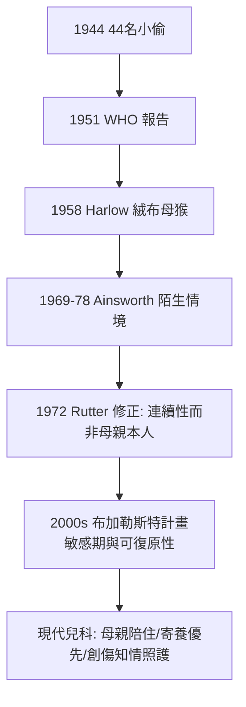

## 1944 - 鮑爾比與母愛剝奪（44 個小偷、戰爭孤兒與兒科的發展心理學革命）

## 案件摘要

**本案偵破的是兒科史上最反直覺的一案：為什麼物質條件良好的孤兒院，養出的孩子卻越養越糟？**

英國精神分析師與兒科受訓醫師 John Bowlby 在 1944 年發表《44 名少年小偷》（*Forty-Four Juvenile Thieves: Their Characters and Home-Life*）：44 名竊賊中 17 人幼年有長期母子分離經歷（對照組僅 2/44）——「母愛剝奪」與反社會行為的關聯首次被系統提出。1950 年，WHO 委託 Bowlby 撰寫報告（1951 出版《母性照顧與心理健康》），宣稱：「母親的喪失與剝奪對幼兒人格的傷害，等同於營養不良對身體的傷害。」本案推理核心：Bowlby 把動物行為學（Lorenz 的印隨）、精神分析、兒科病房觀察與統計結合，催生了**依附理論**（attachment theory）——它改變了兒科病房規則（母親陪住）、孤兒院政策（家庭式寄養）、乃至母親的社會角色；其結論的科學化驗證（Ainsworth 的陌生情境實驗，1969–78）與爭議（1960s 對「母親專職」的性別政治批評），是發展心理學最經典的後續偵查。

## 前因 -- 為什麼會有這個案子

- **戰爭孤兒與疏散兒童**。二戰期間英國大規模疏散兒童（1939 年起數百萬），多數兒童離母而寄宿；戰後檔案與臨床直覺顯示：這些孩子出現退縮、冷淡、發育遲滯——「無人陪伴的創傷」浮出水面。
- **孤兒院的死亡悖論**。18–19 世紀育嬰堂（見 `1741-倫敦育嬰堂與嬰兒死亡率.md`）的高死亡率曾歸因於感染與餵養；但 20 世紀初衛生改善後，仍有孤兒院出現原因不明的嬰兒死亡與「住院症」（hospitalism）——餓不死、病不倒，卻精神萎縮。
- **Spitz 的電影證據**。René Spitz 1945 年發表育幼機構研究：孤兒院嬰兒（衛生良好）的抑鬱、發育倒退與驚人死亡率，對比監獄附設育兒室（由服刑母親哺育）嬰兒的正常發育——**清潔殺不死嬰兒，冷漠會**。其紀錄片《Grief: A Peril in Infancy》（1947）震撼戰後醫界。
- **Bowlby 的雙重訓練**。Bowlby（1907–1990）受訓於劍橋自然科學與倫敦兒科（Truman 醫院），再入精神分析；他親眼見過病房中「母親不能探視」規則下兒童的崩解——兒科臨床與精神分析的結合點正在此。

## 線索與推理 -- 理論與文獻

**線索一：44 名小偷的對照設計。** Bowlby 以兒童輔導診所的 44 名竊賊對照 44 名情緒障礙非竊賊兒童，記錄早期分離史：

| 組別 | 6 歲前 6 個月以上母子分離 | 「無情性格」(affectionless) |
|---|---|---|
| 竊賊組 | 17/44 | 14/44 |
| 對照組 | 2/44 | 0/44 |

這不是 RCT，而是**回溯性對照**——Bowlby 清楚其限制（選擇偏差、分離與貧困混淆），並在書中明言「僅為初步線索」；但 17 對 2 的效應量足以開啟後續數十年的前瞻驗證。

**線索二：跨物種的佐證。** Konrad Lorenz 的印隨（imprinting，1935 諾獎級觀察，1973 獲獎）顯示幼鵝對第一個移動物體形成不可逆的社會依附；Harlow 的恆河猴絨布/鐵絲母猴實驗（1958）則致命一擊地證明：**幼猴餓了會找鐵絲奶瓶，害怕時卻抱著絨布媽媽**——依附不是餵養的副產品，是獨立的行為系統：

$$ \text{依附} \neq f(\text{餵養}), \quad \text{依附} = f(\text{接觸舒適} + \text{安全基地}) $$

**線索三：依附理論的形式化。** Bowlby 結合演化論與控制論，提出依附行為系統的模型：

- **安全基地（secure base）**：照顧者作為探索世界的出發點與避難所。
- **內部工作模型（internal working model）**：幼兒對「我是否值得愛、他人是否可靠」的內化預期，成為人格的底層腳本。
- **分離焦慮三階段**：抗議→絕望→疏離（Robertson 的病房觀察影像為證）。

1969–78 年，Mary Ainsworth 以**陌生情境實驗**（Strange Situation）將依附量化為安全型、迴避型、矛盾型（後加混亂型）——理論進入可測量階段，且預測力延伸至成人關係（Main 的成人依附訪談）。

**線索四：對「母愛壟斷」的反偵查。** Bowlby 1951 報告被讀成「母親必須全天候在場」，1960s–80s 遭到三路反駁：(1) 女權與勞動經濟學——把照顧鎖死在母親身上的社會成本；(2) Michael Rutter 的《Maternal Deprivation Reassessed》（1972）——剝奪的要害是**缺乏穩定、可預期的照顧者**（連續性），而非母親本人；(3) 羅馬尼亞孤兒院自然實驗（1990s–2020s，Bucharest Early Intervention Project）：被寄養救出的兒童認知與依附可部分恢復，但恢復度與分離年齡相關——敏感期存在，但**可干預**。依附理論因此從「母愛教條」進化為「照顧品質科學」。

## 結案 -- 後果與影響

- **兒科病房規則的改寫**。「母親不能探視」的規則在 1950s–60s 被逐步廢除；今日兒科的「家庭中心照護（family-centered care）」、手術前家長陪伴、Parenteral 過夜陪住，全部是此案的直接判決。
- **兒童福利政策的轉向**。孤兒院在西方世界急速關閉，寄養與家庭式收養成為主流；1955 年起 Bowlby 之妻、兒童心理學家 Ursula Bowlby 等推動的嬰幼兒收養年齡下限，同源於此。
- **發展心理學的骨架**。依附理論成為 20 世紀後半葉發展心理學與臨床心理學最被引用的框架之一；成人精神病理學（邊緣型人格、創傷）皆以其為解釋軸之一。
- **一句話結案**：Bowlby 破的是一樁「無形的營養不良」——嬰兒需要的第四種維生素是**一個穩定的人**；兒科從此明白，孩子的病歷上永遠有一欄要填：他身邊站著誰。

## 關鍵人物與文獻

- **John Bowlby（1907–1990）**——英國精神分析師、前兒科醫師；依附理論創始人；塔維斯托克診所終身教授。
- **René Spitz（1887–1974）**——匈牙利裔美國精神分析師；育幼機構抑鬱（anaclitic depression）與「醫院症」的研究者，1947 紀錄片震動醫界。
- **Mary Ainsworth（1913–1999）**——Bowlby 的合作者與檢驗者；陌生情境實驗與巴爾的摩縱貫研究的設計者。
- **Harry Harlow（1905–1981）**——威斯康星比較心理學家；恆河猴依叢實驗（1958 APA 主席演講《The Nature of Love》）；其實驗倫理亦成為動物權利的標誌性爭議。
- **Michael Rutter（1933–2021）**——英國兒童精神醫學之父；1972 以流行病學修正母愛剝奪論，開創兒童精神流行病學。
- 原始文獻——Bowlby, *Forty-Four Juvenile Thieves*, 1944；*Maternal Care and Mental Health*, WHO, 1951；Ainsworth et al., *Patterns of Attachment*, 1978；Rutter, *Maternal Deprivation Reassessed*, 1972。
- 現代註腳——2020s 依附研究與表觀遺傳學結合（NR3C1 基因甲基化與早困境遇），「母愛剝奪」案的偵查工具已深入分子層；而 WHO 2020 前後的「養育照護框架（Nurturing Care Framework）」把 Bowlby 的判決寫進了全球兒童發展政策。
