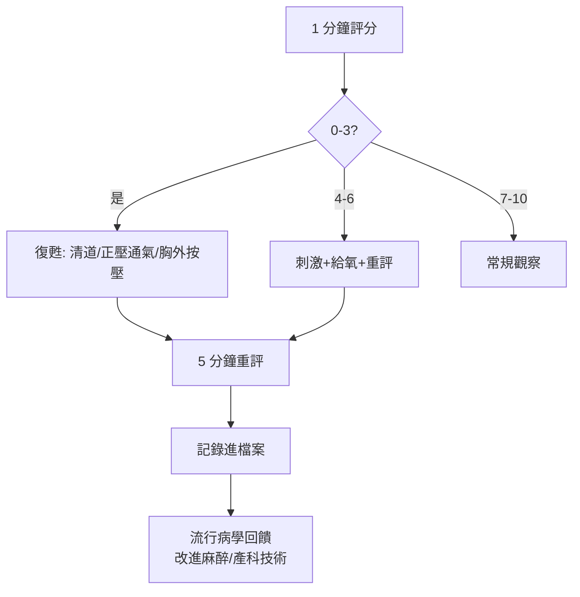

## 1952 - Apgar 評分（麻醉科醫師的一分鐘檢查表與新生兒科的通用語言）

## 案件摘要

**本案偵破的是新生兒科史上最精緻的「工具案」：在沒有任何儀器的年代，如何在一分鐘內判斷一個剛出生的嬰兒需不需要救？**

1952 年，紐約哥倫比亞大學麻醉科醫師 Virginia Apgar 提出**新生兒評分表**：在出生後 1 分鐘（後加 5 分鐘）以五項可床邊觀察的指標各評 0–2 分——**A**ppearance（膚色）、**P**ulse（心率）、**G**rimace（刺激反射）、**A**ctivity（肌張力）、**R**espiration（呼吸），滿分 10。這張表後來以發明者姓氏成為記憶口訣（Apgar＝五指標縮寫），1958 年經 15,000+ 例數據驗證（Apgar, James 等）後被全球採納，至今是地球上使用頻率最高的醫學評分——每天約 35 萬次。本案推理核心：Apgar 評分把「新生兒是否垂危」從主觀印象轉為**可傳授、可比較、可改善的數字**，直接催生了新生兒復甦術（NRP）、分娩鎮靜的安全標準，以及新生兒科的「分診—救治—記錄—回饋」閉環。

## 前因 -- 為什麼會有這個案子

- **麻醉的意外事故**。1940s，分娩麻醉（尤其吸入麻醉與脊髓麻醉）普及後，新生兒窒息與麻醉相關死亡成為美國產科的灰色地帶；「嬰兒出生時不哭」的處置全憑接生者個人習慣。
- **Apgar 的身份策略**。Virginia Apgar 是哥倫比亞第一位女性全職麻醉教授（1949），因性別被排擠出外科手術領域，轉任產科麻醉觀察崗——她把「邊緣職位」變成觀察哨：產房裡的新生兒沒有人負責，這是一個無人認領的病人。
- **資料的荒漠**。1950s 前新生兒死亡原因的記錄極差：嬰兒死亡登記常寫「stillbirth/congenital debility」，無法分析。偵破的第一步是**建檔**。
- **麻醉科的量化傳統**。麻醉是醫學中最早把生命徵象儀表化的學科（血壓、血氧、生命徵象表）——Apgar 把這套儀表化文化帶進產房。

## 線索與推理 -- 理論與文獻

**線索一：五項指標的選擇邏輯。** Apgar 的標準是「不需儀器、不需解釋、任何接生員都會評」——她曾測試 20+ 項徵象（含體溫、血糖），最終留下五項臨床分辨力最高者：

| 指標 | 0 分 | 1 分 | 2 分 | 生理對應 |
|---|---|---|---|---|
| 心率 | 無 | <100 | ≥100 | 循環灌注 |
| 呼吸 | 無 | 慢不規則 | 哭聲宏亮 | 氣體交換 |
| 肌張力 | 軟癱 | 屈曲 | 活躍 | 中樞神經 |
| 刺激反射 | 無 | 皺眉 | 咳/哭 | 神經完整性 |
| 膚色 | 全蒼白/紫 | 四肢紫 | 全粉紅 | 氧合與灌注 |

總分 4–6 = 中度抑制（需刺激/給氧），0–3 = 重度窒息（需復甦）。

**線索二：從評分到復甦的因果閉環。** 評分不是終點，是**觸發器**：

Apgar 評分的真正發明是這個閉環：評分→干預→記錄→統計→改進。它把產房變成了一個持續學習系統。

**線索三：1958 的驗證與「5 分鐘分數」的誕生。** 1958 年，Apgar 與 L. Stanley James 以 15,248 例單胎活產數據驗證：1 分鐘低分與新生兒死亡率強相關；隨後發現**5 分鐘評分**對結局的預測力更強（新生兒死亡率在 5 分鐘 0–3 分者為高分者的數十倍）。從此「雙時點評分」成為全球標準：

$$ \text{預後} \sim f(\text{1 min Apgar}, \text{5 min Apgar}, \text{5 min 後的復甦反應}) $$

**線索四：限制與濫用的偵防。** 1980s–2000s，兒科文獻系統釐清評分的界限：(1) Apgar 低分**不等於**窒息或腦癱病因——早產兒天生低分；(2) Apgar 被濫用為醫療訴訟與「母親過錯」的證據（ACOG 1996/2006 聲明：單憑 Apgar 不可判定窒息腦病）；(3) 擴展評分（E-Apgar, 2015）加入產房復甦措施記錄以修正這些混淆。一個好工具也會被當成壞證據——偵防它自己的濫用，是此案的第二段偵查。

## 結案 -- 後果與影響

- **新生兒復甦計畫（NRP）的根基**。1987 年起美國心臟學會與兒科學會的 NRP 以 Apgar 評分為評估骨架，全球培訓了數百萬名復甦人員；新生兒窒息從「不可測的悲劇」變成「可訓練的急救」。
- **分娩安全的制度化**。Apgar 評分使麻醉與產科技術的改進有了結局指標：脊髓麻醉技術、胎兒監護、早產兒轉運網絡皆以其為成果衡量——一張一分鐘的表格成為品管回饋的核心信號。
- **女性醫師的典範案件**。Apgar 後獲公共衛生碩士（Johns Hopkins, 1959），任 March of Dimes 先天缺陷部門主管（見 `1955-沙克小兒麻痺疫苗.md` 的民間資本），推廣新生兒篩檢（PKU 篩查的擴大）——她的一生示範了「被排擠者如何建立新戰場」。
- **一句話結案**：Apgar 的偵探學是「先讓不可見的垂危變成可見的數字，再讓數字長出手去救孩子」——新生兒科的通用語言由此誕生，而它寫成的第一頁，來自一位被手術室拒之門外的女醫師。

## 關鍵人物與文獻

- **Virginia Apgar（1909–1974）**——哥倫比亞麻醉科教授（1949，美國首位女性全職麻醉教授）；1952 提出評分、1958 驗證；後任 March of Dimes 醫療事務副總裁，推動先天缺陷篩檢；業餘小提琴手，曾自製樂器行銷新生兒衛教。
- **L. Stanley James（1920–1993）**——哥倫比亞新生兒生理學家；1958 年大樣本驗證的統計主腦，新生兒血氣研究的先驅。
- **Duncan Holaday**——同團隊生理學家，以臍帶血 pH/血氣研究為評分的生理學提供硬證據。
- 原始文獻——Apgar, *A proposal for a new method of evaluation of the newborn infant*, Curr. Res. Anesth. Analg., 1953；Apgar et al., *Evaluation of the newborn infant—second report*, JAMA, 1958。
- 現代註腳——1994 年美國發行 Apgar 紀念郵票（20 美分醫學先驅系列）；2015 年的擴展 Apgar（E-Apgar）把「復甦措施」寫入評分，2020s WHO 正採用——一張 70 歲的表格仍在版本迭代。
