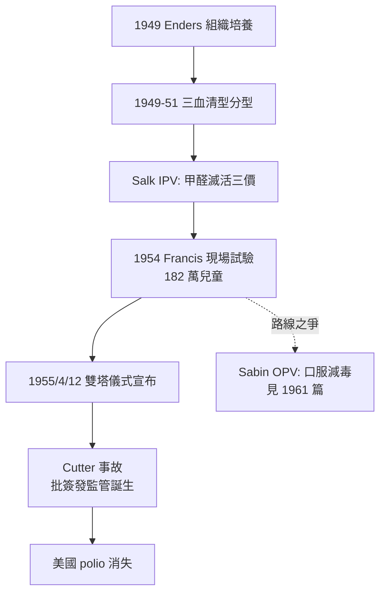

## 1955 - 沙克小兒麻痺疫苗（雙塔儀式、史上最大疫苗試驗與「滅活還是減毒」的路線戰爭）

## 案件摘要

**本案偵破的是 20 世紀兒科的頭號大案：一種讓孩子癱瘓的流行病，如何在八年內被按倒？**

1955 年 4 月 12 日（富蘭克林逝世十週年），密西根大學舉行史上第一次電視直播的科學記者會——「雙塔儀式（Cutter & Francis）」宣布：Jonas Salk 的**滅活脊髓灰質炎疫苗（IPV）**在 1954 年 Francis 現場對照試驗中有效率約 60–90%，安全可大量生產。當日美國家長排隊接種；兩年內美國小兒麻痺年病例從約 58,000 降至 1960 年代初的每年個位數流行。本案推理核心：疫苗的成功來自三項關鍵偵查——(1) Enders 的非神經組織培養（1949 諾獎）解鎖了病毒量產；(2) 血清流行病學（1949–51，分辨三個血清型）；(3) Salk 用甲醛滅活的「死疫苗」路線打敗了當時的共識質疑；但其後繼的沙賓口服減毒疫苗（見 `1961-沙賓口服減毒疫苗.md`）證明疫苗學需要兩條路線並存。

## 前因 -- 為什麼會有這個案子

- **衛生悖論**。小兒麻痺在 20 世紀成為已開發國家的惡夢，恰因衛生改善：嬰兒期（母傳抗體掩護下）不再輕症感染，首次感染推遲到學齡期，而脊髓灰質炎的癱瘓風險隨年齡**上升**——這是希波克拉底「同名異病」命題的 20 世紀版（見 `-0400-兒童不是小號的成人.md`）。
- **鐵肺與恐懼的年代**。1930s–50s 每個夏天都是「polio season」：游泳池關閉、電影院歇業；鐵肺呼吸器病房、Roosevelt 總統的癱瘓（1921），使此病成為國家級恐懼。
- **March of Dimes 的資本**。1938 年 Roosevelt 創立國家小兒麻痺基金會（NFIP），以「一角硬幣」募款（總統生日舞會、郵票、零錢箱），成為史上最大民間醫學資助機構——民間資本第一次全額包辦一種病的疫苗研發。
- **1949 的鑰匙**。Enders、Weller、Robbins 在試管中以非神經組織（人胚皮膚肌肉）培養脊髓灰質炎病毒成功——病毒可以量產、疫苗成為可能；三人獲 1954 年諾貝爾獎。

## 線索與推理 -- 理論與文獻

**線索一：三個血清型的分型。** 1949–51 年，Dulbecco、Koprowski 等以蝕斑純化技術確立脊髓灰質炎病毒有三個血清型（I、II、III）——型間幾乎無交叉免疫。疫苗必須是**三價**：

$$ V_{\text{有效}} \iff Ab_{\text{I}} \cap Ab_{\text{II}} \cap Ab_{\text{III}} \text{ 同時足量} $$

單一毒株的傳聞療法（民間的「麻痺後接種」迷信）在血清型面前全數破產——分型是疫苗學的前置偵查。

**線索二：Salk 的滅活路線。** Salk（病毒學家、流感疫苗老手）押注：以猿猴腎組織培養三型病毒、甲醛徹底滅活、保留 D 抗原誘導中和抗體。反對者（以 Olitsky、Morgan 為首的哈佛—洛克菲勒陣營）認為滅活不徹底將致災。Salk 的反擊是**劑量—效價—殘活檢測**的工程化：每批疫苗須通過猴體接種無殘活病毒的檢驗。免疫學原理上，IPV 誘導體液免疫（血清中和抗體）、防癱瘓，但腸道黏膜免疫弱——這是後來沙賓路線的切入點。

**線索三：1954 的 Francis 現場試驗——史上最大 RCT。** Thomas Francis Jr.（Salk 流感時期的老師）設計雙盲安慰劑對照、覆蓋 44 州 182 萬兒童的現場試驗：

| 組別 | 人數（~） | 麻痺型病例 | 保護率 |
|---|---|---|---|
| 接種（I 型對比） | ~20 萬 | 較少 | I 型 ~60–70% |
| 安慰劑 | ~20 萬 | 基線 | — |

總體有效率公告為 60–90%（型別異質）。這是人類史上最大規模的對照試驗，其公布方式（電視、全國同時）也成為科學傳播史的標誌事件。

**線索四：Cutter 事件的教訓。** 1955 年 4 月下旬，Cutter 實驗室一批滅活不徹底的疫苗造成 12 萬兒童接種、51 例麻痺、5 死亡——現代疫苗安全監管（批簽發 lot release、國家級不良事件監測）由此催生。偵探式的教訓：**疫苗的風險不在設計，在製造與監管**——每一批次的殘活檢測是整個免疫計畫的生命線（此原則沿用至今日 COVID 疫苗的批簽發）。

## 結案 -- 後果與影響

- **美國小兒麻痺的終結**。1961 年病例降至 161 例；1979 年美國本土野毒型麻痺歸零。
- **疫苗學的雙路線格局確立**。IPV（滅活）與 OPV（減毒，見 `1961-沙賓口服減毒疫苗.md`）的比較成為疫苗學核心議題：安全性 vs 黏膜免疫與群體傳播阻斷；今日根除後期全球已轉回 IPV 為主。
- **民間資助醫學的典範**。March of Dimes 模式（公眾小額捐款→大科學工程→臨床試驗→全民接種）成為 JDRF、黑色素瘤基金會等慈善科學的原型；1955 年的勝利是其最高回報。
- **一種病一場戰爭的社會記憶**。鐵肺病人（如 Paul Alexander，2024 年去世，在鐵肺中生活逾 70 年）、疫苗郵票、雙塔儀式——小兒麻痺成為 20 世紀美國集體記憶中最完整的「疾病敘事」。
- **一句話結案**：Salk 的勝利是「滅活也夠用」的工程判斷戰勝了學閥的理論潔癖；而 Cutter 事故隨即提醒世人——疫苗學的另一半科學在工廠與監管局，不在實驗室。

## 關鍵人物與文獻

- **Jonas Salk（1914–1995）**——匹茲堡大學病毒學家；拒絕為 IPV 申請專利（「你能為太陽申請專利嗎？」——此語有修辭成分，實為基金會放棄專利）；1963 年創立 Salk 研究所。
- **Thomas Francis Jr.（1900–1969）**——密西根大學流行病學家，流感疫苗導師；1954 試驗的總設計師與裁判。
- **John Enders（1897–1985）、Thomas Weller（1915–2008）、Frederick Robbins（1916–2003）**——組織培養三人組，1954 諾貝爾獎；Enders 實驗室同時孕育了麻疹疫苗（見 `1963-麻疹減毒活疫苗.md`）。
- **Hilary Koprowski（1916–2013）**——減毒疫苗的先行者（1950 首次人體試驗），路線戰爭中長期被邊緣化的第三位主角。
- 原始文獻——Francis et al., *Evaluation of the 1954 Poliomyelitis Vaccine Field Trial*, Am. J. Public Health, 1955；Enders, Weller & Robbins, Science, 1949。
- 現代註腳——2022 年紐約州廢水檢出疫苗衍生型 II 型病毒、2023–24 倫敦與加薩的 IP 接種行動，顯示根除後期「OPV→IPV 轉換」的微妙平衡仍在進行——1955 年的案卷至今仍有續頁。
