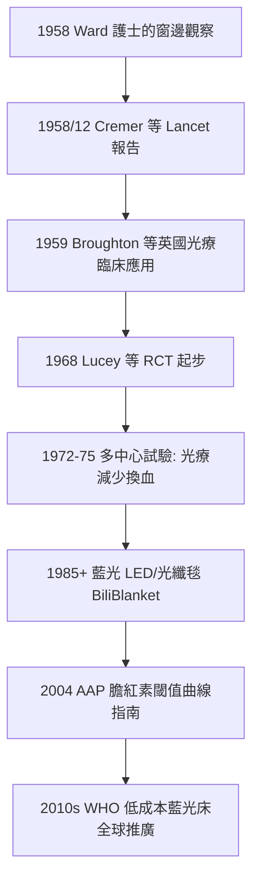

## 1958 - 新生兒黃疸光療（英格蘭護士的眼睛、光化學與「用光線做藥」的偵破）

## 案件摘要

**本案偵破的是兒科史上最詩意的一案：治療新生兒黃疸的藥，竟然是日光。**

1958 年，英國 Rochford 綜合醫院的護理師（Sister J. Ward）觀察到：曝曬在窗邊陽光下的黃疸嬰兒，皮膚黃染消退更快。她在 Ward 的配合下向醫院報告；同一年，Essex 郡的兒科醫師 R. J. Cremer、P. M. Perryman 與 D. H. Richards 在 *The Lancet* 發表《Sensitivity of hyperbilirubinaemia to light》（1958 年 12 月）——以系統測定證明**可見光能降低血清膽紅素**。醫院隨即以藍光燈建立正規光療；1970s 大型對照研究（如 Lucey, 1972–75）確認光療減少換血需求，此後成為全球新生兒黃疸的第一線治療。本案推理核心：這是「觀察—臨床驗證—光化學機制—劑量標準化」的完整偵破鏈；其機制（膽紅素的光異構化）在 1960s–70s 被解明，而 2000s 的對照試驗（Bhutani 與 AAP 指南）把光療推進到「以膽紅素閾值曲線管理」的精密時代。

## 前因 -- 為什麼會有這個案子

- **黃疸的古老困境**。新生兒生理性黃疸在古代醫籍已有記載；病理性高膽紅素血症（尤其 Rh 溶血病，見 `1940-Rh溶血病與換血療法.md`）的核黃疸（膽紅素腦病）是致死致殘的急症。
- **1950s 前唯一的武器是換血**。操作複雜、風險高、需血庫支持——發展中國家幾乎無力負擔；「有沒有更簡單的辦法」是新生兒科的懸案。
- **觀察性線索的日常性**。1940s–50s 的嬰兒室常把嬰兒置窗邊「曬太陽」（當時還帶有「日光浴有益」的時尚色彩），護士的臨床直覺是本案的第一線索——歷史上許多偵破始於護理人員的觀察。
- **膽紅素化學的成熟**。1916 年 van den Bergh 的定量反應、1950s 血清膽紅素測定的標準化，使「黃疸消退更快」從印象變成可測量的數據。

## 線索與推理 -- 理論與文獻

**線索一：光異構化的機制偵破。** 游離（未結合）膽紅素是脂溶性分子，無法經腎或膽汁排泄（新生兒肝酶 UGT1A1 未成熟）。光的治療機制在 1960s–70s 被解明：

$$ \text{膽紅素 } 4Z,15Z \xrightarrow{h\nu \ (\lambda \approx 450\text{-}470\,\text{nm})} \text{光異構體(}4E,15E \text{ 與 lumirubin)} $$
$$ \text{光異構體: 水溶性} \Rightarrow \text{不經肝結合即可由膽汁與尿液排泄} $$

兩種途徑：可逆的結構異構（configuration）與不可逆的環化（structural isomer，lumirubin）。綠光與藍光皆有效，藍光（450 nm）最接近膽紅素吸收峰——「皮膚就是反應器，光照就是化學試劑」。

**線索二：臨床驗證的節奏。**

1970s 的隨機試驗最終排除「光療只是讓膽紅素檢測值假性下降」的懷疑——真實換血率下降、核黃疸近乎消失。偵破完成於數字，而非傳聞。

**線索三：劑量與安全窗的工程。** 光療是「以皮膚為反應器」的光化學，劑量三要素：光譜（藍光最佳）、輻照度（$\mu W/cm^2/nm$）、暴露表面積。安全側的偵防：光療的副作用（脫水、體溫波動、視網膜防護、青銅嬰兒症候群見於膽汁淤積兒）在 1970s–90s 被逐項量化——光照這味「藥」同樣有毒窗，劑量學是它成熟的標誌。

**線索四：全球正義的延伸案。** 光療設備便宜（相對換血），但 2010s 調查顯示南亞與非洲仍有大量嬰兒死於可防的核黃疸——WHO 與各 NGO 推動低成本 LED 藍光床（如 Firefly 光療裝置）；2010s Gavi 式的「適宜技術」路線（見 `1974-WHO擴大免疫計畫.md` 的物流案）在新生兒黃疸上重演。

## 結案 -- 後果與影響

- **換血需求的斷崖下降**。光療普及後，HDN 時代的換血量下降 90% 以上；換血成為光療失敗的後備手段——新生兒黃疸從外科式搶救轉為內科式管理。
- **新生兒黃疸的精密管理學**。2004 年 AAP 指南以出生時齡（小時）× 風險分層畫出膽紅素干預曲線；經皮膽紅素儀（transcutaneous bilirubinometer）讓篩查無創化——「每一個出院前的黃疸篩查」成為 2010s 標準。
- **日光療法的水土迴歸**。2000s 研究證明在熱帶地區，特定波段的日光（配合防護）可作為過渡性光療——1958 年的原始觀察在資源受限地區獲得新用途；科學史完成一次優雅的迴圈。
- **一句話結案**：光療案的偵破證明，最好的藥有時不在藥典，而在窗台上——但只有當護士的觀察被醫師接住、化學家接住、統計學家接住，陽光才會變成處方。

## 關鍵人物與文獻

- **Sister J. Ward**——Rochford 綜合醫院護理師；1958 年窗邊觀察的第一線報告者，史上少數以「臨床護理觀察」署名於治療方法發明鏈起點者。
- **R. J. Cremer、P. M. Perryman、D. H. Richards**——Rochford/Essex 兒科醫師團隊；1958 *Lancet*《Sensitivity of hyperbilirubinaemia to light》的作者，光療的臨床證明人。
- **Jerold Lucey（1924–2016）**——美國佛蒙特新生兒科教授；1970s 光療與呼吸支持的多中心 RCT 推動者，《Pediatrics》主編（1974–2009）。
- **Audrey Smith 與 Gunn**——光異構化機制的化學偵破者（1969–70，London Hammersmith）。
- 原始文獻——Cremer, Perryman & Richards, Lancet, 1958；Lucey et al., Pediatrics, 1972；AAP Subcommittee on Hyperbilirubinemia, Pediatrics, 2004。
- 現代註腳——2010s 波士頓等地的「sunlight as phototherapy」現場研究（最終發表於 NEJM/Pediatrics）證實熱帶日光的可控性；核黃疸在低收入國家的殘餘流行（估計每年數十萬），是 1958 年懸案的未結餘案。
