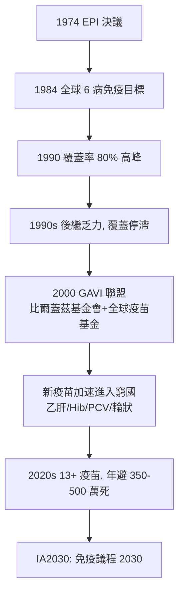

## 1974 - WHO 擴大免疫計畫（EPI：一支疫苗的全球配送戰爭）

## 案件摘要

**本案偵破的是公共衛生史上最大的「物流案」：如何在沒有電、沒有路、沒有醫師的地球上，為每年 1.2 億新生兒接種疫苗？**

1974 年 5 月，世界衛生大會通過 WHA27.57 決議，啟動**擴大免疫計畫**（Expanded Programme on Immunization, EPI）：把已有但覆蓋極不均的六種兒童疫苗——卡介苗（結核）、白喉、百日咳、破傷風（DTP）、麻疹、口服脊髓灰質炎（OPV）——系統地推到每一個國家、每一個村落。1974 年全球三劑 DTP 覆蓋率約 5%；1990 年達 80% 高峰；至今 EPI 覆蓋的疫苗已擴至 13+ 種，每年估計避免 350–500 萬人死亡。本案推理核心：EPI 的勝利不是發明新疫苗，而是發明**免疫系統工程**——冷鏈、接種日程、衛生人力培訓、覆蓋率監測與社會動員；它把「接種」從醫療行為升級為國家義務與全球基礎設施。

## 前因 -- 為什麼會有這個案子

- **疫苗貧富不均的殘酷數據**。1970s，開發中國家每年 500 萬以上兒童死於麻疹、百日咳、破傷風、白喉、結核、脊髓灰質炎——而這些病在已開發國家已近消失（見 `1894-白喉抗毒素.md`、`1955-沙克小兒麻痺疫苗.md`、`1963-麻疹減毒活疫苗.md`）。疫苗存在，兒童照死。
- **天花根除的示範**。1967 年 WHO 天花根除計畫（1980 宣告成功，見 `1796-詹納牛痘.md`）證明：跨國協調、監測-圍堵、專責人力可以在全球尺度上戰勝一種病——EPI 是其方法論的普惠化。
- **初級衛生保健的浪潮**。1978 年阿拉木圖宣言（「2000 年人人享有衛生保健」）把免疫接種列為 PHC 八大要素之一——EPI 獲得政治綱領背書。
- **冷鏈的技術缺口**。疫苗是熱敏感生物製品：OPV 需 -20°C、麻疹 2–8°C；熱帶國家的疫苗在運輸途中大量失活——「世界上最長的冰箱」是 EPI 的核心工程難題。

## 線索與推理 -- 理論與文獻

**線索一：免疫系統工程的五件套。** EPI 的實際發明是一套可複製的操作系統：

| 模組 | 內容 | 關鍵創新 |
|---|---|---|
| 冷鏈 | 冷藏箱、冰排、疫苗運送流程 | 隨後發明太陽能冰箱、疫苗瓶監測片（VVM, 1996） |
| 日程 | 出生/6/10/14 週 + 9 月齡的標準接種表 | 與產婦住院、母嬰手冊綁定 |
| 人力 | 接種員培訓、督導體系 | 非醫師也可安全接種 |
| 監測 | 覆蓋率調查（30 群抽樣法） | 以統計代替自報 |
| 動員 | 國家免疫日、宗教/酋長背書 | 政治承諾制度化 |

**線索二：30 群抽樣法——覆蓋率的偵探學。** 怎麼知道一個 5,000 萬人口的國家接種率多少？EPI 採用 Serfling/ Henderson 式的**兩階段群組抽樣**（30 clusters × 7 children）：

$$ p \approx \frac{\sum \text{接種數}}{30 \times 7}, \quad \text{95% CI} \approx p \pm 10\% $$

粗糙但可行——它讓覆蓋率第一次成為可獨立查核的數字，接種率從此可以與政府問責掛鉤。統計學是 EPI 的監督官。

**線索三：VVM 與冷鏈的最後一哩。** 1996 年 Temptime 發明的**疫苗瓶監測片**（Vaccine Vial Monitor）是一枚貼在瓶上的化學變色小方塊：累積受熱超過閾值即變色。它使偏遠地區的接種員無需猜測疫苗是否已壞——每一瓶疫苗自帶「體溫履歷」。這是 EPI 物流案中被低估的殺手級發明，使戰地與雨林接種成為可能。

**線索四：從 EPI 到 GAVI 的資本閉環。**

GAVI（現 Gavi, the Vaccine Alliance）以「預採購承諾（AMC）」為新發明：富國基金會先承諾買單，藥廠才肯為窮國降價生產——這是 EPI 物流案 30 年後補上的「財務冷鏈」。

## 結案 -- 後果與影響

- **兒童死亡率的歷史性下降**。全球 5 歲以下兒童死亡率從 1974 年的約 13% 降至 2020s 的 3.7%——免疫接種是其中貢獻最大的單一干預；嬰幼兒死因從感染主導轉向圍產與營養（見 `1952-Apgar評分.md`、`1919-佝僂病與維生素D.md` 的延伸議題）。
- **「免疫覆蓋率」成為國家治理指標**。覆蓋率、EPI 疾病監測、DTP3 等指標進入世界銀行與聯合國開發指數；2015 年 SDG 3 與 2020 年 IA2030 都以免疫為核心。
- **疫苗猶豫的全球內建**。EPI 的成功也製造了其對手：接種世代不再見過這些病，風險感知逆轉——1974 年英國百日咳疫苗恐慌（見 `1906-百日咳桿菌發現.md`）、1998 MMR 醜聞（見 `1963-麻疹減毒活疫苗.md`）、2003 尼日利亞 polio 疫苗抵制，皆為系統性反噬。
- **一句話結案**：EPI 證明疫苗的科學只佔一半，另一半是**讓它到得了那個孩子**——冷鏈、抽樣、冰排與承諾，是看不見的疫苗成分。

## 關鍵人物與文獻

- **D. A. Henderson（1928–2016）**——天花根除計畫總指揮；其「監測-圍堵」方法論成為 EPI 的遺傳母體；2001 年創建約翰霍普金斯公共衛生安全中心。
- **Ralph Henderson 與 EPI 首任主任團隊**——EPI 初期的技術設計者（含 30 群抽樣法與接種日程標準化）；EPI 首任負責人為 Ralph H. Henderson（與 D. A. Henderson 無親緣，常被混淆——歷史偵探的彩蛋）。
- **Jim Grant（1922–1995）**——UNICEF 主持人；1980s 的「兒童革命（Child Survival Revolution）」把 EPI 接種率從 20% 推到 80%，口號「GOBI-FFF」（生長監測、口服補液、母乳、免疫＋生育間隔、食品、女童教育）。
- 原始文獻——WHA27.57 決議（1974）；WHO/EPI/GEN/79.04 系列技術報告；Grant, *The State of the World's Children*（UNICEF, 1982–95）。
- 現代註腳——COVID-19 期間 DTP3 覆蓋率 30 年來首次倒退（2020–21），2023 年才勉強恢復；Gavi 已為全球 10 億以上兒童接種——EPI 的案卷仍在續寫。
