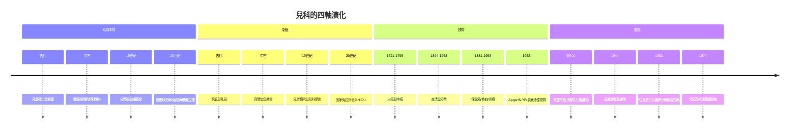

# 兒科的歷史：從古代幼兒照護、育嬰堂悲劇、疫苗戰爭到新生兒科的誕生

> 本書以「推理探案」的體例，為兒科史上的每個關鍵事件寫一篇 wiki：
> 謎題是什麼（為何兒童不是小號的成人？為何善意育嬰堂反而殺嬰？）？
> 偵探是誰（鄉村醫師、貴婦、護理師、麻醉科女教授）？線索與推理是什麼？
> 每篇檔名以年份開頭（4 位數，負年以 `-` 開頭，如西元前 600 年 = `-0600`）。

## 雙線主軸

| 線 | 演變 |
|---|---|
| **醫學認知線** | 兒童照護經驗 → 兒童特殊性被發現又被掩埋 → 分類學建檔 → 血清/疫苗 → 營養與內分泌 → 圍產與新生兒科 → 發展心理學 |
| **制度權力線** | 家庭與乳母 → 教會育嬰堂 → 兒童醫院 → 兒科建科 → 國家免疫計畫 → 全球兒童生存運動 |

---

## 年表（非常詳細版）

### 第一篇：古代世界——兒科觀念的第一次誕生

| 年份 | 事件 | 意義 | wiki |
|---|---|---|---|
| 約前 1550 | 埃及《埃伯斯紙草》已含兒童疾病與哺育記錄 | 最早的兒童醫療文本之一 | （參見性病書 -1550 篇） |
| 約前 600 | 蘇斯魯塔《本集》記載新生兒清道、臍帶處理、初乳哺育；Kaumārabhṛtya（幼兒照顧）成為阿育吠陀正式分科 | 兒科分科的制度化起源 | [-0600-蘇斯魯塔與古代兒童照護](-0600-蘇斯魯塔與古代兒童照護.md) |
| 約前 400 | 希波克拉底文集記載出牙、小兒腹瀉與驚厥；提出「兒童疾病與成人同名而不同質」 | 「兒童不是小號成人」的最早書面宣告 | [-0400-兒童不是小號的成人](-0400-兒童不是小號的成人.md) |
| 約 150 | 蓋倫建立成人解剖正典；羅馬有 medicus puerorum 頭銜但不入正典；索拉努斯《婦科學》記載新生兒照護 | 成人醫學正典把兒科埋進註腳 1500 年 | [0150-蓋倫羅馬小兒觀](0150-蓋倫羅馬小兒觀.md) |
| 610 | 巢元方《諸病源候論》小兒雜病諸候 255 論：臍瘡、鵝口瘡、變蒸、驚、疳、痘瘡、解顱 | 東方兒科的官方症候學檔案庫 | [0610-諸病源候論小兒雜病候](0610-諸病源候論小兒雜病候.md) |
| 629 | 唐太醫署設「少小科」，兒科入官學 | 中國兒科建制化，早於歐洲一千二百年 | 同上 |

### 第二篇：兒科辨證體系與育嬰制度——中古到啟蒙

| 年份 | 事件 | 意義 | wiki |
|---|---|---|---|
| 1119 | 錢乙《小兒藥證直訣》（閻季忠輯）：小兒「易虛易實、易寒易熱」，望診為綱，創六味地黃丸 | 兒科獨立診斷理論的東方宣言 | [1119-錢乙小兒藥證直訣](1119-錢乙小兒藥證直訣.md) |
| 1198 | 教宗英諾森三世令羅馬聖靈醫院設棄嬰輪盤；育嬰堂席捲天主教歐洲（佛羅倫斯 Innocenti 1445） | 兒童福利制度的起點與死亡率悖論 | [1196-育嬰堂與棄嬰輪盤](1196-育嬰堂與棄嬰輪盤.md) |
| 1473 | 德國 Metlinger《兒童調理書》：西方第一本兒科印刷書（落後東方八百餘年） | 歐洲兒科文本的起步 | （參見 1119、1196 篇） |
| 1741 | Thomas Coram 創倫敦育嬰堂；1756「全收」方案引爆 66% 死亡率；登記簿成為嬰兒死亡率統計的搖籃 | 慈善數據審判慈善；韓德爾與 Hogarth 的藝術贊助 | [1741-倫敦育嬰堂與嬰兒死亡率](1741-倫敦育嬰堂與嬰兒死亡率.md) |
| 1802 | 巴黎 Hôpital des Enfants-Malades 開幕：世界首所專治兒童的醫院 | 兒童醫院的示範效應 | [1860-雅可比兒科獨立建科](1860-雅可比兒科獨立建科.md) |

### 第三篇：人工免疫的誕生——人痘、牛痘與血清療法

| 年份 | 事件 | 意義 | wiki |
|---|---|---|---|
| 16–17 世紀 | 中國痘醫發展人痘四法（痘衣、痘漿、旱苗、水苗）；經鄂圖曼與非洲傳播 | 人工免疫的多文明起源 | [1721-人痘接種](1721-人痘接種.md) |
| 1721 | Montagu 夫人在倫敦為女兒接種；Mather 與 Boylston 在波士頓接種 240+ 人（死亡率 2.5% vs 15%） | 第一場以人口數據驗證的醫學干預 | 同上 |
| 1796 | 詹納以牛痘接種 James Phipps，再以天花病毒攻擊而不病；1798 出版《Inquiry》 | 史上第一支疫苗（vaccine 之名源自母牛） | [1796-詹納牛痘](1796-詹納牛痘.md) |
| 1853 | 英國強制牛痘接種法；反疫苗運動誕生 | 疫苗與國家權力的張力開始 | 同上 |
| 1888 | Roux 與 Yersin 證明白喉外毒素 | 「細菌致病、毒素殺人」的釐清 | [1894-白喉抗毒素](1894-白喉抗毒素.md) |
| 1890 | Behring 與北里柴三郎發現抗毒素（白喉、破傷風） | 體液免疫的第一塊基石 | 同上 |
| 1894 | 巴黎 Roux 臨床驗證抗毒素：兒童病死率 40%→<10%；馬血清工廠開張 | 兒科急症的第一次系統性逆轉 | 同上 |
| 1901 | Behring 獲首屆諾貝爾生理學或醫學獎（北里與 Roux 未分享，爭議至今） | 血清療法成為正典 | 同上 |
| 1920s | Ramon 甲醛類毒素；DTP 三聯疫苗（1948）的技術源頭 | 從被動救急到主動預防 | 同上 |

### 第四篇：兒科建科與新生兒科的搖籃

| 年份 | 事件 | 意義 | wiki |
|---|---|---|---|
| 1852 | 倫敦 Great Ormond Street 兒童醫院開業（Charles West） | 英語世界的兒童醫院標杆 | [1860-雅可比兒科獨立建科](1860-雅可比兒科獨立建科.md) |
| 1860 | Abraham Jacobi 在紐約醫學院開設美國首門兒科課程 | 兒科的第一次獨立宣言（美國） | 同上 |
| 1866 | Jacobi《兒童疾病的治療》；1888 美國兒科學會（APS）成立 | 兒科以「死亡率下降的社會價值」取得身份 | 同上 |
| 1881 | Tarnier 以禽類孵化器為原型製造醫用保溫箱（couveuse） | 新生兒科的第一件設備 | [1881-早產兒保溫箱](1881-早產兒保溫箱.md) |
| 1893 | Budin 發表保溫箱對照數據，推廣母乳與產前照護 | 新生兒生理學的奠基 | 同上 |
| 1896–1943 | Martin Couney 的「嬰兒孵化器展覽」（柏林→康尼島）：救活 6,000+ 早產兒 | 奇觀經濟學下的新生兒科傳播 | 同上 |
| 1901 | Landsteiner 發現 ABO 血型（1930 諾獎） | 輸血安全化，為新生兒換血鋪路 | [1940-Rh溶血病與換血療法](1940-Rh溶血病與換血療法.md) |
| 1930 | 美國兒科學會（AAP）自 APS 分立 | 兒科的「成年禮」 | [1860-雅可比兒科獨立建科](1860-雅可比兒科獨立建科.md) |

### 第五篇：營養、免疫與圍產——20 世紀上半葉的偵破潮

| 年份 | 事件 | 意義 | wiki |
|---|---|---|---|
| 1906 | Bordet 與 Gengou 純培養百日咳桿菌；1930s 全細胞疫苗、1948 DTP | 嬰幼兒頭號咳嗽兇手歸案 | [1906-百日咳桿菌發現](1906-百日咳桿菌發現.md) |
| 1919 | Huldschinsky 紫外線治癒佝僂病；Mellanby 魚肝油犬實驗；1922 McCollum 命名維生素 D；1924 Steenbock 照射食物 | 「陽光是藥」與強化牛奶的公共衛生革命 | [1919-佝僂病與維生素D](1919-佝僂病與維生素D.md) |
| 1939–40 | Levine/Stetson 與 Wiener/Landsteiner 鑑定 Rh 抗原，鎖定新生兒溶血病的母子血型戰爭 | 同種免疫與胎次規律的偵破 | [1940-Rh溶血病與換血療法](1940-Rh溶血病與換血療法.md) |
| 1944 | Bowlby《44 名少年小偷》；Spitz 育幼機構研究；1951 WHO《母性照顧與心理健康》 | 母愛剝奪與依附理論的誕生 | [1944-鮑爾比與母愛剝奪](1944-鮑爾比與母愛剝奪.md) |
| 1946–47 | Louis Diamond 新生兒換血療法 | 新生兒科第一台「體外肝臟」 | [1940-Rh溶血病與換血療法](1940-Rh溶血病與換血療法.md) |
| 1949 | Enders、Weller、Robbins 組織培養脊髓灰質炎病毒（1954 諾獎） | 病毒量產的鑰匙，疫苗戰爭開始 | [1955-沙克小兒麻痺疫苗](1955-沙克小兒麻痺疫苗.md) |
| 1958 | Finn 證明產後 72 小時抗 D 注射可阻斷致敏（1968 核准） | 「以抗體防抗體」的免疫預防典範 | [1940-Rh溶血病與換血療法](1940-Rh溶血病與換血療法.md) |

### 第六篇：疫苗黃金年代與新生兒科的成年

| 年份 | 事件 | 意義 | wiki |
|---|---|---|---|
| 1952 | Virginia Apgar 提出新生兒評分（1958 大樣本驗證，加 5 分鐘評分） | 新生兒科的通用語言與復甦觸發器 | [1952-Apgar評分](1952-Apgar評分.md) |
| 1954 | Francis 現場試驗：182 萬兒童、史上最大 RCT | 疫苗學的方法論巔峰 | [1955-沙克小兒麻痺疫苗](1955-沙克小兒麻痺疫苗.md) |
| 1955/4/12 | 雙塔儀式宣布 IPV 成功；隨即 Cutter 事故催生批簽發監管 | 勝利與教訓同日到達 | 同上 |
| 1958 | Rochford 護理師觀察＋Cremer 等 *Lancet* 報告：光線可治新生兒黃疸 | 「用光線做藥」的完整偵破 | [1958-新生兒黃疸光療](1958-新生兒黃疸光療.md) |
| 1959 | Avery 與 Mead 發現表面活性物質缺乏是早產兒 RDS 的病因 | 新生兒科的分子病理起點 | [1881-早產兒保溫箱](1881-早產兒保溫箱.md) |
| 1961 | 沙賓口服減毒疫苗（OPV）獲准；蘇聯數千萬人試驗的冷戰醫學合作 | 腸道戰爭用腸道武器 | [1961-沙賓口服減毒疫苗](1961-沙賓口服減毒疫苗.md) |
| 1963 | 麻疹減毒活疫苗（Enders 株）獲准；1971 MMR 三聯 | $R_0\approx 16$ 的病被逼入可根除名單 | [1963-麻疹減毒活疫苗](1963-麻疹減毒活疫苗.md) |
| 1963 | Liley 首例胎兒宮內輸血 | 胎兒醫學誕生 | [1940-Rh溶血病與換血療法](1940-Rh溶血病與換血療法.md) |
| 1968 | 抗 D 免疫球蛋白（RhoGAM）核准 | Rh 溶血病在發達國家近乎絕跡 | 同上 |
| 1987 | 美國 NRP（新生兒復甦計畫）以 Apgar 骨架全球推廣 | 一分鐘評分長出急救之手 | [1952-Apgar評分](1952-Apgar評分.md) |
| 1990s | 表面活性物質、CPAP、肺保護通氣；1,500 g 早產兒存活率 >90% | 早產兒照護的連續破案 | [1881-早產兒保溫箱](1881-早產兒保溫箱.md) |
| 1998 | Wakefield MMR 自閉症造假論文（2010 撤稿）→ 2019 麻痺回潮 | 疫苗猶豫成為公共衛生頭號對手 | [1963-麻疹減毒活疫苗](1963-麻疹減毒活疫苗.md) |

### 第七篇：全球兒童生存運動與未完成的卷宗

| 年份 | 事件 | 意義 | wiki |
|---|---|---|---|
| 1974 | WHO 擴大免疫計畫（EPI）：六病、冷鏈、30 群抽樣 | 疫苗的物流戰爭 | [1974-WHO擴大免疫計畫](1974-WHO擴大免疫計畫.md) |
| 1978 | 阿拉木圖宣言：免疫接種入初級衛生保健八要素 | EPI 的政治綱領 | 同上 |
| 1980 | 天花根除宣告（WHA33.3） | 從詹納母牛到根除的 184 年 | [1796-詹納牛痘](1796-詹納牛痘.md) |
| 1980s | Jim Grant 的兒童革命（GOBI-FFF）；DTP3 覆蓋率 20%→80% | UNICEF 的大動員 | [1974-WHO擴大免疫計畫](1974-WHO擴大免疫計畫.md) |
| 1988 | 世界衛生大會決議根除小兒麻痺（GPEI） | OPV 的全球總攻 | [1961-沙賓口服減毒疫苗](1961-沙賓口服減毒疫苗.md) |
| 1990s–2020s | 羅馬尼亞孤兒院自然實驗與 Bucharest 計畫：依附可部分恢復 | 母愛剝奪論的科學修正與平反 | [1944-鮑爾比與母愛剝奪](1944-鮑爾比與母愛剝奪.md) |
| 2000 | GAVI 聯盟成立：預採購承諾（AMC）打通「財務冷鏈」 | 新疫苗加速進入窮國 | [1974-WHO擴大免疫計畫](1974-WHO擴大免疫計畫.md) |
| 2004 | AAP 膽紅素閾值曲線與出院前黃疸篩查 | 黃疸管理的精密化 | [1958-新生兒黃疸光療](1958-新生兒黃疸光療.md) |
| 2015 | 擴展 Apgar（E-Apgar）：復甦措施寫入評分 | 70 歲的表格仍在迭代 | [1952-Apgar評分](1952-Apgar評分.md) |
| 2015–2019 | 野毒型 II（2015）、III（2019）型小兒麻痺根除；nOPV2（2024）問世 | OPV→IPV 的時序混用與「防回歸鎖」 | [1961-沙賓口服減毒疫苗](1961-沙賓口服減毒疫苗.md) |
| 2019 | 美國麻疹 1,282 例（1992 年來最高）；薩摩亞疫情 83 死 | 免疫覆蓋的窟窿自動報警 | [1963-麻疹減毒活疫苗](1963-麻疹減毒活疫苗.md) |
| 2020–2023 | COVID 致 DTP3 覆蓋率 30 年來首次倒退；2022 倫敦/紐約廢水 VDPV | EPI 卷宗的續頁 | [1974-WHO擴大免疫計畫](1974-WHO擴大免疫計畫.md) |
| 2020s | WHO 養育照護框架（Nurturing Care）；袋鼠式照護全球推廣 | 依附理論與熱力學進入全球政策 | [1944-鮑爾比與母愛剝奪](1944-鮑爾比與母愛剝奪.md) / [1881-早產兒保溫箱](1881-早產兒保溫箱.md) |

---

## 核心線索：兒科史的四大維度演變

### 三個反覆出現的偵探母題

1. **樣本偏差的代價**：蓋倫以成人建正典（見 `0150-蓋倫羅馬小兒觀.md`）、育嬰堂只收最弱的嬰兒（見 `1196-育嬰堂與棄嬰輪盤.md`）——兒科史上的冤案多數源於「樣本是誰」被遺忘。
2. **善意需要科學護航**：倫敦育嬰堂「全收」方案、孤兒院的清潔卻冷漠、Apgar 之前無人負責的新生兒——制度的失靈常常不是惡意，而是缺了可測量的回饋（見 `1741-倫敦育嬰堂與嬰兒死亡率.md`、`1944-鮑爾比與母愛剝奪.md`）。
3. **觀察者的民主化**：擠奶女工的傳聞（1796）、護理師窗邊的黃疸（1958）、黑奴 Onesimus 的口述（1721）、被手術室排擠的女醫師（1952）——兒科史的反覆劇本是：偵破來自邊緣，驗證來自制度。

### 一個統一的定量框架

兒科史的每一次躍進，本質上都是在縮短這條不等式的兩端：

$$ P(\text{兒童活到成年})_{\text{今日}} \approx 99\% \quad \text{vs} \quad P_{\text{古代}} \approx 50\text{–}70\% $$

而貢獻最大的三項干預是：**免疫接種**（見 1721→1974 的疫苗線）、**營養與餵養科學**（見 1119→1919 的營養線）、**圍產與新生兒技術**（見 1881→1958 的新生兒線）——兒科是用科學把「賭命」改寫成「工程」的歷史。

---

## 各篇索引

| 分篇 | 檔案 |
|---|---|
| 古代 | [-0600-蘇斯魯塔與古代兒童照護](-0600-蘇斯魯塔與古代兒童照護.md) · [-0400-兒童不是小號的成人](-0400-兒童不是小號的成人.md) · [0150-蓋倫羅馬小兒觀](0150-蓋倫羅馬小兒觀.md) · [0610-諸病源候論小兒雜病候](0610-諸病源候論小兒雜病候.md) · [1119-錢乙小兒藥證直訣](1119-錢乙小兒藥證直訣.md) |
| 制度 | [1196-育嬰堂與棄嬰輪盤](1196-育嬰堂與棄嬰輪盤.md) · [1741-倫敦育嬰堂與嬰兒死亡率](1741-倫敦育嬰堂與嬰兒死亡率.md) |
| 免疫與疫苗 | [1721-人痘接種](1721-人痘接種.md) · [1796-詹納牛痘](1796-詹納牛痘.md) · [1894-白喉抗毒素](1894-白喉抗毒素.md) · [1906-百日咳桿菌發現](1906-百日咳桿菌發現.md) · [1955-沙克小兒麻痺疫苗](1955-沙克小兒麻痺疫苗.md) · [1961-沙賓口服減毒疫苗](1961-沙賓口服減毒疫苗.md) · [1963-麻疹減毒活疫苗](1963-麻疹減毒活疫苗.md) · [1974-WHO擴大免疫計畫](1974-WHO擴大免疫計畫.md) |
| 兒科建制與新生兒 | [1860-雅可比兒科獨立建科](1860-雅可比兒科獨立建科.md) · [1881-早產兒保溫箱](1881-早產兒保溫箱.md) · [1940-Rh溶血病與換血療法](1940-Rh溶血病與換血療法.md) · [1952-Apgar評分](1952-Apgar評分.md) · [1958-新生兒黃疸光療](1958-新生兒黃疸光療.md) |
| 營養與心理發展 | [1919-佝僂病與維生素D](1919-佝僂病與維生素D.md) · [1944-鮑爾比與母愛剝奪](1944-鮑爾比與母愛剝奪.md) |

> 姊妹卷：《性病的歷史》（同目錄上層），以同樣體例寫性傳播疾病史；兩書在梅毒、新生兒眼炎、臍血移植、HIV 根治等案件上互有引用。
