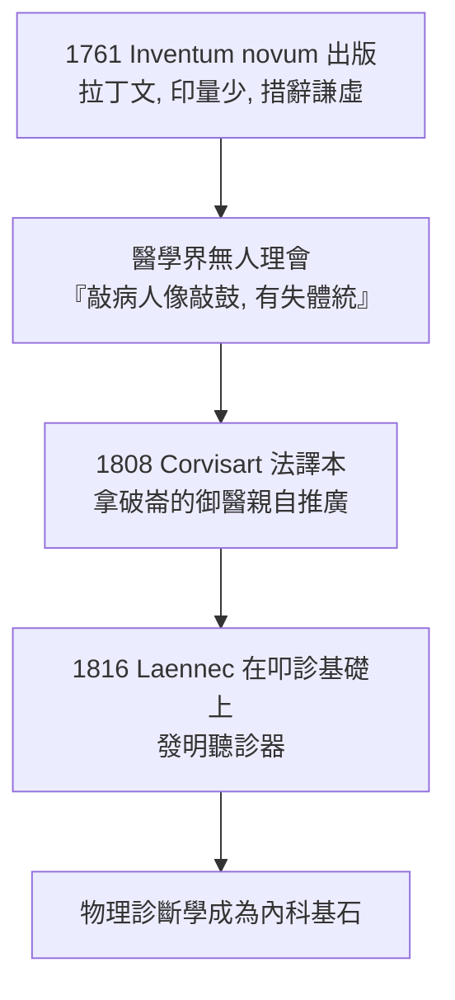

## 1761 - 奧恩布魯格叩診（酒桶上的偵探，把胸腔當鼓打）

## 案件摘要

**本案偵破的是「不開刀，如何知道胸腔裡藏了什麼」。**

1761 年，維也納聖三一醫院的醫生 Leopold Auenbrugger 出版拉丁文小冊《以叩擊人胸診斷胸腔內部隱疾的新發現》（*Inventum novum*）：以指節或併攏的手指敲擊胸壁，正常肺是清音、實變（肺炎、腫瘤）是濁音、氣胸與大量積液則如鼓鳴。這是內科第一次以**物理檢查的量化訊號**「透視」身體內部——比 X 光早 134 年。本案的真相是：偵破工具來自酒窖——奧恩布魯格幼年隨開酒館的父親以敲擊判斷桶中酒量，他把這套「以聲測物」的民間技術搬進了病房。而醫學界對這份禮物**冷落了整整 47 年**。

## 前因 -- 為什麼會有這個案子

- **屍檢已先行，床邊卻瞎摸**。莫爾加尼（同一年，見 `1761-莫爾加尼病理解剖.md`）證明症狀背後有器官病灶，但病灶生前如何偵測？當時醫生只有視診、觸診和病史——胸腔深處的積水只能等屍檢「驗屍報告」。
- **胸膜積水與肺實變的鑑別困境**。呼吸音都減弱、都發燒，是該穿刺放液還是不該？錯判即死人。當時唯一的「儀器」是醫生的手與耳。
- **酒窖的童年記憶**。奧恩布魯格自己寫道：「我的父親在賣酒時，會敲擊酒桶判斷液面高度；我在檢查病人胸部時，這童年的畫面浮現。」
- **維也納醫學的實證風氣**。Van Swieten 改革下的維也納醫學院重床邊教學與屍檢對照——醫院病房與解剖室一牆之隔，是檢驗叩診的理想實驗場。

## 線索與推理 -- 數學式、程式、理論

**線索一：聲學原理。** 叩診音的音色由受擊結構的密度與含氣量決定：

| 胸腔狀態 | 密度/含氣 | 叩診音 | 類比 |
|---|---|---|---|
| 正常肺 | 含氣海綿 | 清音（resonant） | 敲滿桶 |
| 肺炎實變 | 液體滲出填充 | 濁音（dull） | 敲實木 |
| 大量胸腔積液 | 純液體 | 實音（flat） | 敲水桶 |
| 氣胸 | 純氣體高張 | 過清音/鼓音（tympanic） | 敲空鼓 |

**線索二：他如何驗證（七年，無對照但有金標準）。** 奧恩布魯格在病房叩診作判斷，病人死後即解剖對照「判斷 vs 病理」，累積長達七年的配對資料，並描述了六個主要徵象，包括著名的 **skodaic resonance（斯叩達鼓音區）** 的前身——積液上方的鼓音。他的驗證邏輯：

$$ P(\text{濁音} \mid \text{屍檢證實積液/實變}) \gg P(\text{濁音} \mid \text{正常肺}) $$

這正是診斷試驗**敏感度的原始定義**——比 Bayes 定理應用於醫學早了兩百年。

**線索三：為什麼被冷落 47 年？**

敗因分析：拉丁文與印量（傳播問題）、太前衛的「打人」動作（文化阻抗）、以及**沒有大人物背書**——直到 Corvisart 在巴黎宮廷醫學的權威加持下翻譯並教學，法國醫學黃金世代（Laennec、Piorry、Bouillaud）才把它發揚光大。

## 結案 -- 後果與影響

- **物理診斷學誕生**。叩診＋聽診＋觸診＋視診構成的「四診」，讓內科醫生從「聽病人講故事的人」升級為「檢測身體物理性質的儀器操作員」。
- **床邊—屍檢閉環**。奧恩布魯格的「生前判斷、死後驗證」流程，是臨床流行病學「金標準對照」概念的最早實作之一。
- **維也納→巴黎→世界的醫學地理**。19 世紀醫學中心從理論化的德語區轉向病床密集的巴黎醫院，叩診的 rediscovery 是關鍵扳機。
- **一句話結案**：最深刻的臨床工具可能藏在酒窖裡——**偵探的天賦不是新儀器，而是敢把童年的耳朵帶進病房**。

## 關鍵人物與文獻

- **Leopold Auenbrugger（1722–1809）**——奧地利醫生，1761 年出版 *Inventum novum ex percussione thoracis humani*；亦為歌劇作曲家（歌劇《煙囪清潔工》1778 曾由海頓指揮演出）。
- **Jean-Nicolas Corvisart（1755–1821）**——拿破崙御醫，1808 年法譯本並附註釋，自述「這顆被埋沒的種子終於發芽」。
- 原始文獻——Auenbrugger, *Inventum novum*, Vienna, 1761；Corvisart, *Nouvelle méthode pour reconnaître les maladies internes de la poitrine*, Paris, 1808.
- 現代註腳——1998 年 JAMA 的臨床檢查系列指出：即受過訓練的醫生，叩診偵測大量胸腔積液之敏感度仍達 80–90%——一個零成本的 1761 年技術，至今仍通過品質檢驗。
