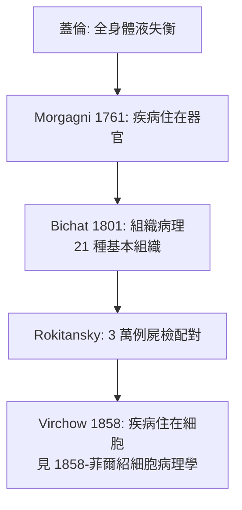

## 1761 - 莫爾加尼病理解剖（症狀是煙，病灶是火：器官病理學的誕生）

## 案件摘要

**本案偵破的是「疾病到底住在身體的哪個部位」。**

1761 年，83 歲的帕度亞大學教授 Giovanni Battista Morgagni 出版兩大冊《論身體的座位與被尋獲之疾病的原因》（*De sedibus et causis morborum per anatomen indagatis*），集結其近六十年的 700 例屍檢報告，逐一將**病人生前的症狀與死後解剖找到的器官病灶**配對。本案的真相是：他讓醫學第一次擁有了「疾病的兇案現場」——症狀不再是被討厭的體液失衡的雜音，而是**病灶向外的廣播**；要破案，就要去現場（器官）找物證。

## 前因 -- 為什麼會有這個案子

- **蓋倫體液論的天花板**。「全身失衡」無法解釋為何同一病人偏癱在左、或只有心臟瓣膜毀損——失衡學說對「定位」完全失語。
- **解剖學革命的前置**。Vesalius（1543《人體構造》）重建了正常解剖；Harvey（1628）證明血液循環；Wepfer（1658）屍檢證明中風病人顱內出血——「病灶可被找到」已有零星判例。
- **屍檢配對的先行者**。義大利的 Benivieni（1507《論某些疾病的隱蔽原因》，約 100 例屍檢）與 Bonet（1679 *Sepulchretum*，摘要三千例屍檢文獻）已鋪路，但都是偶得與轉述，無人系統化。
- **帕度亞的雙重身分**。Morgagni 同時是臨床醫生與解剖學教授——醫院病房與解剖室在同一棟樓，配對的資料結構天然存在。

## 線索與推理 -- 數學式、程式、理論

**線索一：配對法（本案的核心手法）。** 全書以書信體寫成，每一封信都是一宗「案子」：先詳載病人生前的症狀、體徵、治療與死亡，再呈現解剖發現，最後推論因果：

```python
# Morgagni 的偵辦流程（1761 復原）
for case in autopsy_reports:                 # 700 例
    symptoms  = clinical_record(case)        # 生前症狀與體徵
    lesion    = dissect(case)                # 死後器官病灶
    match = infer_cause(symptoms, lesion)    # 配對推論
    # 例: 生前半身麻痺+死後腦出血 → 症狀來自病灶側的對側
```

**線索二：經典案例——定位診斷的出生。** 他記錄了生前左側偏癱而屍檢發現右腦病灶的病例，確立了**運動神經交叉支配**的臨床規則；他描述了生前心絞痛而冠狀動脈鈣化的心臟（比 Heberden 的 angina pectoris 命名早半世紀）、主動脈瓣狹窄、肺結核的空洞腎。推論式可寫成：

$$ \text{症狀} = f(\text{病灶部位}, \text{受損功能}) \quad\Rightarrow\quad \text{由症狀反解病灶} $$

**線索三：「座位（sedes）」這個詞的革命性。** 疾病從彌漫的「體液失衡」收縮成有地址的「器官損害」。這把醫學的偵辦目標從「調平全身」改寫為「找到並修復座位」——內科與外科的分工、以及後來「診斷＝定位＋定性」的思路都由此而來。



## 結案 -- 後果與影響

- **器官病理學創立**。「disease」一詞從狀態變成實體（實體論 disease entity），命名學（nomenclature of disease）從此以器官＋病變為骨架，直通今日 ICD 分類。
- **床邊檢查的新動力**。既知病灶在胸腔腹腔，如何生前「看到」它？叩診（同年！見 `1761-奧恩布魯格叩診.md`）與 55 年後的聽診器（見 `1816-雷奈克聽診器.md`）正是對這個問題的回答。
- **內科教學的模板**。「臨床病理討論會（CPC，Clinico-Pathological Conference）」——內科住院醫師訓練的經典儀式——正是 Morgagni 配對法的制度化，沿用至今。
- **陰影面**。屍檢依賴「活到能解剖」的病人，篩選偏誤從一開始就內建；且器官病理無法解釋功能性疾病與精神疾患——這道裂縫要等細胞病理學（1858）與更晚的神經科學來填。
- **一句話結案**：莫爾加尼把醫學從「聽病人自述的文學」變成「檢驗物證的法醫學」——**症狀是兇手的留言，屍檢是犯罪現場**。

## 關鍵人物與文獻

- **Giovanni Battista Morgagni（1682–1771）**——帕度亞大學解剖學教授（承繼 Vesalius、Falloppio 的教席），終生行醫兼屍檢，80 歲出版畢生心血。
- 原始文獻——*De sedibus et causis morborum per anatomen indagatis*, Venice, 1761；英譯 *The Seats and Causes of Diseases Investigated by Anatomy*, 1769。
- **Antonio Benivieni**——《論某些疾病的隱蔽原因》（死後 1507 出版）被譽為「病理個案報告的開山之作」。
- 現代註腳——20 世紀後期屍檢率從 50% 跌破 10%，臨床病理配對的黃金證據鏈在萎縮；Morgagni 的遺產提醒：**當現場勘查被省略，臨床偵探就只剩口供**。
