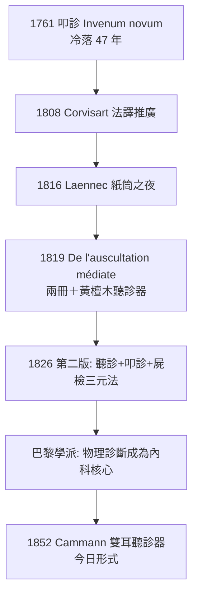

## 1816 - 雷奈克聽診器（紙筒裡的心跳：內科的第一件儀器）

## 案件摘要

**本案偵破的是「心與肺的悄悄話如何被聽清楚」。**

1816 年秋，巴黎 Necker 醫院的醫生 René Laennec 面對一位年輕女病人，心臟嚴重肥胖、直接以耳貼胸聽診既不雅也失準——他隨手捲起一疊紙成筒，一端貼病人胸口、一端貼自己耳朵，心跳聲竟**更清晰**。他隨後委託車匠車出木製圓筒（長 33 公分、可拆成兩節），命名 stethoscope（胸鏡）。1819 年他出版兩冊《間接聽診法》，把囉音、羊鳴音、支氣管音、心雜音一一對應到屍檢病灶。本案的真相是：聽診器不是「放大鏡」而是「偵聽室」——它隔出醫病之間那一段空氣中的音訊通道，讓聲音成為**可命名、可教學、可複製**的臨床證據。

## 前因 -- 為什麼會有這個案子

- **叩診已開路**。Corvisart 1808 年重譯奧恩布魯格（見 `1761-奧恩布魯格叩診.md`），巴黎醫院正颳起「物理診斷」旋風，Laennec 正是 Corvisart 的學生。
- **直接聽診的天花板**。以耳貼胸是希波克拉底留下、Corvisart 恢復的技術，但：音量小（肺音常被胸壁肉層吸掉）、姿態尷尬（尤其是女病人）、且無法「記錄與討論」——三個都指向需要一件中介物。
- **屍檢配對的金標準已在手邊**。Morgagni（見 `1761-莫爾加尼病理解剖.md`）的模式已傳入巴黎；Laennec 個人完成了 2000 次以上屍檢——他有「音—病灶」配對的完整實驗場。
- **法國醫院的結構優勢**。巴黎教學醫院病房大、病人多、死亡常見、解剖便利——「音訊資料庫」規模全球第一。

## 線索與推理 -- 數學式、程式、理論

**線索一：為何紙筒會放大？** 直接貼耳傳導混合了骨傳導與環境噪音；管子隔絕外界、聚攏聲波：

$$ \text{SNR} = \frac{\text{心肺音能量(經管傳導)}}{\text{環境噪音(被管壁阻隔)}} \gg \text{直接貼胸的 SNR} $$

**線索二：聲音的「命名學」——本案最關鍵一步。** Laennec 不只聽，還把聲音分類命名（法語音擬詞），並逐一與屍檢對照：

| 聽到的聲音 | Laennec 命名 | 對應病灶（屍檢驗證） |
|---|---|---|
| 吸氣末細碎爆裂音 | râles crépitants（細囉音） | 肺泡內滲出液——肺炎 |
| 水泡音 | râles muqueux（粗囉音） | 支氣管內分泌物 |
| 吸氣中斷、語音增強 | bronchophony（支氣管語音） | 肺實變 |
| 羊叫般的語音 | egophony（羊鳴音） | 積液上緣受壓肺組織 |
| 心音間的雜音 | souffle（雜音） | 瓣膜病變 |

這等於為心肺建了一套**「聲紋檔案庫」**——診斷從主觀印象變成可檢索的特徵匹配。

**線索三：他本人的推理過程（1819 原文要點）。** 起初他只當紙筒是「隔尷尬的權宜之計」，但第一晚在心臟病人身上就聽到過去從未聽清的音——他立即意識到「量的差異會變成質的差異」：能聽見的音，就是過去不存在於醫學的證據類型。接下來三年，他把每一個新音與屍檢配對，「我聽過的每一個音，我都試著在解剖台上找到它的來源」。

**線索四：他還命名了「肺結核的音」。** Laennec 對結核（他自己就是結核病人）提出結節—滲出的統一認識，把「痨」收斂為單一疾病實體——這是疾病實體論（disease entity）在呼吸科的落地。

## 結案 -- 後果與影響

- **醫病關係的物理轉向**。醫生從「聽病人敘述」轉為「檢查身體」；問診之外，理學檢查成為內科儀式核心——今日白袍掛聽診器的圖像即源於此。
- **專科內科的搖籃**。心臟科與呼吸科自聽診學中長出；Laennec 被稱為「結核與心臟病床邊醫學之父」。
- **教學的可複製性**。聲音有名字、有教材、有對照的屍檢，學生終於可以被訓練「聽懂」——診斷知識第一次大規模標準化傳播。
- **隱私與權力的雙面性**。儀器讓醫生「獲得」了身體的內部資訊，也埋下「醫學凝視」的爭議；但同時它降低了對病人自述完整性的依賴，反而對不善言表的病人更公平。
- **一句話結案**：Laennec 的天才不在木頭筒，而在**為每個聲音建立帳號並與病灶配對**——偵聽器的價值，永遠取決於偵探的對照資料庫。

## 關鍵人物與文獻

- **René Théophile Hyacinthe Laennec（1781–1826）**——布列塔尼出身，Corvisart 高徒；1826 年 45 歲死於結核，遺言由姪兒 Mériadec（聽診學繼承者）以聽診器為其聽診。
- 原始文獻——*De l'auscultation médiate ou Traité du diagnostic des maladies des poumons et du cœur*, Paris, 1819；第二版 1826 年增訂為標準版。
- **Joseph Skoda（1805–1881）**——維也納醫生，1839 年以物理聲學重新解釋聽診音，剔除 Laennec 的理論雜質，把聽診學變成純粹的聲學診斷法。
- 現代註腳——Laennec 自己造的許多術語（ronchus 等）被後世修改，但他建立的「音—病灶配對法」在 2010 年代以心雜音 AI 分類演算法的形式復活：數位聽診器 + 機器學習的訓練集，本質上仍是那套 1819 年的偵探檔案。
