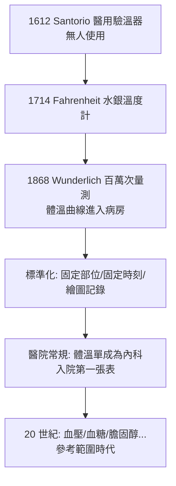

## 1868 - 溫德利希體溫計（兩百年前就發明的儀器，遲到的一次入院）

## 案件摘要

**本案偵破的是「發燒到底是一種敘述，還是一個數字」。**

1868 年，萊比錫大學醫院的 Carl Reinhold August Wunderlich 出版巨著《論病程中的體溫及其後果》（*Das Verhalten der Eigenwärme in Krankheiten*）：以標準化的腋下體溫計對約 25,000 名病人累積百萬次測量，畫出各疾病的**體溫曲線**，確立健康平均約 $37\,^\circ C$、發燒門檻約 $37.5\text{–}38\,^\circ C$，並示範傷寒、瘧疾等各有特徵性曲線。本案的真相是：體溫計 16–17 世紀已被發明（Santorio 甚至量過自己 30 年），卻在病房門外站了兩百年——**Wunderlich 破的案不是「體溫有意義」（早就知道），而是「如何讓全行業接受數字取代觸感」**。

## 前因 -- 為什麼會有這個案子

- **儀器早已存在**。1612 年 Santorio 改良伽利略驗溫器並用於病人；Fahrenheit 水銀溫度計（1714）、攝氏溫標（1742）相繼問世——但醫生們照舊以手背貼額判斷「熱」。
- **體液論的詞彙貧乏**。發燒被歸為「熱性的體液運動」， Fever 有「間歇熱、弛張熱」等分類，卻沒有一致的度量——同一個「熱」字，各醫生所指的溫度差異可達數度。
- **醫院醫學的興起**。巴黎與維也納的大型教學醫院提供了大樣本與系統記錄的可能——臨床研究從個案變成資料集。
- **萊比錫的條件**。Wunderlich 自 1850 年起主持萊比錫醫院，配備專職人員定時測量、記錄、繪圖——等於自建了一台「體溫流行病學機器」。

## 線索與推理 -- 數學式、程式、理論

**線索一：把溫度變成時間序列。** 每日固定時刻測量，畫成曲線圖（溫度表 fever chart）——今天病房床頭的體溫單就是它：

$$ T(t) = \text{每日量測序列} \quad \Rightarrow \quad \frac{dT}{dt} \text{ 的形態即為診斷線索} $$

**線索二：他發現的「曲線指紋」。**

| 曲線形態 | 典型疾病 | 偵探價值 |
|---|---|---|
| 持續高熱緩升（階梯狀上升） | 傷寒 | 與瘧疾的驟升驟降區分 |
| 間歇性高峰（隔日/三日） | 瘧疾 | 揭示病原的週期性（後來知為裂殖體破裂同步性） |
| 弛張熱＋傍晚高峰 | 膿血症、結核 | 提示病灶活動性 |

**線索三：統計化的第一步。** 他報告健康人腋溫的分布：均值約 $37\,^\circ C$，正常範圍 $36.3\text{–}37.5\,^\circ C$；下午略高、清晨略低——這是最早的**生理參考範圍**之一。他甚至敢下結論：「發燒不是病，而是身體對疾病反應的徵候」——把 fever 從疾病名單中除名，降級為 sign。這在當時是概念上的地震。

**線索四：為何遲到兩百年？（本案的反派）。** 反派不是無知，而是**職業慣性與技術摩擦**：早期溫度計長達 30 公分、需量測 20 分鐘；且「觸感」是醫生的身體技藝，數字使老手的權威貶值。Wunderlich 的說服力來自三件事：樣本量（25,000 人）、標準化流程、以及**可複製的曲線圖**——你不必相信他，你可以照做再看一次。

## 結案 -- 後果與影響

- **量化內科的開幕**。體溫之後，血壓（1896 Riva-Rocci 袖帶）、血液常規、化學指標相繼進入病房；「住院」這件事的第一意象——掛著的體溫單——就是本案的遺產。
- **「sign vs symptom」的嚴格分界**。發燒被重定義為徵候後，醫學開始系統地區分病人主觀敘述與可測量體徵——這是循證醫學（見 `1996-循證醫學.md`）「證據分級」的史前史。
- **Wunderlich 的 37°C**。2020 年代的研究（如 Stanford 的 eHEART 資料分析）發現現代人平均體溫已降至約 $36.5\text{–}36.6\,^\circ C$——可能反映慢性發炎負擔下降與量測/人群差異；「正常值」本身也有歷史。
- **陰影面**。體溫曲線的權威一度過大：維多利亞時代醫院曾以「曲線好不好看」評價治療，忽略病人主觀痛苦——量化是雙面刃。
- **一句話結案**：Wunderlich 的真正發明不是溫度計，而是**「醫院常規」這個概念——讓每個病人每天自動生產數據**。大數據醫學的起源，是 1868 年的一張紙表。

## 關鍵人物與文獻

- **Carl Reinhold August Wunderlich（1815–1877）**——萊比錫大學內科教授；*Das Verhalten der Eigenwärme in Krankheiten*, Leipzig, 1868；英譯 *On the Temperature in Diseases*, 1871。
- **Santorio Santorio（1561–1636）**——帕度亞教授，最早將定量測量引入醫學（脈搏鐘、體重椅、驗溫器），是「被浪費了兩百年的先知」。
- **Carl Wunderlich 的助理**——其量測體系依賴大量護理與記錄人員，醫學史上第一次把「團隊資料生產」引進臨床研究。
- 現代註腳——2015 年之後，連續體溫監測的可穿戴裝置把 $T(t)$ 的取樣間隔從「每日兩次」壓縮到每分鐘，Wunderlich 的時間序列偵探法，正在被重新放大一百萬倍。
