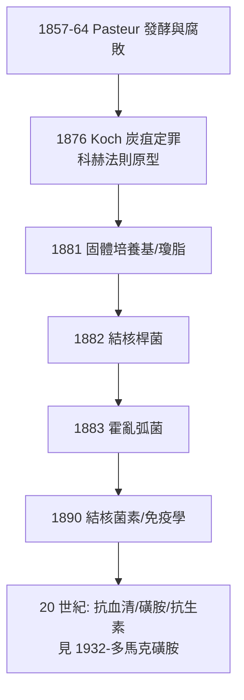

## 1876 - 科赫炭疽桿菌（第一次把兇手押上法庭：細菌致病說的定罪典範）

## 案件摘要

**本案偵破的是「一種動物的流行病，究竟誰是兇手」。**

1876 年，32 歲的鄉村醫生 Robert Koch 在沃爾斯泰因（Wollstein）自家實驗室（設備包括：一台妻子送的顯微鏡、廚房、與自己培養的牛脾臟檢體）完成炭疽病病原的證明：他發現病牛血液中的桿狀微生物能在牛眼房水中培養、能連續傳代 20 次仍致病、並首度觀察到**炭疽桿菌的芽孢**——解釋了炭疽為何能在牧場土壤中潛伏數十年。以小鼠做接種—發病—再分離的閉環實驗。本案的真相是：人類第一次**以一套可重複的實驗程序「定罪」某個微生物**，這套程序後世稱為科赫法則（Koch's postulates）——細菌致病說從假說升格為可以判案的證據標準。

## 前因 -- 為什麼會有這個案子

- **半個世紀的懸案**。1837 年 Pollender 等人已在病畜血中看見桿狀物，但「細菌是病因，還是死後繁殖的旁觀者」無法定案——兇手早就在現場，卻無法排除「群眾嫌疑」。
- **發酵說的鋪路**。Pasteur 於 1857–1864 年證明發酵與腐敗由微生物引起，並以曲頸瓶實驗駁倒自然發生說；「微生物有作惡能力」已成立，但尚未在**動物感染病**上定罪。
- **德法競爭**。普魯士政府在普法戰爭後大力資助科學；巴斯德在巴黎，德國急需自己的微生物學旗手。
- **農業經濟的壓力**。炭疽使德國牲畜損失慘重，且病因眾說紛紜（毒土說、氣候說、自發說）——地主需要一個能指導防疫的答案。

## 線索與推理 -- 數學式、程式、理論

**線索一：閉環證明的邏輯（後世稱科赫法則的原始版）。**

```python
# Koch 的定罪程序（1876, 沃爾斯泰因）
suspect = isolate(blood_of_sick_mouse)      # 1. 病畜體內發現桿菌
pure = culture(suspect, aqueous_humor)      # 2. 純培養(牛眼前房液為無菌培養基)
for i in range(20):                         #    連續傳代 20 代
    pure = culture(pure)
healthy_mouse.inoculate(pure)               # 3. 接種健康小鼠 → 發病
recovered = isolate(blood_of_dead_mouse)    # 4. 再分離出同一桿菌
assert recovered == suspect                 #    閉環: 同一兇手
```

每一步都在排除一種辯護：步驟 2 排除「屍體污染物」；步驟 3 的 20 代傳代排除「共犯毒素」；步驟 4 排除「 opportunistic 旁觀者」。

**線索二：芽孢的發現——本案的「不在場證明」破解。** 1876 年 Koch 觀察到桿菌在不良環境下縮成折光的橢圓芽孢，遇適宜條件復萌。這解釋了牧場為何反覆發病、以及為何巴斯德的「埋葬病畜會污染土壤」預警成立。偵探意義：**兇手有一種休眠形態**，流行病學的間斷現象從此可解。

**線索三：技術的同步突破。** 本案成功依賴三項發明，全在 1876–1882 間完成：
- **懸滴法與乾燥染色**（Koch, 1877）——細菌終於「看得清」。
- **固體培養基**（1881，馬鈴薯切片→明膠→瓊脂，助手 Hesse 之妻 Fanny 建議用瓊脂）——純培養的關鍵，等於給每個嫌疑犯單獨的審訊室。
- **顯微攝影**——證據可以寄給遠方法庭。

$$ \text{病原定罪} = f(\text{顯微鏡} + \text{純培養} + \text{動物模型} + \text{再分離}) $$

**線索四：從炭疽到結核到霍亂的擴張。** 1876 炭疽 → 1882 結核（見 `1882-科赫結核桿菌.md`）→ 1883 霍亂（與巴黎 Pasteur 學派的 Nicati/Rietsch 幾乎同時）——法則每通過一次庭審，細菌致病說的轄區就擴大一圈。



## 結案 -- 後果與影響

- **醫學因果標準的改寫**。「某微生物致病」不再是斷言而是**可檢驗的程序**；流行病學與傳染病學在證據規則上被統一。科赫 1905 年獲諾貝爾生理學或醫學獎。
- **公共衛生獲得武器**。隔離、消毒、牛奶巴斯德消毒、水源管制——防疫措施從經驗律令變成有微生物學依據的政策（同時期英國傳染病法案的更激進版本見性病史 `../性病的歷史/1864-英國傳染病法案.md`）。
- **細菌學的黃金二十五年**。1880 年代被稱為「細菌學的黃金年代」：傷寒、白喉、肺炎鏈球菌、腦膜炎球菌、破傷風……幾乎每年都有新兇手落網。
- **法則的局限（被告的權利）**。無症狀帶原（Typhoid Mary）、無法培養的病原（梅毒螺旋體、病毒、後來的幽門桿菌的爭議、prion）都不符合法則——科赫自己在 1890 年就承認帶原者現象並修正法則。法則是「給可培養細菌的判例」，不是宇宙通則。
- **一句話結案**：Koch 的遺產不是找到炭疽桿菌，而是**發明了一套讓所有人都能重複的定罪程序**——從此，指控微生物需要證據鏈，這是醫學法治的起點。

## 關鍵人物與文獻

- **Robert Koch（1843–1910）**——普魯士鄉村醫生→柏林帝國衛生署→傳染病研究所所長；1905 年諾貝爾獎（結核的研究）。
- **Ferdinand Cohn（1828–1898）**——藻類學家，1885 年前科赫最重要的學術支持者；1876 年在《Cohn 植物生物學文稿》第 2 卷發表科赫的炭疽論文，並協助其赴布雷斯勞演示。
- **Pasteur（1822–1895）**——發酵說與免疫減毒技術的奠基者；1881 年炭疽疫苗公開試驗（Pouilly-le-Fort）與科赫陣營的競爭，是德法微生物學雙雄對峙的著名戲碼。
- 原始文獻——Koch, *Die Ätiologie der Milzbrand-Krankheit, begründet auf die Entwicklungsgeschichte des Bacillus anthracis*, Cohn's Beiträge zur Biologie der Pflanzen, 1876.
- 現代註腳——炭疽桿菌 2001 年成為生物恐怖襲擊的工具（美國炭疽郵件事件，5 死）；Koch 當年在廚房建立的定罪程序，至今仍是法醫微生物學鑑識攻擊株來源的模板。
