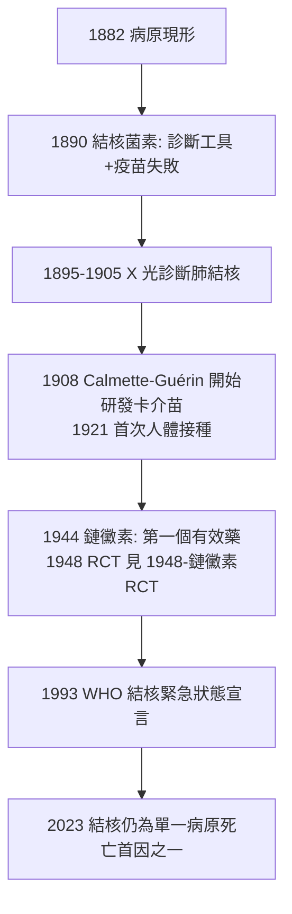

## 1882 - 科赫結核桿菌（世紀白色瘟疫的兇手現身：德國 3 月 24 日的夜晚）

## 案件摘要

**本案偵破的是「人類史上殺人最多的單一病原——結核病——到底是什麼」。**

1882 年 3 月 24 日晚，柏林生理學會的小教室裡，Robert Koch 以一場近乎默劇的演示公布：結核病（肺痨、瘰癧、結核性腦膜炎……當時視為多種病）的病原是**同一種抗酸染色才看得見的細長桿菌**——Mycobacterium tuberculosis。他展示了染色切片、純培養、豚鼠接種與再分離的完整證據鏈。本案的真相是：Koch 不只抓到兇手，還**推翻了當時的正統理論——結核是遺傳病／貧窮人的體質病**；並首次證明同一病原可造成「肺型、骨型、腦膜型」等看似不同的疾病——「一因多症」的統一，是疾病實體論最壯觀的勝利。

## 前因 -- 為什麼會有這個案子

- **白色瘟疫的世紀統治**。19 世紀結核殺死歐洲約 1/7 的人口；濟慈、契訶夫（本行即醫生）、勃朗特姊妹皆死於此。它是浪漫主義文學的「時尚死法」，也是工廠城市的頭號死因。
- **遺傳說 vs 傳染說的百年纏訟**。多數歐洲醫學權威（含 Virchow 學派多數）主張體質／遺傳；但 Jean-Antoine Villemin（1865）已證明把病人的結節接種給兔子會致病——傳染說有實驗，卻無人見過病原。
- **科赫法則的既有武器**。1876 年炭疽案（見 `1876-科赫炭疽桿菌.md`）建立的程序，加上 1881 年的固體培養基與顯微攝影——工具箱齊備，只差一個難纏的嫌犯。
- **結核桿菌的狡猾**。它極小（$0.3\text{–}0.5 \times 3\ \mu m$）、不尋常染色（普通苯胺染料不上色）、生長極慢（培養需數週）、且人類與豚鼠間有抗性差異——是當時「最難定罪的嫌犯」。

## 線索與推理 -- 數學式、程式、理論

**線索一：新染色的發明（本案的鑑識突破）。** 嫌犯「隱形」是因為其蠟質莢膜（分支菌酸）拒絕一般染料。Koch 以**鹼性亞甲藍長時間加溫染色，再以 Vesuvine（俾斯麥棕）複染**——在褐色背景中，結核組織裡浮出一根根藍色細桿：

$$ \text{可視化} = \text{加熱驅動染料} \times \text{抗酸莢膜} \quad \Rightarrow \quad \text{組織中的病原現形} $$

（後來 Ziehl–Neelsen 抗酸染色法即由此改良，至今仍是結核診斷的第一線。）

**線索二：四步定罪程序（法則的完整首演）。**

```python
# 1882 年的證據鏈
lesion = stain(guinea_pig_tissue)        # 1. 病灶中始終可見同型桿菌
pure   = culture(lesion, blood_serum)    # 2. 血清固體培養基上純培養(15 天)
healthy.inoculate(pure)                  # 3. 豚鼠接種 → 同樣結核病
again  = reisolate(dead_guinea_pig)      # 4. 再分離同菌 → 閉環
```

**線索三：一因多症的統一。** Koch 展示肺結核、皮膚狼瘡、瘰癧、結核性腦膜炎患者的病灶中是同一種桿菌，且各型病灶接種豚鼠後可交叉致病。推理結論：

$$ \text{痨病} \cup \text{狼瘡} \cup \text{瘰癧} \cup \text{腦膜炎} \Rightarrow \textbf{同一疾病實體: 結核病} $$

這改寫了疾病的定義方式：**疾病的邊界由病原決定，不由症狀決定**。

**線索四：流行病學的推論。** 既然結核是傳染病，則「遺傳說」的觀察證據（家庭聚集）可重新解讀為**同住傳播**。Koch 據此提出防疫主張：隔離、消毒痰液、不吐痰運動——公共衛生政策第一次可以寫出微生物學的理由。



## 結案 -- 後果與影響

- **結核病研究的世紀開端**。結核菌素（1890，OT 試驗成為皮膚試驗診斷工具）、卡介苗（1921）、異菸鹼醯肼（1952）、DOTS 策略——整個結核防治史都從 1882 年的柏林之夜起算。3 月 24 日成為世界結核病日。
- **德國醫學的勝利與「法則化」**。科赫法則被神化為傳染病診斷的金科玉律，影響直到 20 世紀末——包括它對後來幽門桿菌案的誤導性裁判標準（見 `1983-幽門桿菌.md`）。
- **諾貝爾獎與結核菌素的陰影**。Koch 1905 年獲獎；但他 1890 年誇大結核菌素的治療效果（實為遲發過敏反應物，可致病人惡化）是生涯最大挫敗——偵探也會在慶功宴上失言。
- **社會面向**。「結核＝傳染病」帶來療養院隔離、強制通報與社會污名；同時也催生了工人住宅、通風、牛奶管制的改革論述。
- **一句話結案**：Koch 的勝利在於**把疾病的定義權從症狀轉移給病原**——人類第一次知道，那個殺死七分之一的鄰居、又被詩歌美化的白色瘟疫，只是一根染成藍色的細桿。

## 關鍵人物與文獻

- **Robert Koch（1843–1910）**——時任柏林帝國衛生署；1882/3/24 演講〈論結核病〉收錄於 *Berliner Klinische Wochenschrift* 1882 年第 15 期。
- **Fanny Hesse（1850–1934）**——Koch 助理 Walther Hesse 之妻，建議以瓊脂替代明膠做固體培養基（她有果醬製作經驗）——細菌學史上最重要的「家庭配方」。
- **Jean-Antoine Villemin（1827–1892）**——1865 年以接種實驗證明結核可傳染，被視為「實驗結核病學之父」，但生前未獲重視。
- **Paul Ehrlich**——抗酸染色技術的後續改良者；Ziehl（1882）與 Neelsen（1883）定型的 Ziehl–Neelsen 染色法沿用至今。
- 現代註腳——結核桿菌的全基因組於 1998 年定序完成；2020 年代 Xpert MTB/RIF 分子檢測可在 2 小時內完成 Kock 需要數年的鑑識——但每年仍有逾百萬人死於這根藍色細桿。
