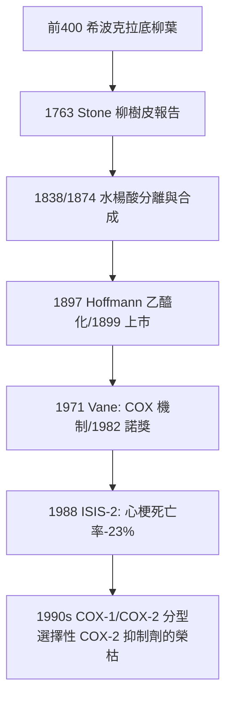

## 1899 - 阿司匹林（柳樹皮到拜耳藥廠：合成藥物時代的頭號長青商品）

## 案件摘要

**本案偵破的是「柳樹皮為什麼能退燒——以及一個化學修飾如何製造出史上銷量最大的藥」。**

1897 年，拜耳化學家 Felix Hoffmann 依父親風濕痛之苦，將水楊酸乙醯化，合成出穩定且腸胃刺激較低的乙醯水楊酸；1899 年拜耳以「Aspirin」上市（A 源自乙醯基 Acetyl，spir 源自植物 Spiraea ulmaria）。本案的真相是：阿司匹林的偵辦分兩輪——第一輪（19 世紀）從民間藥物柳樹皮中提取有效成分水楊苷、並量化其退燒效果；第二輪要等到 1971 年，John Vane 才揭開機制（抑制前列腺素合成，1982 諾獎）——**人類先用了 70 年，才弄懂這顆藥為什麼有效**。而它 1940 年代後意外發現的抗血小板作用，更把一顆止痛藥改造成心血管預防醫學的基石。

## 前因 -- 為什麼會有這個案子

- **柳樹皮的千年民間案卷**。前 400 年希波克拉底（見 `-0400-希波克拉底與體液學說.md`）已記載柳葉粉止痛；1763 年英國牧師 Edward Stone 向皇家學會報告以柳樹皮退瘧疾熱——民間療法的「口供」早就在，缺的是化學與臨床鑑識。
- **19 世紀藥物化學的起步**。1838 年 Raffaele Piria 自水楊苷分解出水楊酸；1874 年 Hermann Kolbe 完成水楊酸的工業合成（Kolbe–Schmitt 反應）——天然藥物的分子化。
- **水楊酸的副作用瓶頸**。苦、傷胃、嘔吐——病人難以長期耐受；治療劑量與胃刺激間的矛盾，等待一個化學修飾。
- **染料—藥廠的誕生**。Bayer 原為染料公司，1880 年代轉型製藥；「以化學修飾天然產物、再以商標行銷」的現代藥業模式正在成形（同一模式稍後造就海洛因——本案的黑暗雙胞胎）。

## 線索與推理 -- 數學式、程式、理論

**線索一：化學修飾的前藥邏輯。** 乙醯化降低對胃黏膜的直接刺激，且在體內迅速水解回水楊酸發揮作用——與後來 Prontosil 的前藥概念（見 `1932-多馬克磺胺.md`）同源：

$$ \text{水楊酸(苦/傷胃)} \xrightarrow{\text{乙醯化}} \text{乙醯水楊酸(穩定/耐受)} \xrightarrow{\text{體內水解}} \text{水楊酸(活性)} $$

**線索二：早期臨床評估的原始 RCT 雛形。** 1899–1900 年間，拜耳與柏林醫師 Heinrich Dreser 等以動物實驗（蛙、兔）＋劑量遞增報告支持上市；更早 1876 年蘇格蘭醫生 Thomas Maclagan 已以風濕病人對照比較水楊苷與一般療法——民間線索進入量化審理的第一步。

**線索三：機制遲到 70 年。** 1971 年 John Vane 以離體灌流實驗證明：阿司匹林與吲哚美辛抑制花生四酸轉化為前列腺素，並闡明其解熱、鎮痛、抗炎的共同機制是**抑制環氧化酶（COX）**——1982 年諾獎（與 Bergström、Samuelsson）。1990 年代更發現阿司匹林對 COX-1 進行**不可逆乙醯化**，血小板的 COX 無法再合成，抗血小板作用持續血小板終生（7–10 天）：

$$ \text{ASA} + \text{COX-1(Ser-529)} \xrightarrow{\text{共價乙醯化, 不可逆}} \text{TXA}_2 \downarrow \Rightarrow \text{血小板聚集} \downarrow $$

**線索四：心血管的意外豐收。** 1948 年加州醫生 Lawrence Craven 觀察到咀嚼阿司匹林糖的扁桃腺炎病童術後出血異常，據此建議中老年人服用以預防心肌梗塞——被忽視三十年；直到 1974–1988 年 ISIS-2、PTT 等系列 RCT 證實其降低心梗與中風死亡，阿司匹林成為抗血小板治療的祖師爺。

## 結案 -- 後果與影響

- **合成藥物時代的頭號商品**。「藥物＝化學修飾＋臨床量化＋品牌行銷」的現代藥業三件套自阿司匹林定型；它至今仍在世界衛生組織基本藥物清單上。
- **非處方藥（OTC）與自我照護的普及**。1900 年代起紙盒裝的阿司匹林進入家庭藥箱——醫療主權首次部分下放給病人。
- **機制遲到的教訓**。本案與胰島素、青黴素同屬「先有效、後解謎」的家族；它證明**療效可以先行，但因果機制終究要補交**——而機制（COX-1 vs COX-2）後來反過來指導了新一代藥物與副作用的預測。
- **預防醫學的雙面刃**。低劑量阿司匹林一級預防的建議在 2010–2020 年代因出血風險被逐版收縮（USPSTF 2022 收窄適用人群）——「便宜的老藥」也必須按證據重新量刑（見 `1996-循證醫學.md`）。
- **一句話結案**：阿司匹林的傳奇是「**民間口供 → 化學鑑識 → 臨床判決 → 機制補案**」的完整四幕劇——人類最常吃的藥，也是偵辦時間最長的一宗。

## 關鍵人物與文獻

- **Felix Hoffmann（1868–1946）**——拜耳化學家；同年他也乙醯化嗎啡合成海洛因——化學修飾技術本身無善惡，用途的倫理由人承擔。
- **Arthur Eichengrün**——主導乙醯化實驗方向的化學主管；二戰納粹集中營倖存者，晚年自稱阿司匹林實為其主意——專利時代「誰是偵探」的百年懸案。
- **John Vane（1927–2004）**——前列腺素與 COX 機制的闡明者，1982 年諾貝爾生理學或醫學獎；亦因 COX-2 抑制劑的心血管風險預警而再度成為焦點。
- 原始文獻——Stone, "An account of the success of the bark of the willow in the cure of agues," *Phil Trans R Soc*, 1763；Vane, "Inhibition of prostaglandin synthesis as a mechanism of action for aspirin-like drugs," *Nature*, 1971；ISIS-2 Collaborative Group, *Lancet*, 1988。
- 現代註腳——2020 年代低劑量阿司匹林仍在結直腸癌化學預防的辯論中續審；一顆 1899 年的藥，案卷至今沒有寫完。
