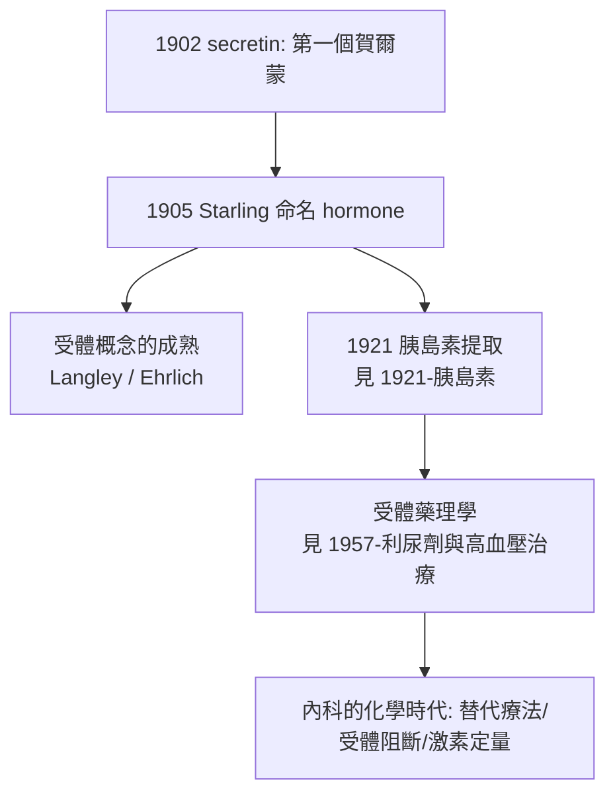

## 1902 - 促胰液素與內分泌學（身體的化學電報：第一個賀爾蒙）

## 案件摘要

**本案偵破的是「胰臟為什麼會知道腸子裡來了胃酸」。**

1902 年 1 月，倫敦大學學院的生理學家 William Bayliss 與 Ernest Starling 重做法國 Pavlov 實驗室的經典實驗：以鹽酸灌入去神經的小腸，胰液仍然分泌。神經已切斷，訊號靠什麼傳？他們推理必有**化學信使**由腸黏膜釋放入血，刺激胰臟。數月後他們從小腸黏膜提出該物質（促胰液素，secretin），注入血管果然引發胰液分泌。1905 年 Starling 在皇家醫學院講座上造字「hormone」（希臘語「激起」）。本案的真相是：人類第一次證明**身體裡存在不靠神經的化學調節系統**——內分泌學誕生，並為胰島素（見 `1921-胰島素.md`）與一切受體藥理（見 `1957-利尿劑與高血壓治療.md`、`1994-他汀與4S試驗.md`）開路。

## 前因 -- 為什麼會有這個案子

- **神經反射的壟斷**。19 世紀末生理學的統治範式是神經反射弧：刺激→傳入神經→中樞→傳出神經→器官反應。Pavlov 學派發現切斷小腸一切神經後胰液仍分泌，就以「局部反射」「神經未除淨」等解釋硬拗——範式內的修補。
- **Pavlov 的「難題紀錄」**。1894 年 Pavlov 的學生 Popielski 已重複出同樣結果，卻被要求「再仔細找神經」——線索已在案卷裡躺了八年。
- **「內部分泌」的概念已在漂流**。1895 年 Brown-Séquard（自己注射睪丸萃取物）提出「internal secretions」；甲狀腺切除後黏液水腫（1874 Gull）、甲狀腺移植治療（1891 Murray）暗示腺體分泌化學物質入血——但無人做出乾淨的實驗證明。
- **Bayliss–Starling 的配對**。一個是生物物理與酶學家，一個是心臟生理「Frank–Starling 定律」的本人——一個懂化學、一個懂力學。

## 線索與推理 -- 數學式、程式、理論

**線索一：關鍵的排除法。** 他們設計的實驗等於一道三重排除：

```text
實驗 1: 切斷小腸一切神經 + 酸灌腸 → 胰液仍分泌   ⇒ 排除中樞/外神經
實驗 2: 把酸直接注入血流          → 胰不分泌     ⇒ 排除「酸本身經血刺激胰」
實驗 3: 磨碎小腸黏膜 + 酸, 靜置, 取萃取液注入靜脈
        → 胰液大量分泌!                          ⇒ 信使來自黏膜, 走血液
```

**線索二：概念的算式。**

$$ \text{調節訊號} = \begin{cases} \text{神經(電, 快, 點對點)} & \text{舊範式} \\ \text{賀爾蒙(化學, 慢, 廣播式)} & \text{新範式} \end{cases} $$

身體從此有兩套通訊系統：神經是**電話**，賀爾蒙是**廣播電台**——目標細胞靠「有沒有收音機（受體）」決定是否回應。這個受體概念後來由 Ehrlich 的「Corpora non agunt nisi fixata」與 Langley 的「receptive substance」（1905）接力成熟。

**線索三：命名與體系化。** 1905 年 Starling 定義 hormone；隨後腎上腺素結晶（1901 Takamine）、腦下垂體系列研究、胰島素（1921）相繼納入體系：



**線索四：臨床的立即回報。** 內科第一次有了「缺什麼補什麼」的化學邏輯：黏液水腫補甲狀腺、愛迪生氏症補腎上腺皮質（1930s 可體松）、糖尿病補胰島素——**內分泌替代療法**成為內科治療史中最乾淨的一支。

## 結案 -- 後果與影響

- **生理學的擴張**。神經—體液雙軸成為生理學常識；消化、代謝、水鹽、生殖、應激全部重寫。
- **製藥工業的新礦脈**。腺體萃取物→純化賀爾蒙→半合成類似物→受體激動/拮抗劑：從胰島素、皮質類固醇到 GLP-1 類藥物，整條產業鏈的祖譜都是 1902 年。
- **診斷的化學化**。賀爾蒙定量（生物檢定→放射免疫分析，Yalow 1960，1977 諾獎）使內科診斷進入「以濃度定義疾病」的時代。
- **一句話結案**：Bayliss 與 Starling 破的是「無線電謎案」——**Pavlov 找了八年神經線，兇手卻是化學電報**；內分泌學教會醫學一件事：身體的通訊，不只在電線裡。

## 關鍵人物與文獻

- **William Maddock Bayliss（1860–1924）**——倫敦大學學院生理學教授；亦因 Brown Dog 事件（1903 反動物實驗訴訟）成為媒體焦點。
- **Ernest Henry Starling（1866–1927）**——Frank–Starling 心臟定律、微血管液體平衡（Starling forces）、賀爾蒙概念三項遺產在身。
- 原始文獻——Bayliss & Starling, "The mechanism of pancreatic secretion," *J Physiol* 28:325–353, 1902；Starling, "The chemical correlation of the functions of the body"（Croonian Lecture, 1905）。
- **Ivan Pavlov（1849–1936）**——消化生理 1904 年諾獎得主；聞 secretin 發現後在其報告中坦然引用——大師對新範式的沉默致敬。
- 現代註腳——secretin 在 1990 年代還爆出「自閉症 miracle cure」的錯誤炒作（後經 RCT 否證），成為「缺乏對照的熱情」的教科書案例——證據標準（見 `1996-循證醫學.md`）比荷爾蒙本身更需要被嚴格看管。
