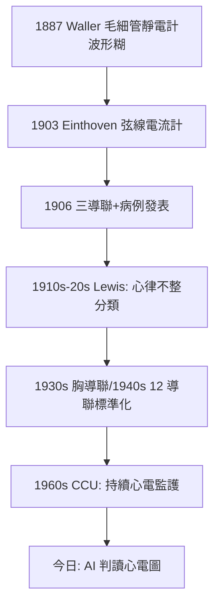

## 1903 - 愛因托芬心電圖（把心臟的電報接上紙帶：內科的波形革命）

## 案件摘要

**本案偵破的是「心跳不只是聲音與脈搏，還是一道電流」。**

1903 年，萊頓大學的 Willem Einthoven 以自己設計的**弦線電流計**（string galvanometer，以鍍銀石英細絲在強磁場中偏移）錄下人類第一張可用的心電圖，並在同年記錄到心房顫動等心律不整的波形。1906 年他確立三大標準導聯（I、II、III），1924 年獲諾貝爾生理學或醫學獎。本案的真相是：Einthoven 破的案不只是技術（電生理信號 1887 年 Waller 已錄到），而是**「如何讓心臟的電訊號變成可命名、可分類、可教學的曲線語言」**——P 波、QRS 複合波、T 波這套波形字母表，使心臟病成為內科第一個擁有「生理學即時影像」的專科。

## 前因 -- 為什麼會有這個案子

- **物理學的成熟**。1856 年 Kölliker 與 Müller 證明心肌的電活動可刺激神經；1876 年 Lippmann 毛細管靜電計可記錄心跳電位——但波形失真、無法量化。
- **Waller 的先行示範**。1887 年 Augustus Waller 以毛細管靜電計錄下人體心電圖（受試者是他的鬥牛犬 Jimmy），並推測心臟可視為一個電偶極子——概念正確，儀器太慢，波形是糊的。
- **臨床的需求**。心律不整（尤其新發現的心房顫動，1902 年電生理確認）與房室傳導阻滯無法以脈搏觸診精確分類——內科需要「心臟的內部電線圖」。
- **萊頓的地理劣勢轉優勢**。醫院與 Einthoven 實驗室相距 1.5 公里，早期病人得踩著導線走過來（或以電話線遠距傳輸）——這段「笨拙」逼出了極高靈敏度的儀器設計。

## 線索與推理 -- 數學式、程式、理論

**線索一：弦線電流計的物理。** 極細導線（鍍銀石英絲，重僅約 0.3 mg）懸於磁場，通過心電電流時受勞倫茲力偏移，以顯微鏡—照相記錄：

$$ \text{偏移量 } x \propto \frac{I \cdot L \cdot B}{\text{弦線張力}} \quad \Rightarrow \quad \text{電流 } I \text{ 被轉成可拍照的位移} $$

關鍵在於**響應速度快到足以跟上心跳**——毛細管靜電計做不到的事。

**線索二：波形字母表的誕生。** Einthoven 命名 P、Q、R、S、T（沿用 Waller 的部分字母並修正對位），並定義三個雙極肢導：

| 波/段 | 對應事件 | 臨床意義（今日） |
|---|---|---|
| P 波 | 心房去極化 | 房顫時消失→「亂顫基線」 |
| QRS 複合波 | 心室去極化 | 寬 QRS＝心室性心搏過速的證據 |
| T 波 | 心室再極化 | 高聳＝高血鉀的線索 |
| PR 間期 | 房室傳導時間 | 延長＝房室阻滯 |

**線索三：三角與向量的數學。** Einthoven 三角把身體當電偶極子，三導聯電位滿足：

$$ \text{Lead I} + \text{Lead III} = \text{Lead II} $$

這個恆等式讓「心臟電軸」可被計算——心電圖從此不只是曲線集，而是一套**向量幾何**。

**線索四：臨床驗證的閉環。** 1906–1908 年他與萊頓醫院合作，記錄並發表房顫、期外收縮、房室阻滯等病例的心電圖，與屍檢與臨床病程配對（Morgagni 傳統的電子版，見 `1761-莫爾加尼病理解剖.md`）。至 1910 年代，倫敦 Lewis、波士頓與維也納的團隊把心電圖推向全面臨床化。

## 結案 -- 後果與影響

- **心臟科成為第一個「生理學儀器專科」**。聽診器聽的是機械（見 `1816-雷奈克聽診器.md`），心電圖看的是電——診斷解析度再上一階。
- **冠心病的時代舞台**。1930–50 年代急性心肌梗塞的 ST-T 演變被確立，使胸痛病人的分診有了客觀依據；1960 年代冠心病監護病房（CCU）以持續心電監護＋去顫器把 AMI 死亡率砍半——硬體的祖譜都在 1903。
- **監護醫學的濫觴**。手術室、ICU、救護車的波形監視器，全是弦線電流計的直系後代。
- **諾貝爾與遠距醫療的巧合**。1905 年起 Einthoven 已用電話線把心電圖從醫院傳到實驗室——史上第一例遠距生理監測。
- **一句話結案**：Einthoven 的勝利是**把器官變成波形**——從此心臟會自己寫日記，而內科醫生學會了讀。

## 關鍵人物與文獻

- **Willem Einthoven（1860–1927）**——萊頓大學生理學教授，荷蘭—爪哇混血；1924 年諾貝爾獎（1925 年補頒）。發表時還謙稱「電流計的改進主要歸功於工程師們」。
- **Augustus Waller（1856–1922）**——首錄人體心電圖者；據說見 Einthoven 的儀器後笑言自己「只是個掃石頭的，他蓋了宮殿」。
- **Sir Thomas Lewis（1881–1945）**——心電圖臨床化總工程師，把波形分類系統化，被稱為英國心臟學之父。
- 原始文獻——Einthoven, "Le télécardiogramme," *Archives internationales de physiologie*, 1906；Einthoven, Fahr & de Waart, "Über die Richtung und die manifeste Größe der Potentialschwankungen im menschlichen Herzen," *Pflügers Archiv*, 1913.
- 現代註腳——2020 年代手錶式單導聯心電圖已可篩檢房顫；Einthoven 的三角簡化成手腕上的一對電極——但判讀字母表仍是他的 P、QRS、T。
