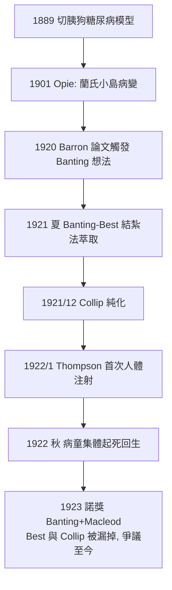

## 1921 - 胰島素（多倫多的夏天：把死刑犯的糖尿病變成慢性病）

## 案件摘要

**本案偵破的是「糖尿病的病人為什麼在餓死中死去」。**

1921 年夏天，多倫多大學：32 歲的骨科醫生 Frederick Banting 與 22 歲的醫學生 Charles Best 在 Macleod 教授的實驗室裡，以結紮胰管讓腺泡細胞萎縮的方法，從狗的胰臟分離出降血糖萃取物；同年 12 月生物化學家 Collip 完成純化。1922 年 1 月 11 日，14 歲的 Leonard Thompson 成為首位接受注射的糖尿病童；同年秋，飢餓瀕死的病童們在多倫多病院「起死回生」——病房走廊的歡呼被寫進醫院紀錄。本案的真相是：胰島素不是被「發現」的（1921 年前已知其存在），而是被**從死路百出的提取戰中救出來**的——本案最艱難的不是找到兇手（胰臟內分泌），而是洗掉刑場上的干擾雜質。

## 前因 -- 為什麼會有這個案子

- **糖尿病的死刑**。胰島素問世前，兒童第一型糖尿病的標準療法是 Allen 飢餓療法（每日數百大卡），平均延命約一年；病童死狀是消瘦、酮酸中毒、昏迷。
- **器官切除的線索已齊**。1889 年 von Mering 與 Minkowski 以切胰臟的狗製造糖尿病模型——病因器官確定；1901 年 Opie 指出蘭氏小島的病變——靶點縮小到內分泌島。
- **提取戰的二十年失敗**。全球試圖萃取「胰臟內分泌物（insuline, de Meyer 1909 命名）」者無數：萃取物不是無效就是劇毒——腺泡細胞的消化酶（胰蛋白酶）在提取過程中**把賀爾蒙本身分解掉**，這是所有人失敗的共同原因。
- **Banting 的靈感來源**。1920 年 10 月深夜，Banting 準備講課讀到 Moses Barron 的論文：結紮胰管後腺泡萎縮、蘭氏小島卻存活——一條「繞過消化酶」的提取路線在他腦中成形。

## 線索與推理 -- 數學式、程式、理論

**線索一：內分泌邏輯的應用。** 本案完全建立在 1902 年賀爾蒙概念（見 `1902-促胰液素與內分泌學.md`）之上：某腺體分泌化學信使入血，缺之則病——治療＝補信使。

$$ \text{糖尿病} \iff [\text{胰島素}]_{血} \approx 0 \quad\Rightarrow\quad \text{治療: } [\text{胰島素}]_{血} > 0 $$

**線索二：Banting–Best 的逐步戰術。**

```python
# 1921 夏, 多倫多, 醫學樓 221 室
def extract_pancreatic_hormone(dog):
    ligate(dog.pancreatic_duct)             # 結紮胰管 → 腺泡萎縮
    wait(weeks=7)
    grinded = homogenize(dog.atrophic_pancreas)  # 萎縮後只剩小島+導管
    return ringer_extract(grinded)          # 生理鹽水萃取

# 結果: 去胰臟糖尿病狗注射萃取物 → 血糖下降, 存活延長
# (第 408 號狗 存活 70 天, 成為實驗室明星)
```

**線索三：Collip 的純化突破。** 酒精分級沉澱配合 pH 控制，把粗萃取物升級為可安全注射的純品——這是本案從「實驗室奇蹟」跨到「藥物」的橋樑。第一次人體注射（Thompson, 1/11/1922）因雜質僅致無菌膿腫、療效微弱；1/23 以 Collip 純品再注，血糖從 $>440\ mg/dL$ 降至正常水平。

**線索四：臨床的戲劇性驗證。** 1922 年秋多倫多病院的一批瀕死病童（包括 15 歲的 Elizabeth Hughes）在注射後從酮酸中毒昏迷中清醒、體重回升、可以奔跑。



## 結案 -- 後果與影響

- **糖尿病的死亡降級**。第一型糖尿病從急性死刑變成可管理的慢性病；病人壽命從數月延至數十年，微血管併發症成為新戰場（1993 年 DCCT 試驗證明嚴格血糖控制預防併發症）。
- **內分泌藥業與「大規模生產醫學」**。1923 年 Eli Lilly 合作量產；1936 年長效魚精蛋白鋅胰島素；1982 年重組 DNA 人胰島素上市——從動物胰臟到發酵槽的技術鏈。
- **諾獎爭議（本案的附案）**。1923 年獎只頒 Banting 與 Macleod；Banting 宣布與 Best 平分獎金，Macleod 則與 Collip 平分——團隊科學與個人榮譽制度的衝突自此成為經典案例。
- **專利的政治學**。四人以每劑象徵性 1 加元把專利轉給多倫多大學，「讓藥品儘快廉價普及」——醫學史上最著名的反商業化姿態；百年後胰島素定價爭議（美國每瓶數百美元）反諷地重演了這段歷史。
- **一句話結案**：胰島素案的偵探精神不在發現，而在**戰勝提取過程中的自我破壞**——有時候，兇手不在組織裡，而在你的培養皿裡。

## 關鍵人物與文獻

- **Frederick Banting（1891–1941）**——骨科醫生轉研究員；1934 年受封爵士，1941 年死於戰時飛機失事。
- **Charles Best（1899–1978）**——醫學生助手，後繼任實驗室主持人。
- **J. J. R. Macleod（1876–1935）**——生理學教授、提供資源與方法學監督；**James Collip（1892–1965）**——生化學家、純化與「提取失效危機」（1922 年初一度全部實驗無法重現）的解決者。
- **Elizabeth Hughes（1907–1981）**——美國外交官之女，飢餓療法下體重一度僅 20 餘公斤；1922 年 8 月赴多倫多注射後重生，享年 73 歲，育有三子。
- 原始文獻——Banting, Best, Collip, Campbell, Fletcher, "Pancreatic extracts in the treatment of diabetes mellitus," *Can Med Assoc J*, 1922；Banting & Best, *J Lab Clin Med*, 1922。
- 現代註腳——2020 年代 GLP-1 受體促效劑（同源於內分泌學的腸道賀爾蒙）再度改寫糖尿病與肥胖治療；百年間，這個領域始終在「替換失去的信使」與「操縱既有的信使」之間兩線並進。
