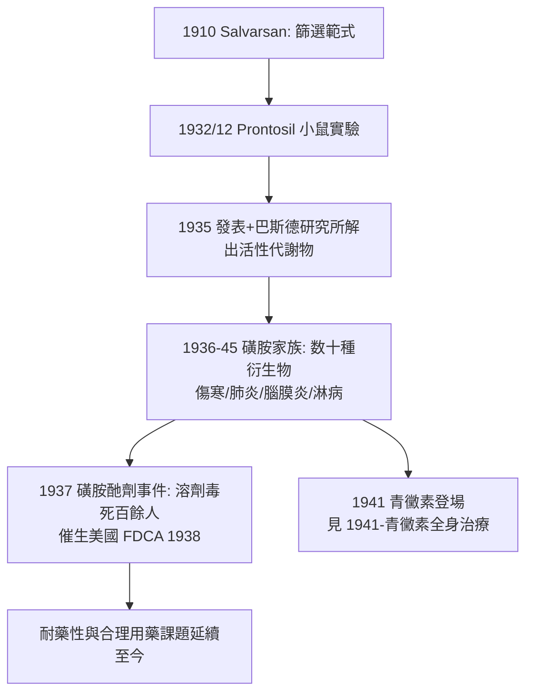

## 1932 - 多馬克磺胺（紅色染料的秘密：第一類能治全身感染的藥）

## 案件摘要

**本案偵破的是「細菌進了血液，還有救嗎」。**

1932 年 12 月，拜耳（Bayer）實驗治療實驗室的 Gerhard Domagk 在例行篩選中測試紅色偶氮染料 Prontosil：以致命劑量的溶血性鏈球菌感染小鼠後，投藥組全部存活、對照組全數死亡——且小鼠耐受劑量遠高於殺菌所需劑量。1933 年首次人體試用成功，1935 年發表。同年法國巴斯德研究所 Tréfouël 夫婦等揭開謎底：Prontosil 在體內被代謝切成**對胺基苯磺醯胺（sulfanilamide）**——真正開槍的是這個無色小分子。本案的真相是：磺胺是第一類以「先找靶點、再系統篩選」（Ehrlich 傳統，見性病史 `../性病的歷史/1910-埃爾利希洒爾佛散606.md`）問世的全身性抗菌藥，並在 1936–1945 年間把鏈球菌敗血症、產褥熱、肺炎、腦膜炎從絕症名單上成批劃掉——青黴素之前，內科的抗生素時代其實由一支紅色染料揭幕。

## 前因 -- 為什麼會有這個案子

- **化療的傳統與斷層**。Ehrlich 的 Salvarsan（1910）證明「魔法子彈」可行，但只對梅毒、錐蟲有效；1920 年代對最常見的死因——球菌感染——束手無策。
- **染料工業的軍火庫**。IG Farben 旗下拜耳實驗室按 Ehrlich 範式建了龐大的偶氮、吖啶化合物庫，以鏈球菌小鼠模型系統篩選——Domagk 自 1927 年起主持此項目，篩了數千種化合物。
- **1918 流感大流行與戰間期的傷口感染**。肺炎、敗血症、產褥熱是當時病房的日常死刑；臨床對「有效藥」的需求巨大。
- **偶氮染料對蛋白的親和力**。染料天生會「選擇性染色」細菌與組織——Ehrlich 式的直覺：會選擇性結合，就可能選擇性殺傷。

## 線索與推理 -- 數學式、程式、理論

**線索一：治療指數的勝利。** Domagk 的核心數據：

$$ TI = \frac{LD_{50}(\text{小鼠})}{ED_{50}(\text{鏈球菌})} \gg 20 \quad (\text{Prontosil: 治療劑量 } \ll \text{中毒劑量}) $$

這正是 Ehrlich 定義的化療驗收標準——染料本身在試管裡竟**不殺菌**（體外無活性），必須在體內才起效，這條線索當時幾乎使它被淘汰，卻成為後續解謎的鑰匙。

**線索二：法國組的代謝解謎。** 1935 年巴斯德研究所的 Tréfouël、Nitti 與 Bovet 證明：Prontosil 在體內被還原切斷偶氮鍵，釋出 **sulfanilamide**——而 sulfanilamide 本身（1908 年就已被合成、無專利保護）直接抗菌。

```python
# 1935 年的謎底
prontosil (紅色, 體外無活性)
    └─(體內代謝: 偶氮鍵還原)→ sulfanilamide (無色, 直接殺菌)
        ⇒ 拜耳篩選的一直是「前藥」: 真正的子彈由病人自己製造
```

**線索三：作用機制的革命——競爭性抑制與「代謝類似物」。** 1940 年 Woods 與 Fildes 提出經典解釋：磺胺的結構酷似細菌合成葉酸所需的对胺基苯甲酸（PABA），它**冒名頂替**佔據酶的活性位，斷絕細菌的葉酸供應：

$$ \text{磺胺} \xrightarrow{\text{競爭二氫蝶酸合酶}} \text{葉酸合成受阻} \Rightarrow \text{細菌「餓死」} $$

而人類細胞直接從食物攝取葉酸、不靠這條路合成——**選擇性毒性的分子級解釋**首次落實。治療學從「毒死敵人」升級為「騙死敵人」。

**線索四：臨床戰果與女兒的故事。** 1935 年 Domagk 的女兒 Hildegard 因針刺感染鏈球菌敗血症垂危，Domagk 違反程序以 Prontosil（高劑量）救回——臨床證據與個人悲喜劇同框。1936 年羅斯福總統之子 FDR Jr. 因鏈球菌咽炎被磺胺救回，美國媒體的報導使磺胺一夜成名。



## 結案 -- 後果與影響

- **死亡率的地圖改繪**。產褥熱、鏈球菌敗血症、肺炎、腦膜炎球菌腦膜炎、淋病——1930 年代末這些內科與產科的頭號殺手首次可治；英美醫院統計顯示敗血症死亡率斷崖式下降。
- **藥政法誕生的代價**。1937 年美國 Massengill 為做兒童用液劑，把磺胺溶於工業溶劑二甘醇，毒死逾百人（多為兒童）——1938 年《聯邦食品藥品化妝品法》要求上市前毒性審查；藥物安全監管（FDA 權力）的直接起點。
- **諾貝爾的納粹插曲**。Domagk 1939 年獲諾獎，卻被納粹政府禁止領獎，1947 年才補領（無獎金）——科學榮譽與極權政治的交會點。
- **耐藥性的開場**。磺胺濫用數年內耐藥菌遍地——抗生素時代的「耐藥預言」由它先寫下，也成為後世（含 `1948-鏈黴素RCT.md` 的聯合用藥討論）的教訓。
- **一句話結案**：磺胺案教會醫學三件事——**篩選要系統、活性要看代謝、機制要找到酶**；「以分子冒名頂替騙倒細菌」的招式，至今仍是抗感染藥設計的主旋律。

## 關鍵人物與文獻

- **Gerhard Domagk（1895–1964）**——拜耳實驗病理與細菌學主任；1939 年諾貝爾生理學或醫學獎。
- **Tréfouël 夫婦（Jacques 與 Thérèse）、F. Nitti、D. Bovet**——巴斯德研究所，1935 年解出活性代謝物；Bovet 後以抗組織胺工作獲 1957 年諾獎。
- **Daniel Bovet 的註腳**——解謎者與後來的受體藥理學家是同一人：篩選—代謝—機制的三段式偵辦在他身上合體。
- 原始文獻——Domagk, "Ein Beitrag zur Chemotherapie der bakteriellen Infektionen," *Deutsche Medizinische Wochenschrift*, 1935；Tréfouël et al., *C R Soc Biol*, 1935；Woods, *Br J Exp Pathol*, 1940（代謝類似物學說）。
- 現代註腳——磺胺至今仍在藥典（複方 SMZ-TMP 治泌尿道感染、肺囊蟲肺炎）；而「結構相似分子騙取酶活性位」的策略，正是後來 HMG-CoA 還原酶抑制劑（他汀，見 `1994-他汀與4S試驗.md`）的設計原型。
