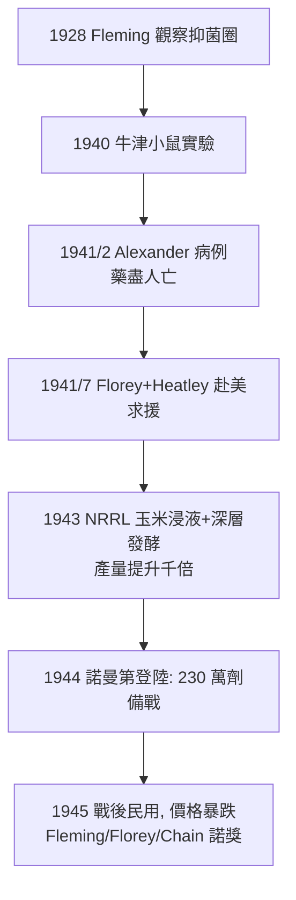

## 1941 - 青黴素全身治療（十二天的奇蹟與量產戰爭：抗生素時代的正式開幕）

## 案件摘要

**本案偵破的是「一個被晾了十二年的培養皿，如何變成扭轉死亡的武器」。**

1928 年 Fleming 偶然發現青黴菌的抑菌圈，但提取困難，直到 1940 年牛津 Florey–Chain 團隊以冷凍乾燥與層析純化出穩定制劑，並在小鼠保護實驗中展現驚人療效。1941 年 2 月 12 日，43 歲的牛津警察 Albert Alexander（被玫瑰刺劃傷後全身鏈球菌與葡萄球菌敗血症、一眼已被摘除）成為首位接受青黴素全身注射的病人：24 小時內退燒、進食、病灶明顯吸收。但全實驗室僅有約 4 克藥物——他們從病人尿液中回收青黴素回注，撐了五天，最後藥盡人亡。本案的真相是：青黴素案由三段偵辦組成——**Fleming 的偶然觀察、牛津的系統開發、英美戰時的工業化量產**——它證明「有藥」與「有足夠的藥」是兩場戰爭。

## 前因 -- 為什麼會有這個案子

- **Fleming 的 1928**。聖瑪麗醫院細菌學家 Alexander Fleming 假期返工時發現一枚遭青黴菌污染的葡萄球菌培養皿，菌落周圍有透明抑菌圈；命名 penicillin，1929 年發表——但粗培養液不穩定、提純失敗，他自己判斷「適合局部防腐，不適合全身治療」，之後十二年幾乎無人接手。
- **防腐劑的教訓**。第一次世界大戰的傷口死亡證明石炭酸等防腐劑在組織深處無能為力——需要一種「能在血裡殺菌、不傷身體」的藥（Ehrlich 的選擇性毒性，見 `1932-多馬克磺胺.md` 已由磺胺部分兌現）。
- **牛津的動員**。1938 年 Florey 與 Chain 研究「溶菌酶」時翻到 Fleming 的舊文獻，與 Heatley、Abraham 等組隊，獲洛克菲勒基金會小額資助——目標正是尋找比磺胺更強的抗菌物質。
- **戰爭的推力**。1941 年底美國參戰，傷員感染的規模使青黴素從學術項目變成戰略物資；美國農業部北方研究室（NRRL）與數十家藥廠合作攻關。

## 線索與推理 -- 數學式、程式、理論

**線索一：牛津的關鍵實驗（1940 年 5 月 25 日，星期六）。** 八隻小鼠注射致命鏈球菌，四隻給青黴素：

$$ P(\text{治療組存活}) = 1 \quad ; \quad P(\text{對照組存活}) = 0 $$

Chain 深夜看到結果時在日記寫下「我簡直不敢相信眼睛」——這組 n=4 的實驗成為人類醫學史最著名的小樣本之一（其可信度來自效果量極大與可重複性）。

**線索二：Albert Alexander 病例的偵辦紀錄。**

```text
1941/2/12  首劑 200mg 靜脈注射(當時體外效價計)
1941/2/13  體溫下降, 食慾恢復, 右眼窩膿腫縮小 — 全身狀況逆轉
1941/2/15  藥將用盡 → 開始從病人尿液回收青黴素回注
1941/2/17  尿回收不足以維持血中濃度, 感染復燃
1941/3/14  藥盡, 病人死亡(感染未清, 非藥物毒性)
```

偵辦結論有二：(1) **青黴素對全身性球菌感染有效**——選擇性毒性成立，人體耐受極高；(2) **療效受制於供給**——「劑量不足即前功盡棄」成為量產戰役的動員令。

**線索三：量產的工程戰（本案的下半場）。**



技術鏈：表面培養（牛奶瓶）→ 玉米浸液培養基 → 玉米鬚誘變選種（X 光誘變的黴菌株產量提升百倍）→ 深層通氣發酵槽（戰後成為整個生物製藥工業的母機）。

**線索四：機制的補完。** 1957 年 Sheehan 合成青黴素母核 6-APA；1965 年 Tipper 與 Strominger 提出作用機制：青黴素冒充 D-Ala-D-Ala 端，**共價封鎖轉肽酶**，使細菌細胞壁無法交聯——細菌在自身膨壓下爆裂。這是繼磺胺之後，第二個「冒名頂替」機制的完整破譯。

## 結案 -- 後果與影響

- **感染病醫學的斷層線**。1941 年前後，鏈球菌敗血症、肺炎、心內膜炎、梅毒（見性病史 `../性病的歷史/1943-青黴素治癒梅毒.md`）、腦膜炎從「內科醫生的絕望清單」變成「處方科目」；人類平均壽命的最後一段大跳升主要歸功於感染病死亡率的崩落。
- **生物製藥工業的成型**。深層發酵、菌株改良、效價標準化（牛津單位）、臨床試驗化上市——現代藥廠的作業系統在 1941–1945 間完成韌體安裝。
- **Fleming 的警世預言**。1945 年諾獎演說即警告「無知的病人買不到足量青黴素，就會培養出耐藥菌」——MRSA、VRE、CRE 的世紀，驗證了這份結案陳詞。
- **偶然性的方法論**。青黴素常被引用為「 serendipity 」的典範，但本案真正的教訓是 Pasteur 那句「機遇偏愛有準備的頭腦」：抑菌圈需要被看見、被追問、被資助——Fleming 的眼睛、Florey 的組織力、美國的工廠缺一不可。
- **一句話結案**：Albert Alexander 之死不是失敗，而是本案的**量刑基準**——它量化了「差一點就救活」的距離，並把人類工業動員到剛好跨過那條線。

## 關鍵人物與文獻

- **Alexander Fleming（1881–1955）**——聖瑪麗醫院；1929 年發表 penicillin 論文；1945 年與 Florey、Chain 共享諾貝爾獎。
- **Howard Florey（1898–1968）**——牛津病理學教授，本案的總指揮與資源動員者；**Ernst Chain（1906–1979）**——德裔生化學家，純化與機理先鋒；**Norman Heatley（1911–2004）**——微量提取與測定技術的發明者，公認「最該得獎而未得」的工程師。
- **Albert Alexander（1896–1941）**——牛津 Radcliffe 醫院警員；其病歷由 Charles Fletcher 記錄，Fletcher 後成為皇家醫師。
- 原始文獻——Chain, Florey et al., "Penicillin as a chemotherapeutic agent," *Lancet*, 1940/8/24；Abraham et al., "Further observations on penicillin," *Lancet*, 1941/8/16（含 Alexander 病例）。
- 現代註腳——2020 年代 β-內醯胺酶抑制劑複方、頭孢菌素五代更迭、以及全球抗生素研發荒（經濟模型失靈）——本案的續集仍在連載：耐藥性是青黴素唯一未痊癒的後遺症。
