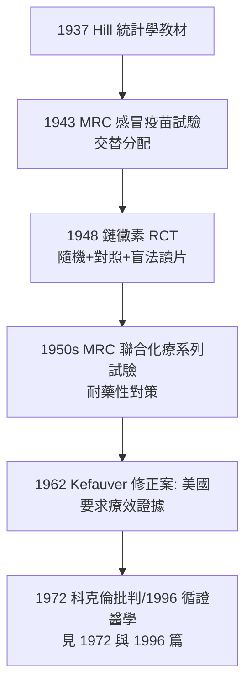

## 1948 - 鏈黴素 RCT（隨機化的立法時刻：醫學史上第一個現代隨機對照試驗）

## 案件摘要

**本案偵破的是「新藥到底有沒有用——誰說了算」。**

1948 年，英國醫學研究理事會（MRC）在 *BMJ* 發表「Streptomycin treatment of pulmonary tuberculosis」：107 名急性進行性肺結核病人被**隨機分配**為鏈黴素組（55 人）與臥床對照組（52 人），以盲法讀片評估 X 光變化，並以**存活率**與影像改善為終點。結果：治療組影像改善 51% vs 8%，死亡 4 vs 14——鏈黴素勝出。本案的真相是：這是第一個以**隨機化＋對照＋盲法評估＋預設終點**完整執行的臨床試驗，隨機對照試驗（RCT）從此成為評估治療的最高法庭——內科學的證據憲法在 1948 年立法。

## 前因 -- 為什麼會有這個案子

- **鏈黴素太貴太少**。1946 年瓦克斯曼團隊發現鏈黴素（結核第一個有效藥），但戰後英國無力大量進口——**藥物稀缺反而造就了隨機分配的道德合理性**：與其誰有門路誰先得，不如抽籤公平。
- **無對照傳統的破產**。在此之前，新藥上市靠「病好像好轉了」的敘事：金製劑治結核曾風行二十年（實為劇毒）、結核菌素的慘敗（見 `1882-科赫結核桿菌.md`）、以及 19 世紀放血的長命百歲——**結核病的自然病程本就起伏不定**，「看起來好轉」毫無證據力。
- **方法學的知識儲備**。Fisher 的隨機化與統計檢定（1920s，農業試驗場）、Hill 的統計學（*Principles of Medical Statistics*, 1937）早已成熟；1930s 美國的血清試驗與 1943 年 MRC 感冒疫苗試驗已局部使用「交替分配」——但交替可被預測、可被操弄。
- **Austin Bradford Hill**。MRC 統計顧問、倫敦衛生與熱帶醫學院教授，本案的總設計師；他與結核專家 Philip D'Arcy Hart 合作寫下了這份「方法學憲章」。

## 線索與推理 -- 數學式、程式、理論

**線索一：隨機化的邏輯核心。** 為何必須隨機？因為結核病人的預後受年齡、病期、營養、社會階層影響，而這些因素**不可窮舉**。隨機分配在期望上使兩組的已知與未知混雜因素同分布：

$$ E[\text{混雜因素} \mid \text{隨機組 A}] = E[\text{混雜因素} \mid \text{隨機組 B}] $$

這是觀察研究永遠做不到的——**隨機化是唯一能對未知偏誤免責的分配方式**。

**線索二：分配的執行細節（本案的誠實之處）。** 試驗採用「密封信封＋按抽籤順序」的序列分配，並規定參與醫師**不知下一個信封內容**——防止醫生把預後較差的病人「安排」進對照組（或反之）的道德直覺干擾。

**線索三：終點的選擇。** 試驗預先定義：(1) 死亡；(2) 影像改善（由不知分組的放射科醫師盲法讀片、分級判定）；(3) 痰菌陰轉。以死亡率為「硬終點」取代「病人主觀感受」——這直接繼承了 Wunderlich（見 `1868-溫德利希體溫計.md`）以來「sign 重量於 symptom」的傳統。

```python
# 1948 MRC 試驗的偵辦摘要
n, treated, control = 107, 55, 52
# 影像顯著改善: 51% vs 8%   (治療 vs 臥床)
# 6 個月死亡:    4/55 vs 14/52
risk_ratio = (4/55) / (14/52)     # ≈ 0.27
# 結論: 鏈黴素對急性進行性肺結核有效 — 但...
```

**線索四：本案的反轉——耐藥性現身。** 試驗同時報告：治療組多數病人三個月內出現鏈黴素耐藥菌。這直接催生 1950 年代 MRC 後續試驗：**鏈黴素＋PAS 聯合用藥**——「單藥短暫勝利、聯合長期制勝」成為結核化療（乃至 HIV 雞尾酒療法）的通則。RCT 不只評估藥，還評估出**用藥策略**。



## 結案 -- 後果與影響

- **RCT 成為藥物審批的門檻**。1962 年美國 Kefauver–Harris 修正案要求「實質療效證據」（substantial evidence），歐洲各國相繼跟進；今日新藥上市的核心證據格式即由 1948 年定型。
- **結核化療的成功方程式**。鏈黴素→PAS→異菸鹼醯肼→利福平的 MRC 系列試驗，把結核從「療養院的命運」變成「門診化療可治之症」——藥物與方法學的雙重勝利。
- **倫理辯論的起點**。「隨機剝奪有效治療？」的質疑自始存在；後世的回應是：在證據未明前，隨機反而是最公平且最能避免「無效療法成規」的選擇——臨床均衡（clinical equipoise）概念成為倫理基石。
- **Hill 的謙遜**。他終生強調統計證據不是真理機器：「試驗給的是機率，不是判決書」——這種克制成為後世統計學家的職業倫理。
- **一句話結案**：1948 年的立法本質是**把「哪個治療有效」的裁判權從經驗與權威移交給隨機化**——內科從此按證據等級判案，而非按資歷。

## 關鍵人物與文獻

- **Austin Bradford Hill（1897–1991）**——試驗設計者；1965 年再提出因果推論的「Hill 準則」（9 條），成為流行病學的因果判斷工具箱；1971 年受封爵士。
- **Philip D'Arcy Hart（1900–2006）**——結核醫師與勞工流行病學家，試驗的臨床主持人，享年 105 歲。
- **Geoffrey Marshall**——結核委員會主席，於 1947 年說服鏈黴素製造商 Merck 以「研究合作」名義供藥。
- 原始文獻——Medical Research Council, "Streptomycin treatment of pulmonary tuberculosis," *BMJ*, 1948/10/30, ii:769–782。
- 現代註腳——2020 年 COVID-19 大流行中，RECOVERY 平台試驗以同樣的隨機化框架在數月內篩出地塞米松有效、羥氯喹無效——1948 年的方法學憲章，七十年後仍是疫情中的救命章程。
