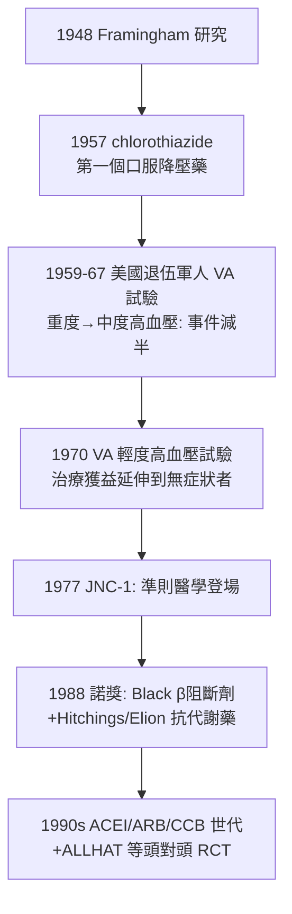

## 1957 - 利尿劑與高血壓治療（從「觀望必治之疾」到終身服藥：慢性病藥理的範式轉移）

## 案件摘要

**本案偵破的是「血壓高到底該不該治、能不能治」。**

1957 年，默沙東（Merck）的化學家 Karl Beyer 團隊推出氯噻嗪（chlorothiazide）——第一個口服有效、鈉排泄充分且不過度排鉀的利尿劑；1959 年起系列臨床研究與 VA 合作試驗（1967、1970）證明降壓可減少中風與心衰竭事件。到 1970 年代，JNC 準則（1977 首版）把高血壓正式定義為「需要終身藥物治療的疾病」。本案的真相是：1957 年之前，醫學界的主流立場驚人地消極——「高血壓是身體對老化腎臟的必要補償，降壓反而傷害灌注」；本案是內科史上最大規模的**疾病觀翻案**：把一億級人口的「體質」重新定義為「可治之疾」，並樹立了慢性病藥理治療（受體藥理＋大規模 RCT）的完整範式。

## 前因 -- 為什麼會有這個案子

- **高血壓的「必要論」統治**。1930–50 年代頂級教科書（如《現代內科學》1940 年代版）寫道：高血壓可能「是維持腎臟灌注的必要反應」，降壓治療常弊大於利；1931 年英國名醫 Charles Friedberg 甚至說「無症狀的輕度高血壓，病人比醫生更該少擔心」。
- **早期的慘痛教訓**。唯一的重度高血壓療法是交感神經切除術與劇毒的 hexamethonium／神經節阻斷劑——體位性昏厥、腸阻塞，無法長期使用。「降壓＝自殘」的印象由真實的劣藥累積而成。
- **Framingham 心臟研究（1948 開跑）**。同時期正在蒐集動脈粥狀硬化的前瞻性危險因子資料——「高血壓是危險因子」的流行病學證據即將到案。
- **藥理學的工具箱升級**。碳脱水酶抑制劑（1949/50， acetazolamide）雖利尿卻致代謝性酸中毒、效果遞減；Merck 化學家循磺胺結構（見 `1932-多馬克磺胺.md` 的代謝類似物傳統）尋找更強的排鈉分子——thiazide 誕生。

## 線索與推理 -- 數學式、程式、理論

**線索一：Beyer 團隊的化學偵辦。** 從磺胺的「排鈉副作用」出發，逐輪修飾苯環：先得碳脱水酶抑制劑（ acetazolamide，機制清楚但臨床不理想），再合成**氯噻嗪**——排鈉主力、降壓持久、口服有效：

$$ \text{Na}^+ \text{ 排泄} \uparrow \Rightarrow \text{血漿容積} \downarrow \Rightarrow \text{血壓} \downarrow \quad (\text{長期: 周邊阻力亦下降}) $$

**線索二：受體藥理的接力（本案的第二波武器）。** 1950s 後半，Black 提出受體阻斷構想，1964 年 propranolol（β 阻斷劑）上市（1988 諾獎）；α-甲基多巴、利血平、clonidine 陸續加入。降壓從「排水」擴展到「堵住交感傳訊」——**受體**成為內科治療學的通用插座（後續 ACE 抑制劑 1975–81、CCB、ARB 1990s 依序上線）。

**線索三：VA 合作試驗——把「有效」釘死在事件上。** 1967 年與 1970 年的退伍軍人管理局雙盲安慰劑對照試驗以**硬終點**（中風、心衰竭、腎衰竭、猝死）評估：

$$ \text{嚴重事件發生率: 治療組} \approx \frac{1}{4} \sim \frac{1}{8} \text{ 對照組} $$

1970 年代後半由於安慰劑組事件過多而被提前中止——這種「因療效明確而提前止步」的設計，宣告「觀望」不再是倫理選項。

**線索四：概念的三重翻案。**

| 舊觀念（≤1957） | 新觀念（≥1970s） |
|---|---|
| 高血壓是老化補償，無症狀不必治 | 無症狀＝危險因子，正是治療對象 |
| 降壓會傷害腎灌注 | 降壓保護腎、腦、心 |
| 治療＝住院手術或劇毒藥 | 治療＝門診一片藥、終身服從 |

## 結案 -- 後果與影響

- **中風死亡率的半世紀下降**。美國中風年齡標準化死亡率自 1960 年代至今下降逾 70%——史上最大規模的疾病預防勝利之一，thiazide 與後續降壓藥是第一推手。
- **「終身服藥」的醫病契約**。本案確立了現代慢性病的治療形態：無症狀也要吃藥、依醫囑定期回診——醫學對「治療」的定義從「把病治好」擴展到「把風險壓低」。
- **準則醫學（guideline medicine）誕生**。1977 年 JNC 報告（僅 6 頁）開啟國家治療準則的先河；此後所有準則的證據分級（見 `1996-循證醫學.md`）都是這條路的延伸。
- **藥廠的雙面角色**。默沙東的 Beyer 團隊以化學偵辦創造市場，也開啟「把危險因子變成適應症」的商業模式——同樣的引擎後來驅動他汀（見 `1994-他汀與4S試驗.md`），也驅動了後世的過度診斷爭議。
- **一句話結案**：1957 年真正的藥不是氯噻嗪，而是**「治療無症狀的風險」這個新觀念**——內科從此不僅治病的現在，也治理它的未來。

## 關鍵人物與文獻

- **Karl H. Beyer（1914–1996）**——默沙東藥理部主任，帶領 Sprague、Baer 等合成 thiazide 家族；Lasker 獎（1958）。
- **Edward D. Freis（1912–2005）**——VA 合作試驗總設計師；早年深受「必要論」教科書影響，後以 RCT 推翻自己受過的教育——「偵探先逮捕自己的舊信念」的典範。
- **James Black（1924–2010）**——β 阻斷劑與 H2 阻斷劑（西咪替丁）發明人，1988 年諾獎；其「受體阻斷治療學」與 thiazide 同屬本案武器庫。
- 原始文獻——Beyer, *Pharmacol Rev*, 1958；Veterans Administration Cooperative Study Group, *JAMA*, 1967; *Circulation*, 1970；*Report of the Joint National Committee (JNC-1)*, 1977。
- 現代註腳——SPRINT（2015）試驗再將目標血壓壓至 120 mmHg 以下，準則隨之修訂——本案的法庭自 1957 年起持續開庭，每隔數年重審一次「多低才算夠低」。
