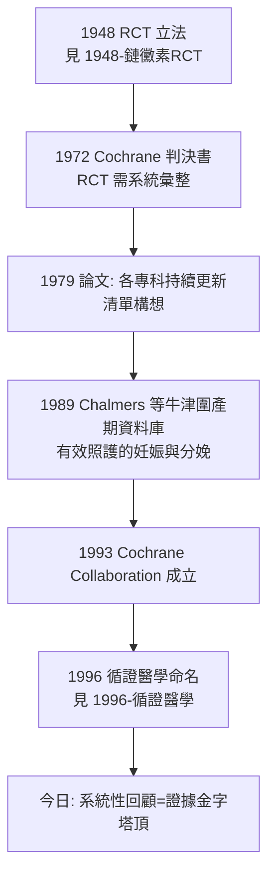

## 1972 - 科克倫效能與效率（一位戰俘流行病學家的判決書：醫學必須學會數自己的勝場）

## 案件摘要

**本案偵破的是「醫學整體而言，到底有沒有在進步」。**

1972 年，威爾斯醫學流行病學家 Archie Cochrane 出版小冊《效能與效率：對衛生服務的隨機反思》（*Effectiveness and Efficiency: Random Reflections on Health Services*），百餘頁，卻提出一份尖銳的控訴：**國家花費巨資的醫療體系，幾乎從不系統性地檢驗哪些治療真的有效**；他主張所有醫療介入都應經隨機對照試驗（RCT）檢驗、且證據應被**系統性彙整**供所有醫生使用。本案的真相是：Cochrane 破的不是單一療法的謎，而是**醫學的「司法上訴制度缺失」**——零散的試驗散落各期刊，無人彙總、無人更新、無人負責；他的判決書直接催生了 Cochrane Collaboration（1993）與循證醫學運動（見 `1996-循證醫學.md`）。

## 前因 -- 為什麼會有這個案子

- **RCT 已發明、卻未執法**。1948 年鏈黴素試驗（見 `1948-鏈黴素RCT.md`）立了法，但到 1970 年代，多數治療仍是「醫學界習慣」而非證據判決；且試驗結果零散、重複、矛盾——**有了法庭，卻沒有案卷管理制度**。
- **英國 NHS 的成本危機**。1948 年成立的國民健保到了 1970 年代開支失控；政府亟欲知道「錢花在哪裡才有效」——Cochrane 被任命撰寫衛生服務效能的總體檢（Ruffle 講座）。
- **Cochrane 的傳奇履歷**。西班牙內戰與二戰期間他在德國戰俘營擔任營區醫生：20 名俄國戰俘呈「垂死」狀態，他手頭只有阿司匹林與黑麵包，無力施救，以為他們必死；戰後一名德國醫官告訴他——那只是「戰俘營神經症」，醫官以一句「我明天就放你們回家」治癒了所有 20 人。Cochrane 終生自問：**「我到底會不會行醫？」**——這個創傷成為他執意「以證據評價醫學」的心理起點。
- **先驅的鋪路**。Pierre Louis 的數字法（19 世紀放血之辯）、Bradford Hill 的統計學、以及美國技術評估運動——「評估醫學」的思想已零星存在，缺一位能把話說絕的人。

## 線索與推理 -- 數學式、程式、理論

**線索一：三個詞的辨析（本案的核心概念工程）。** Cochrane 區分：

| 概念 | 定義 | Cochrane 的判語 |
|---|---|---|
| 效能 effectiveness | 在理想試驗條件下的療效 | 需以 RCT 證明 |
| 效率 efficiency | 每單位成本取得的健康 | 資源應流向高效介入 |
| 人性 humanity | 病人被關懷與尊重的程度 | 「自由給予、慷慨供應」 |

他名句：「caring is free（關懷是免費的）——若我們少花錢在無效能的介入上，就有更多餘裕提供關懷。」

**線索二：他抓出的「無效醫療」範例。** 書中以圍產期醫學為主戰場（其妻為產科醫生）：當時盛行的新生兒氧氣濫用（致早產兒視網膜病變失明）、無根據的產科常規——他點名 **「圍產期醫學是「RCT 覆蓋率」最糟的領域，也是最該先改革的一線」**。推論式：

$$ \text{醫療體系的淨效益} = \sum_{\text{介入}} (\text{效能}_i \times \text{使用量}_i) - \text{傷害} $$

若 $\text{效能}_i$ 從未量測，總和就是一筆糊塗帳——**這筆帳必須有人記**。

**線索三：系統性彙整的方案。** 他主張（延續 1979 年論文）為每個專科建立「經 RCT 檢驗之介入的**持續更新清單**」：

```python
# Cochrane 1972/1979 的藍圖
for specialty in all_medical_specialties:
    trials  = collect_all_rcts(specialty)      # 收齊全部試驗
    summary = synthesize(trials)               # 系統性回顧+meta 分析
    register = updatable_register(summary)     # 可更新、公開、可被質疑
    deliver_to(doctors, patients, policymakers, register)
```

（meta 分析的統計技術由 Glass 1976 命名、Pocock 與 Yusuf 等在 1980s 成熟——但「持續更新的證據登記所」這個制度構想是 Cochrane 的。）

**線索四：他以身作則的雙重身分。** Cochrane 本身是結核與胸部疾病醫生（戴維斯威爾斯結核研究主任）、也是 Rhondda Valley 的社區流行病學家——他知道「煤礦工人為何不參加胸片篩檢」這種問題的答案不在統計學裡。他後期（1971 年起）擔任《Effective Health Care》與 NHS 研發計畫的顧問，把理念推進政策。



## 結案 -- 後果與影響

- **Cochrane Collaboration（1993）**。Chalmers 等人在牛津建立「有效照護的妊娠與分娩」資料庫（1989，2 萬頁的系統回顧集）震動學界，促成 1993 年以 Cochrane 命名的國際協作網——今日數萬篇 Cochrane 系統回顧即其遺產。
- **「無效醫療」成為可量測的問題**。衛生技術評估（HTA）、NICE（1999）、各國健康保險的給付審查——都把 Cochrane 的「效能—效率」框架制度化。
- **反面遺產：RCT 崇拜的內建警告**。Cochrane 自己承認某些問題無法 RCT（如麻醉技術、公衛介入），並呼籲對「觀察性證據」保持尊重——後世方法學戰爭（RCT vs 真實世界證據）在他書裡已埋下伏筆。
- **一句話結案**：Cochrane 把醫學的問題從「這個治療有效嗎」升級為「**誰在負責記錄所有治療的勝敗場次**」——一個戰俘營醫生，替整個行業立了案卷制度。

## 關鍵人物與文獻

- **Archie L. Cochrane（1909–1988）**——蘇格蘭醫生、流行病學家；威爾斯醫學院教授。墓誌銘式自傳《One Man's Medicine》記錄了戰俘營的轉捩點。
- **Iain Chalmers**——圍產期流行病學家，Cochrane Collaboration 創辦主持人；1989 年 *Effective Care in Pregnancy and Childbirth* 主編。
- 原始文獻——Cochrane, *Effectiveness and Efficiency: Random Reflections on Health Services*, Nuffield Provincial Hospitals Trust, 1972；Cochrane, "1931–1971: a critical review, with particular reference to the medical profession"（Medicines for the Year 2000 年會演講，1979）。
- 現代註腳——1990 年代英國健保部長曾言「財政部最後學會的是：Cochrane 的書最省錢」；而 2020 年代世衛與 Cochrane 的合作、以及 AI 輔助的文獻自動篩選，正把這份 1972 年的判決書執行到自動化。
