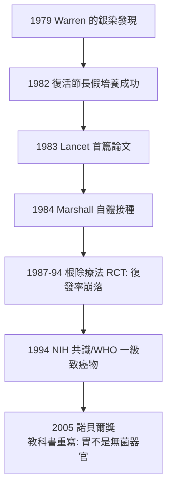

## 1983 - 幽門桿菌（喝下培養液的醫生：消化性潰瘍病因論的地質級翻案）

## 案件摘要

**本案偵破的是「潰瘍是什麼造成的——酸、壓力，還是細菌」。**

1983 年，西澳柏斯的病理學家 Robin Warren 與年輕住院醫生 Barry Marshall 在 *Lancet* 發表：慢性胃炎與消化性潰瘍病人的胃黏膜上，定居著一種此前未知的彎曲桿菌（後命名 *Helicobacter pylori*）。當時的醫學教條斷言「胃酸環境中不可能有細菌定居」——他們看到的多半是「污染」。1984 年，Marshall 喝下一杯純培養的幽門桿菌肉湯，十數天後急性胃炎發作、細菌被從自己的胃裡鑑定出來，再以抗生素自癒。本案的真相是：教科書錯了近百年——**消化性潰瘍的真正兇手是一種細菌，而醫學界花了十餘年、且需要一位醫生拿自己當實驗品，才完成定罪**。2005 年兩人獲諾貝爾生理學或醫學獎。

## 前因 -- 為什麼會有這個案子

- **「無菌之胃」的教條**。1954 年 Palmer 檢視千餘例胃活檢後斷言胃內無細菌存在（檢體被固定技術破壞了細菌）；教科書寫定：胃酸是化學消毒槽，潰瘍成因是「酸與胃蛋白酶的自我消化」。
- **「壓力—酸」範式與其產業**。潰瘍的標準治療是制酸劑、牛奶餐、心理減壓，乃至胃切除手術；1977 年 H2 受體阻斷劑西咪替丁上市（Black，見 `1957-利尿劑與高血壓治療.md` 的受體藥理線），成為史上首批年銷逾十億美元藥物——**整個產業建立在「酸是病因」之上**，翻案等於翻掉搖錢樹。
- **Warren 的顯微鏡線索**。1979 年起，皇家柏斯醫院病理科醫生 J. Robin Warren 在多份胃竇活檢的 Warthin-Starry 染色片上反覆見到彎曲的銀染細菌，且**總是伴隨活動性胃炎**——他在報告上持續註記，卻被同僚視為污染或「無關緊要的隨行者」。
- **Marshall 的加入**。1981 年想找研究題目的住院醫生 Marshall 與 Warren 配對：他們查文獻發現 19 世紀末 Bizzozero 與 Jaworski 已見過胃內螺旋菌、1940 年 Freedberg 與 1975 年 Steer 也曾報告卻遭否認——**線索被系統性忽視了四十年**。

## 線索與推理 -- 數學式、程式、理論

**線索一：培養的關鍵失誤反成突破。** 1982 年復活節長假，培養皿被遺忘在培養箱裡多放了五天——原本按「彎曲桿菌 2–3 天即報陰性」的慣例應丟棄。長假後，平皿上長出白色菌落：**幽門桿菌生長緩慢（需 5–7 天）**，過去所有「培養失敗＝沒有細菌」的陰性結論，可能都只是等得不夠久。

$$ \text{「胃無菌」結論} \propto \text{培養時間上限}^{-1} \quad (\text{方法學的隱含前提}) $$

**線索二：病因關聯的統計。** 1983 年 *Lancet* 首篇論文與後續研究顯示：十二指腸潰瘍病人帶菌率 >90%，慢性胃炎近乎 100%——「找不到例外」的相關性強到不合理：

| 病人族群 | H. pylori 帶菌率 |
|---|---|
| 健康對照（當時西方） | 約 20–50% |
| 慢性活動性胃炎 | ≈ 100% |
| 十二指腸潰瘍 | > 90% |

**線索三：Koch 法則的困境與「自體實驗」的裁定。** 依科赫法則（見 `1876-科赫炭疽桿菌.md`）需要動物模型；但幽門桿菌只感染人與少數靈長類，動物實驗接連失敗，倫理委員會又駁回人體接種申請。Marshall 的選擇：**自己喝**。

```text
1984/7  Marshall 空腹喝下 ~10^9 CFU 幽門桿菌肉湯
第 3 天  晨間噁心、口臭(母親的評語)
第 5-8 天 嘔吐、頭痛、胃鏡: 急性活動性胃炎, 黏膜見螺旋菌
第 14 天 組織學證實帶菌 + 胃炎
隨後     自服替硝唑+..., 痊癒並根除細菌
```

這是歷史上少數以「自我接種」完成科赫第三條（健康個體接種→發病）的案例——倫理上今日絕不可為，卻在當年一錘定音。

**線索四：治療學的終極驗證。** 1990 年代系列試驗確立「三合一根除療法」（質子幫浦抑制劑＋兩種抗生素，見 `1941-青黴素全身治療.md` 的聯合用藥原理）：潰瘍復發率從根除前約 80%/年降到 <5%——**治癒一個病因，疾病就近乎消失**，這是病因論翻案最硬的驗收標準。



## 結案 -- 後果與影響

- **教科書的地質翻轉**。「潰瘍＝酸＋壓力」章節被刪除；胃從「無菌器官」改寫為「具有定居微生物的器官」——微生物組研究的史前里程碑。
- **胃癌的一級預防**。1994 年 WHO 把 H. pylori 列為一級致癌物；帶菌者胃腺癌風險升高數倍，根除治療可顯著降低胃癌發生（日本、韓國的地區性根除計畫）——一次「傳染病式」的癌症防治。
- **制酸藥產業的轉型**。PPIs 未因此衰落（GERD、預防性使用），但「潰瘍 = 需終身制酸」的市場邏輯被拔除；「殺菌後停藥」成為新標準——醫學翻案對產業的殺傷力首次被完整目擊。
- **方法學的教訓**。本案的每一步失誤與翻轉——被否認的顯微鏡觀察、過短的培養時間、被駁回的動物模型、被自己喝掉的倫理障礙——都指向同一件事：**陰性結論的有效性取決於方法的隱含假設**。
- **一句話結案**：幽門桿菌案證明，教科書不是法律，只是**上一輪偵辦的結案報告**——而偵辦程序（科赫法則）本身，也可能需要被偵辦。

## 關鍵人物與文獻

- **J. Robin Warren（1937–2024）**——皇家柏斯醫院病理科醫生；始終強調「我只是反覆看切片、並在報告上誠實註記」。
- **Barry J. Marshall（1951–）**——當年 31 歲的住院醫生；自體實驗後赴美擴展研究，2007 年獲澳洲勳章；名言：「固執與傲慢的差別在於你是否最後拿得出數據。」
- 原始文獻——Warren & Marshall, "Unidentified curved bacilli on gastric epithelium in active chronic gastritis," *Lancet*, 1983；Marshall et al., "Attempt to fulfil Koch's postulates for pyloric Campylobacter," *Med J Aust*, 1985；Helske et al. 與 Hentschel et al. 等根除療法試驗（1987–1994）。
- 現代註腳——2020 年代：H. pylori 耐藥率攀升使根除方案一再升級（四合一含鉍劑）；且 30% 帶菌者菌群的「消失」伴隨 GERD、氣喘等免疫代償假說——兇手定罪了，但它與人類的共生史（逾 5 萬年）仍在改寫判決書的附註。
