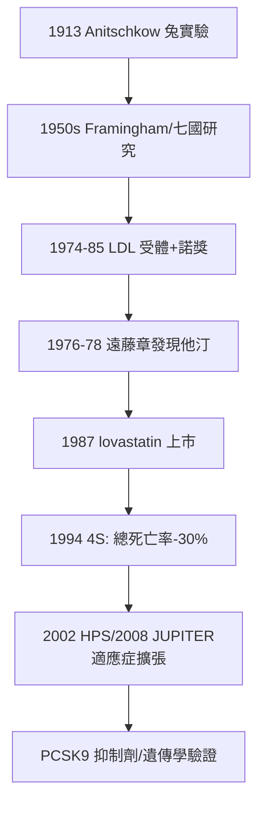

## 1994 - 他汀與 4S 試驗（降膽固醇的世紀之辯：從「膽固醇假說」到「降低死亡率」的硬證據）

## 案件摘要

**本案偵破的是「降膽固醇，到底能不能救命」。**

1994 年 11 月，北歐辛伐他汀存活研究（4S, Scandinavian Simvastatin Survival Study）在 *Lancet* 發表：4,444 名冠心病高膽固醇病人隨機分配接受辛伐他汀或安慰劑，平均追蹤 5.4 年——LDL 降 35%，**總死亡率降 30%**、冠心事件降 42%，無癌症或非心血管死亡的代價。本案的真相是：膽固醇假說自 1913 年提出以來爭訟八十年，歷代降脂藥（煙酸、clofibrate）只降指標不降死亡率；4S 是第一個以他汀把「降脂」翻譯成「救命」的大型 RCT——它同時驗證了受體藥理學（分子設計）、流行病學（危險因子）與 RCT 方法學（見 `1948-鏈黴素RCT.md`）三條線的合流。

## 前因 -- 為什麼會有這個案子

- **膽固醇假說的長途積案**。1913 年 Anitschkow 以純化膽固醇餵兔製造動脈粥狀硬化；1950 年代 Ancel Keys 的七國研究、1955 年以降的 Framingham（見 `1957-利尿劑與高血壓治療.md`）確立膽固醇為冠心病危險因子——但「相關」不等於「降低它就能救命」。
- **第一代降脂藥的敗訴**。1960–80 年代 clofibrate（WHO 試驗 1980：總死亡反而增加）、煙酸、膽酸螯合劑（LRC-CPPT 1984 僅顯示事件微降）——降指標不降命，司法上屢屢敗訴；「膽固醇假說」差點被當成流行病學的冤案。
- **Brown 與 Goldstein 的受體革命**。1974–1985 年，德州二人組闡明 LDL 受體：家族性高膽固醇血症是 LDL 受體缺陷——膽固醇代謝從此有分子級偵辦框架，1985 年獲諾貝爾獎。
- **他汀的化學誕生**。1976 年日本遠藤章自橘青黴分離 compactin（ML-236B），1978 年自紅麴黴分離 lovastatin；默沙東的 Vagelos 團隊開發 lovastatin（1987 上市）與辛伐他汀——**以「假受體」分子騙取 HMG-CoA 還原酶**（磺胺的冒名頂替傳統，見 `1932-多馬克磺胺.md`）。

## 線索與推理 -- 數學式、程式、理論

**線索一：分子級的冒名頂替。** 他汀結構模擬 HMG-CoA 還原酶的受質，競爭性佔據活性位：

$$ \text{HMG-CoA} \xrightarrow{\text{還原酶}} \text{mevalonate} \Rightarrow \text{膽固醇} \quad ; \quad K_i(\text{他汀}) \sim 10^{-9} M $$

且肝臟為補償被抑制的合成而**上調 LDL 受體**——血流中的 LDL 被加速回收，降脂效果遠超第一代藥。

**線索二：4S 的偵辦規格。** 雙盲、安慰劑對照、多中心（北歐 94 個中心）、硬終點（總死亡率）、預設中止規則：

```python
# 4S 試驗摘要 (n=4444, 1994)
ldl_drop      = 0.35            # LDL -35%
total_mortality_rr = 0.70       # 總死亡 RR 0.70 (p=0.0003)
chd_events_rr = 0.58            # 冠心事件 RR 0.58
non_cardio_death  = "無增加"     # 排除「以其他死法抵帳」的疑慮
# 偵辦結論: 降膽固醇 = 救命 (至少在此人群中)
```

$$ \text{NNT} \approx \frac{1}{0.30 \times 0.084} \approx 40 \text{（5 年內每救 1 命需治 40 人）} $$

**線索三：為何 4S 能翻案而 clofibrate 不能？** 三項差異：

| 條件 | clofibrate（WHO, 1980） | 4S（1994） |
|---|---|---|
| 藥效強度 | 降脂微弱 | LDL -35% |
| 終點 | 總死亡（非預設的亞組爭議） | 總死亡（預設主終點） |
| 機制 | 不明 | 受體藥理＋上游酶抑制 |

教訓：**「越靠近因果鏈上游的分子靶點＋越嚴格的終點設計」＝越可信的因果翻案**。

**線索四：隨後的連環驗證。** WOSCOPS（1995，一級預防）、CARE/LIPID（1996，正常膽固醇的冠心病人）、HPS（2002，2 萬人、糖尿病與老人）、JUPITER（2008，CRP 高而 LDL 正常）——他汀的適應症像同心圓般擴張；Mendelian randomization 遺傳學研究（PCSK9 功能缺失突變者終生 LDL 低、心疾風險低）以「自然實驗」形式再驗證因果方向。



## 結案 -- 後果與影響

- **他汀成為史上處方量最大的藥物家族之一**。數億人長期服藥；冠心病死亡率的半世紀下降中，他汀與降壓藥（見 `1957-利尿劑與高血壓治療.md`）並列兩大推手。
- **「危險因子醫學」的完全體**。治療對象從「病人」擴展到「未來病人」——一級預防成為內科日常，也引出過度治療與絕對風險 vs 相對風險的持續辯論（NNT 概念因此普及）。
- **藥廠模式的巔峰與反思**。4S 的商業成功（Zocor 年銷逾 40 億美元）證明「以 RCT 購買適應症」的投資邏輯；2004 年 Vioxx 撤市等事件隨即提醒：同一套引擎也需要煞車系統。
- **一句話結案**：4S 的歷史意義不在「他汀有效」，而在**三種證據（分子機制、流行病學、RCT）首次在同一案件中互為印證**——內科的因果推理從此是「三重鎖」結構。

## 關鍵人物與文獻

- **Michael S. Brown 與 Joseph L. Goldstein**——LDL 受體闡明者，1985 年諾貝爾生理學或醫學獎（兩人為終生合作搭檔）。
- **Akira Endo（遠藤章，1935–2024）**——三共製藥研究員，他汀之父；被稱為「拯救最多生命的日本人」之一，晚年在紐約的辦公室裡仍貼著青黴培養皿照片。
- **Terje Pedersen**——挪威心臟科醫生，4S 主持人；其動機之一是父親死於心臟病。
- 原始文獻——Scandinavian Simvastatin Survival Study Group, "Randomised trial of cholesterol lowering in 4444 patients with coronary heart disease: the Scandinavian Simvastatin Survival Study (4S)," *Lancet*, 1994。
- 現代註腳——PCSK9 抑制劑（2015 上市）與英克司蘭（siRNA，2020）把 LDL 再往下壓，且遺傳學證據顯示「LDL 暴露量 × 時間」是動脈粥狀硬化的積分——膽固醇假說的世紀訴訟，以分子遺傳學的驗屍報告定讞。
