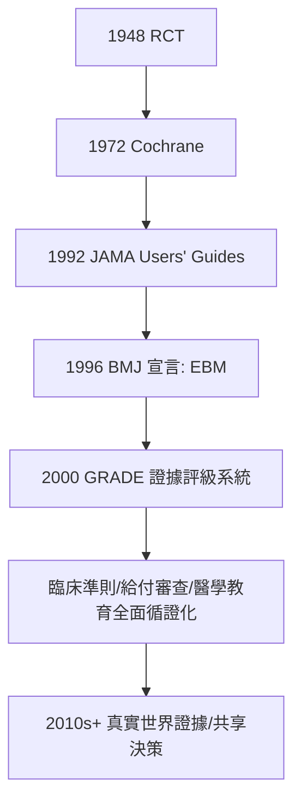

## 1996 - 循證醫學（薩基特的宣言：證據等級成為內科的新憲法）

## 案件摘要

**本案偵破的是「醫生的判斷，到底該以什麼為準」。**

1996 年，Gordon Guyatt、David Sackett 與 McMaster 大學的 Evidence-Based Medicine Working Group 在 *BMJ* 發表《Evidence based medicine: what it is and what it isn't》，正式把「循證醫學（EBM）」定義為：「**審慎、明確、明智地使用當前最佳的證據，來決定個別病人的照護**」，並強調它必須與臨床專業、病人價值觀三者整合。同時期 ACP Journal Club（1991 創刊）與 *Evidence-Based Medicine* 期刊（1996 創刊）把「已篩選的證據摘要」送到基層醫生桌上。本案的真相是：EBM 不是新發現，而是一次**司法制度的整編**——把 1948 年的 RCT（見 `1948-鏈黴素RCT.md`）與 1972 年的科克倫判決書（見 `1972-科克倫效能與效率.md`）升格為內科的日常執法程序。

## 前因 -- 為什麼會有這個案子

- **教科書與專家的信任危機**。1980–90 年代系統性研究發現：教科書建議中僅少數有 RCT 支持；專家意見與隨機試驗結論的衝突屢見不鮮（如早期乳癌手術範圍、胃潰瘍飲食療法）；「年度重印即過時」的教科書模式失靈。
- **文獻爆炸與閱讀能力落差**。Medline 上每年新增數十萬篇論文，基層醫生不可能自行檢索判讀；且醫學院幾乎不教批判性評讀（critical appraisal）。
- **McMaster 的實驗教育**。1969 年起 McMaster 以問題導向學習（PBL）聞名；Guyatt 等把「先提臨床問題、再找證據、再評讀、再應用」內化為住院醫師訓練——最初於 1992 年在 *JAMA* 發表系列論文（「Users' Guides to the Medical Literature」）。
- **前身的名稱之爭**。Guyatt 最初想稱「scientific medicine」，被同僚譏為「其他醫學都不科學嗎？」；「evidence-based」一詞於 1990 年 McMaster 住院醫師計畫文件中誕生，1996 年登堂入室。

## 線索與推理 -- 數學式、程式、理論

**線索一：證據金字塔的立法。** EBM 把研究設計依「偏誤抵抗度」排成階梯：

| 等級 | 證據類型 | 偏誤控制 |
|---|---|---|
| 頂 | 系統性回顧／meta 分析 | 跨試驗彙整，樣本最大 |
| ↑ | RCT（尤其多中心雙盲） | 隨機化＋盲法 |
| → | 隊列研究 | 觀察性，控制已知混雜 |
| ↓ | 病例對照 | 回溯性，易有回憶偏誤 |
| 底 | 病例報告／專家意見 | 最易受選擇與敘事偏誤 |

**線索二：EBM 的五步流程（偵辦 SOP）。**

```python
# EBM 五步驟 (1996 定型)
def evidence_based_practice(patient):
    q = ask(patient)                       # 1. 提出可回答的臨床問題(PICO)
    ev = search(q)                         # 2. 檢索最佳證據
    app = appraise(ev)                     # 3. 批判性評讀(真/重要/可應用?)
    d  = integrate(app, doctor.skill, patient.values)  # 4. 三方整合
    act(d); audit(d)                       # 5. 執行並稽核
    return d
```

第四步是本案的關鍵條款：**證據不是判決書，而是呈堂證供**——最終裁量權仍在醫病對話中。

**線索三：量化指標的新語言。** EBM 普及了 NNT、NNH、ARR、RRR 與 Likelihood Ratio：

$$ \text{NNT} = \frac{1}{\text{ARR}} = \frac{1}{\text{風險}_{對照} - \text{風險}_{治療}} $$

這組語言把「治療 X 降低 50% 風險」翻譯成「治 100 人救 2 人」——相對風險的修辭陷阱自此有了解藥。

**線索四：與 Cochrane、準則的合流。** 1993 年 Cochrane Collaboration（見 `1972-科克倫效能與效率.md`）提供證據的「檢察總署」，1996 EBM 提供「訴訟程序」，各國臨床準則（1977 年 JNC 的後代，見 `1957-利尿劑與高血壓治療.md`）提供「量刑指南」——三件套在 1990 年代末合流。



## 結案 -- 後果與影響

- **醫學教育重寫**。批判性評讀成為必修；住院醫師晨會從「主治醫師的軼事」變成「期刊俱樂部」——Sackett 名言：「EBM 是讓實習醫生也能質疑大教授的工具。」
- **準則與給付的循證化**。NICE（1999）、Cochrane、GRADE（2004 定名）使醫療給付與準則須附證據等級——醫療資源的分配第一次有了可稽核的推理鏈。
- **反彈與修正（本案的內部上訴）**。批評者指出：RCT 過度涵蓋「平均病人」而忽視個體異質性；「病人價值觀」常淪為口號；藥廠學會資助「循證外觀」的研究。2010 年代的回應：真實世界證據、精準醫學、共享決策（shared decision making）——EBM 從金字塔修正為「證據＋專業＋價值」的三腳凳。
- **Sackett 的臨終示範**。2015 年 Sackett 死於軟骨肉瘤，生前發表〈Departing Advice〉：拒絕療效不明的化療、以 EBM 的清醒面對自己的死亡——本案的偵探最後一次出庭，被告是他自己。
- **一句話結案**：1996 年的立法本質是**把「這樣治是因為大家都這樣治」定為違憲**——內科從此必須回答：你的證據是幾級？

## 關鍵人物與文獻

- **Gordon Guyatt（1953–）**——McMaster 內科教授，EBM 一詞的命名者；後領導 GRADE 評級系統。
- **David L. Sackett（1934–2015）**——臨床流行病學之父、牛津循證醫學中心創辦人；1997 年辭去牛津講席，把資助讓給需研究者，騎摩托車返加拿大行醫於基層。
- **Evidence-Based Medicine Working Group**——Guyatt、Sackett、Brian Haynes、Peter Tugwell 等，JAMA 系列與 BMJ 宣言的集體作者。
- 原始文獻——Guyatt, Cairns, Churchill et al., "Evidence-based medicine: a new approach to teaching the practice of medicine," *JAMA*, 1992；Sackett & Rosenberg, "On the need for evidence-based medicine," *J Public Health Med*, 1995；Sackett et al., "Evidence based medicine: what it is and what it isn't," *BMJ*, 1996。
- 現代註腳——2020 年代，AI 輔助的即時證據檢索與 chatbot 判讀正在把「五步驟」壓縮成一個對話框；但「第 4 步整合」——把證據、專業與病人生命觀放上天平——仍是任何演算法都無法代勞的人類法庭程序。
