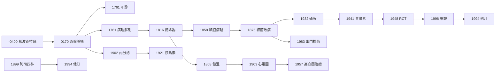

# 內科的歷史：從體液學說、床邊偵探術、細菌獵人，到藥理革命與循證時代

> 本書以「推理探案」的體例，為內科（Internal Medicine）史上的每個關鍵事件寫一篇 wiki：
> 謎題是什麼（病人的徵狀、醫學的盲點）？偵探是誰（醫生、化學家、統計學家）？線索與推理是什麼？
> 每篇檔名以年份開頭（4 位數，西元前以 `-` 負數表示）。

## 雙線主軸

| 線 | 演變 |
|---|---|
| **診斷偵探線** | 觀察與預後 → 體液判讀 → 脈搏與體溫的量化 → 叩診、聽診、病理解剖、顯微鏡、X 光、心電圖 → 實驗室與影像 |
| **病因與治療線** | 體液失衡 → 發酵說 → 細菌致病說 → 抗血清 → 化學治療 → 抗生素 → 受體藥理 → 賀爾蒙與受體阻斷 → 循證醫學 |

---

## 年表（非常詳細版）

### 第一篇：床邊偵探術的起源——古希臘到蓋倫

| 年份 | 事件 | 意義 | wiki |
|---|---|---|---|
| 約前 400 | 希波克拉底學派：觀察、聽胸語音（以耳貼胸）、預後學；四體液學說成型 | 內科從神廟走向床邊 | [-0400-希波克拉底與體液學說](-0400-希波克拉底與體液學說.md) |
| 約 150 | 蓋倫：脈搏作為診斷工具；體液病理學集大成；放血療法體系化 | 一人統治醫學 1500 年 | [0170-蓋倫脈搏診斷](0170-蓋倫脈搏診斷.md) |
| 前 3–13 世紀 | 中世紀阿拉伯醫學（Avicenna《醫典》）、歐洲經院醫學延續蓋倫體系 | 權威文本取代床邊觀察 | [0170-蓋倫脈搏診斷](0170-蓋倫脈搏診斷.md) |

### 第二篇：身體的物理學——叩診、聽診、病理解剖

| 年份 | 事件 | 意義 | wiki |
|---|---|---|---|
| 1761 | 奧恩布魯格出版《以叩胸診斷人體內部疾病的新發現》，被冷落 47 年 | 第一個把胸腔當鼓打的偵探 | [1761-奧恩布魯格叩診](1761-奧恩布魯格叩診.md) |
| 1761 | 莫爾加尼出版《論身體的座位與原因》：症狀要回到器官病灶找答案 | 病理解剖學（器官病理學）誕生 | [1761-莫爾加尼病理解剖](1761-莫爾加尼病理解剖.md) |
| 1816 | 雷奈克發明聽診器，出版《間接聽診法》 | 心肺的直接聲紋證據 | [1816-雷奈克聽診器](1816-雷奈克聽診器.md) |
| 1858 | 菲爾紹出版《細胞病理學》：疾病是細胞的事件 | 從器官下探到細胞 | [1858-菲爾紹細胞病理學](1858-菲爾紹細胞病理學.md) |
| 1868 | 溫德利希《論病程中的體溫與其後果》：體溫計進入病房 | 內科第一個常規量化指標 | [1868-溫德利希體溫計](1868-溫德利希體溫計.md) |
| 1903 | 愛因托芬弦線電流計：心臟電活動成為曲線 | 心電圖問世，1924 諾獎 | [1903-愛因托芬心電圖](1903-愛因托芬心電圖.md) |

### 第三篇之前：藥物化學的先聲

| 年份 | 事件 | 意義 | wiki |
|---|---|---|---|
| 1899 | 拜耳上市乙醯水楊酸 Aspirin（機制 1971 年才由 Vane 解明） | 合成藥物時代的頭號長青商品 | [1899-阿司匹林](1899-阿司匹林.md) |

### 第三篇：看不見的兇手——細菌致病說與傳染病

| 年份 | 事件 | 意義 | wiki |
|---|---|---|---|
| 1876 | 科赫以炭疽桿菌完成病原體證明（後世稱科赫法則） | 細菌致病說的第一次「定罪」 | [1876-科赫炭疽桿菌](1876-科赫炭疽桿菌.md) |
| 1882 | 科赫發現結核桿菌，駁倒「結核是遺傳病」 | 世紀之疾現形 | [1882-科赫結核桿菌](1882-科赫結核桿菌.md) |

### 第四篇：身體的化學——內分泌與代謝

| 年份 | 事件 | 意義 | wiki |
|---|---|---|---|
| 1902 | 貝利斯與史達林發現促胰液素，提出「hormone」概念 | 內分泌學誕生，化學信使加入醫學 | [1902-促胰液素與內分泌學](1902-促胰液素與內分泌學.md) |
| 1921 | 班廷與貝斯特提取胰島素，昏迷糖尿病童起死回生 | 第一個賀爾蒙療法的戲劇性勝利 | [1921-胰島素](1921-胰島素.md) |

### 第五篇：藥物革命——磺胺、抗生素、受體藥理

| 年份 | 事件 | 意義 | wiki |
|---|---|---|---|
| 1932 | 多馬克發現磺胺 Prontosil（1939 諾獎） | 第一類全身性抗菌化療藥 | [1932-多馬克磺胺](1932-多馬克磺胺.md) |
| 1941 | 青黴素首次用於病人（Albert Alexander），1940s 量產 | 抗生素黃金時代開幕 | [1941-青黴素全身治療](1941-青黴素全身治療.md) |
| 1957 | 氯苯蝶啶／thiazide 排鈉利尿劑問世，高血壓從「必治之疾的觀望」變成「終身服藥」 | 慢性病藥理治療的範式轉移 | [1957-利尿劑與高血壓治療](1957-利尿劑與高血壓治療.md) |
| 1994 | 4S 試驗證實他汀降低心肌梗塞與總死亡率 | 受體藥理＋RCT 的冠軍組合 | [1994-他汀與4S試驗](1994-他汀與4S試驗.md) |

### 第六篇：方法論革命——隨機對照與循證醫學

| 年份 | 事件 | 意義 | wiki |
|---|---|---|---|
| 1948 | 英國醫學研究理事會鏈黴素治肺結核試驗：第一個現代 RCT | 隨機分配成為最高證據 | [1948-鏈黴素RCT](1948-鏈黴素RCT.md) |
| 1972 | 科克倫《效能與效率》批判醫學未用統計證據 | 循證醫學的思想先聲 | [1972-科克倫效能與效率](1972-科克倫效能與效率.md) |
| 1996 | 薩基特在 BMJ 定義 Evidence-Based Medicine | 循證醫學成為內科新憲法 | [1996-循證醫學](1996-循證醫學.md) |

### 第七篇：推翻教科書的臨床偵探——幽門桿菌

| 年份 | 事件 | 意義 | wiki |
|---|---|---|---|
| 1983 | 瓦倫與馬歇爾報告幽門彎曲菌；1985 年馬歇爾喝下培養菌自證 | 潰瘍病因論的地質級翻案，2005 諾獎 | [1983-幽門桿菌](1983-幽門桿菌.md) |

---

## 閱讀路線建議

## 理論工具箱（各 wiki 反覆出現的理論）

- **體液論**：血液、黏液、黃膽汁、黑膽汁；疾病＝失衡。醫學史上壽命最長的假說（約 2400 年）。
- **蓋倫主義**：權威文本取代觀察；放血、淨化、脈搏細判。
- **器官／細胞病理學**：疾病有「座位」（locus）——從器官到細胞層級下探。
- **細菌致病說**：特定病原造成特定疾病，可用科赫法則定罪。
- **化學治療與受體理論**：藥物以化學鑰匙選擇性結合靶點（Ehrlich：Corpora non agunt nisi fixata）。
- **受體藥理學**：阻斷劑（β 阻斷劑、H2 阻斷劑、他汀的 HMG-CoA 還原酶抑制）——把鑰匙孔堵住的治療學。
- **RCT 方法學**：隨機化消除選擇偏誤、雙盲消除觀察者偏誤、死亡率等硬終點取代「看起來好多了」。

## 一句話總綱

內科兩千年的歷史，是「偵辦手法」的升級史：從看氣色、摸脈搏、聞尿味，到敲打胸腔、聽心音、量體溫、拍心電圖；從「病人的敘事」到「病理切片」，再到「細菌培養」「受體結合曲線」，最後到「隨機對照試驗的 p 值」。**偵探沒變，變的是證據標準。**
