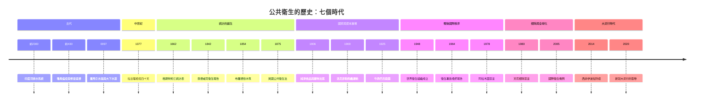

# 公共衛生的歷史

> **一本書讀完人類如何學會「讓一整群人不生病」**——
> 從四千五百年前的排水溝，到全世界同時戴起口罩的那一年。
> 公共衛生的本質只有一句話：**當一個人生病，是醫學的案子；當一整個城市生病，是公共衛生的案子。**

本書採「推理探案」體：每一篇都是一樁案件——**疫病是兇手，而公共衛生是偵探**。
偵探沒有顯微鏡也要破案（切斷傳播鏈不需知道病原體）、沒有疫苗也要救人（隔離、檢疫、乾淨的水）、
沒有權力也要說服（數據、地圖、死亡統計表）。

---

## 雙線主軸

公共衛生史有兩條互相纏繞的主軸，貫穿全書 18 案：

| 主軸 | 核心問題 | 代表案件 |
|---|---|---|
| **A 線：環境與工程的衛生** | 「如何讓致病物質遠離人？」——排水、供水、下水道、食物、空氣 | 印度河排水系統、羅馬引水渠、查德威克報告、牛奶巴氏殺菌、純淨食品法案 |
| **B 線：傳染病防治與流行病學** | 「如何在不知道病原體的情況下擋住瘟疫？」——檢疫、統計、地圖、接種、根除、通報 | 雅典瘟疫、拉古薩檢疫、格朗特死亡表、布羅德街水泵、天花根除、伊波拉、新冠 |

兩條線在 1842–1854 年間交會：**查德威克**（A 線）與 **Snow**（B 線）
同時在倫敦作戰，卻分屬瘴氣論陣營的兩端——這是本書戲劇張力最強的篇章。

---

## 歷史年表（按時代分篇）

### 第一篇：古代——都市密度就是糞便問題（約前 2600 – 500）

| 年份 | 事件 | 意義 | wiki 連結 |
|---|---|---|---|
| 約前 2600–前 1900 | 印度河文明（摩亨佐-達羅、哈拉巴）建造街道排水溝、家庭浴室、磚砌水井與覆蓋式下水道 | 最早的市政衛生工程：無文字的文明用磚頭回答了「都市密度=糞便問題」 | [-2300-印度河排水系統.md](-2300-印度河排水系統.md) |
| 約前 2000–前 1450 | 克里特克諾索斯宮殿使用陶管輸水與沖水式廁所 | 青銅時代的水利工程巔峰，與印度河文明互相印證 | [-2300-印度河排水系統.md](-2300-印度河排水系統.md) |
| 前 430 | 雅典大瘟疫爆發，修昔底德親身記載 | 最早的疫病臨床觀察文獻；「罹病倖存者照護病人最無懼」是免疫經驗的第一次紀錄 | [-0430-雅典瘟疫.md](-0430-雅典瘟疫.md) |
| 前 312 起 | 羅馬開始建造引水渠（Aqua Appia 起共 11 條） | 「水的帝國」：每天輸水上百萬立方公尺進羅馬城 | [0097-羅馬引水渠與下水道.md](0097-羅馬引水渠與下水道.md) |
| 約前 6 世紀–前 2 世紀 | Cloaca Maxima 大下水道建成並持續擴建 | 西方世界用了兩千年的下水道；帝國崩潰後即失傳 | [0097-羅馬引水渠與下水道.md](0097-羅馬引水渠與下水道.md) |

### 第二篇：中世紀——檢疫的發明（541 – 1500）

| 年份 | 事件 | 意義 | wiki 連結 |
|---|---|---|---|
| 1348 | 黑死病抵達威尼斯；威尼斯設立公共卫生三執政 | 城市第一次把「防疫」變成常設行政職位 | [1377-拉古薩檢疫四十天.md](1377-拉古薩檢疫四十天.md) |
| 1377 | 拉古薩（杜布羅夫尼克）首創 trentino——來自疫區者隔離三十天 | 世界上第一條系統性檢疫法規 | [1377-拉古薩檢疫四十天.md](1377-拉古薩檢疫四十天.md) |
| 約 1400s | 隔離期延長為 quaranta giorni（四十天），quarantine 詞源誕生 | 檢疫的流行病學邏輯：切斷傳播鏈不需知道病原體 | [1377-拉古薩檢疫四十天.md](1377-拉古薩檢疫四十天.md) |
| 1468 | 威尼斯設常設衛生委員會；lazaretto（檢疫島）體系成熟 | 中世紀城市衛生行政的最高峰 | [1377-拉古薩檢疫四十天.md](1377-拉古薩檢疫四十天.md) |

### 第三篇：統計的誕生——死亡變成數字（1662 – 1875）

| 年份 | 事件 | 意義 | wiki 連結 |
|---|---|---|---|
| 97 | Frontinus 出任羅馬水務官，著《論羅馬水道》 | 對羅馬供水體系最完整的古代紀錄；工程與法律的雙重治理 | [0097-羅馬引水渠與下水道.md](0097-羅馬引水渠與下水道.md) |
| 1662 | John Graunt 出版《Natural and Political Observations upon the Bills of Mortality》 | 第一張生命表；統計成為公共衛生的眼睛 | [1662-格朗特死亡統計表.md](1662-格朗特死亡統計表.md) |
| 1693 | Edmond Halley 發表布雷斯勞壽命表 | 受 Graunt 啟發，現代精算與人口學的起點 | [1662-格朗特死亡統計表.md](1662-格朗特死亡統計表.md) |
| 1796 | Jenner 牛痘接種實驗成功 | 疫苗的概念誕生，為 180 年後的天花根除埋下種子 | [../生理醫學史/1796-Jenner牛痘接種.md](../生理醫學史/1796-Jenner牛痘接種.md) |
| 1834 | 英國《濟貧法修正案》 | 查德威克由此崛起；「貧窮=行政問題」的政府哲學 | [1842-查德威克衛生報告.md](1842-查德威克衛生報告.md) |
| 1842 | 查德威克《勞動人口衛生狀況報告》出版 | 「疾病比下水道更花錢」：以成本效益論證說服國家介入衛生 | [1842-查德威克衛生報告.md](1842-查德威克衛生報告.md) |
| 1847 | Semmelweis 以洗手使產褥熱死亡率從 18% 降到 1% | 醫院內的第一場流行病學實證 | [../生理醫學史/1847-Semmelweis洗手.md](../生理醫學史/1847-Semmelweis洗手.md) |
| 1848 | 英國《公共衛生法》與衛生總署成立 | 國家第一次以法律承擔人民的健康 | [1842-查德威克衛生報告.md](1842-查德威克衛生報告.md) |
| 1854 | 布羅德街水泵事件：Snow 的死亡地圖與關泵 | 空間流行病學誕生；擊敗瘴氣論 | [1854-布羅德街水泵.md](1854-布羅德街水泵.md) |
| 1858 | Snow 發表霍亂地圖的完整版；倫敦開始改建下水道 | 現代流行病學的開山文獻 | [1854-布羅德街水泵.md](1854-布羅德街水泵.md) |
| 1864 | 巴斯德天鵝頸實驗；巴氏殺菌法問世 | 食品安全的科學基礎 | [1925-牛奶巴氏殺菌.md](1925-牛奶巴氏殺菌.md) |
| 1866 | 倫敦東區霍亂爆發，Snow 的水源理論獲最終驗證（William Farr 自己的數據也倒向他） | 瘴氣論在數據面前投降 | [1854-布羅德街水泵.md](1854-布羅德街水泵.md) |
| 1875 | 英國《Public Health Act》整合全部衛生法規 | 現代公共衛生法的範本：衛生官員、下水道、水質、住房、食品一網打盡 | [1875-英國公共衛生法.md](1875-英國公共衛生法.md) |

### 第四篇：國家與資本進場（1876 – 1947）

| 年份 | 事件 | 意義 | wiki 連結 |
|---|---|---|---|
| 1882 | Koch 發現結核桿菌 | 細菌理論確立，公共衛生有了「指認兇手」的顯微鏡 | [../生理醫學史/1882-Koch結核桿菌.md](../生理醫學史/1882-Koch結核桿菌.md) |
| 1898 | 美西戰爭腐肉醜聞 | 食品安全的政治引爆點 | [1906-純淨食品與藥物法案.md](1906-純淨食品與藥物法案.md) |
| 1902–1907 | Harvey Wiley 的「毒藥隊」人體試驗 | 以志願者吃硼砂的實驗直接推動立法 | [1906-純淨食品與藥物法案.md](1906-純淨食品與藥物法案.md) |
| 1906 | 《The Jungle》出版 + 美國《Pure Food and Drug Act》通過 | 食品安全治理的誕生 | [1906-純淨食品與藥物法案.md](1906-純淨食品與藥物法案.md) |
| 1907 | 傷寒瑪麗 Mary Mallon 首度被隔離 | 第一個被確認的無症狀帶原者案例；個人自由與公共安全的經典衝突 | [1925-牛奶巴氏殺菌.md](1925-牛奶巴氏殺菌.md) |
| 1909 | 洛克菲勒衛生委員會啟動南方鉤蟲運動 | 慈善資本大規模投入公共衛生的範式 | [1909-洛克菲勒鉤蟲運動.md](1909-洛克菲勒鉤蟲運動.md) |
| 1913 | 洛克菲勒基金會成立；其後 International Health Board 擴及全球 | 「垂直計畫」時代的開端 | [1909-洛克菲勒鉤蟲運動.md](1909-洛克菲勒鉤蟲運動.md) |
| 1916 | Johns Hopkins 公共衛生學院成立（美國第一所） | 公共衛生成為一門大學學科 | [1909-洛克菲勒鉤蟲運動.md](1909-洛克菲勒鉤蟲運動.md) |
| 1918 | 大流感全球爆發，死亡 5,000 萬以上 | 現代大流行防疫的第一次總動員 | [../生理醫學史/1918-大流感.md](../生理醫學史/1918-大流感.md) |
| 1920s–1930s | 美國各城市陸續強制牛奶巴氏殺菌 | 乳牛結核與傷寒經由牛奶傳播的時代結束 | [1925-牛奶巴氏殺菌.md](1925-牛奶巴氏殺菌.md) |

### 第五篇：戰後國際秩序——健康是權利（1948 – 1979）

| 年份 | 事件 | 意義 | wiki 連結 |
|---|---|---|---|
| 1948-04-07 | WHO 憲章生效；4 月 7 日成為世界衛生日 | 「健康是身體、心理與社會的完全安適狀態」的定義革命 | [1948-世界衛生組織成立.md](1948-世界衛生組織成立.md) |
| 1948-07-05 | 英國 NHS 成立 | 同年雙響：國家的免費醫療體系誕生 | [1948-世界衛生組織成立.md](1948-世界衛生組織成立.md) |
| 1955 | WHO 啟動全球瘧疾根除計畫 | 失敗的教訓：沒有基層系統的垂直計畫撐不住 | [1978-阿拉木圖宣言.md](1978-阿拉木圖宣言.md) |
| 1964-01-11 | 美國衛生署長《Smoking and Health》報告 | 7,000 篇文獻的系統回顧判定吸菸致肺癌；Hill 因果準則的教科書案例 | [1964-衛生署長吸菸報告.md](1964-衛生署長吸菸報告.md) |
| 1965–1970 | 警示標語（1965）到廣告禁令（1970） | 流行病學證據轉譯為法律管制的雙軌模式 | [1964-衛生署長吸菸報告.md](1964-衛生署長吸菸報告.md) |
| 1967 | WHO 天花根除強化計畫啟動（D.A. Henderson 主導） | ring vaccination 策略取代大規模接種 | [1980-天花根除宣言.md](1980-天花根除宣言.md) |
| 1978-09 | 阿拉木圖宣言：「Health for All by 2000」 | 初級衛生照護（PHC）成為全球政策綱領；中國赤腳醫生的經驗被寫進宣言 | [1978-阿拉木圖宣言.md](1978-阿拉木圖宣言.md) |

### 第六篇：根除與全球化——勝利與新威脅（1980 – 2004）

| 年份 | 事件 | 意義 | wiki 連結 |
|---|---|---|---|
| 1980-05-08 | WHO 正式宣告天花根除 | 人類歷史上唯一被根除的人類疾病 | [1980-天花根除宣言.md](1980-天花根除宣言.md) |
| 1981 | CDC 報告第一群愛滋病例 | 全球化時代的新傳染病時代開啟 | [../性病的歷史/1981-CDC報告與愛滋降臨.md](../性病的歷史/1981-CDC報告與愛滋降臨.md) |
| 2003 | SARS 危機：中國延遲通報導致全球擴散 | 暴露 IHR (1969) 舊條例的致命缺陷 | [2005-國際衛生條例.md](2005-國際衛生條例.md) |

### 第七篇：全球衛生治理與大流行時代（2005 – 2026）

| 年份 | 事件 | 意義 | wiki 連結 |
|---|---|---|---|
| 2005 | WHO 通過《International Health Regulations (2005)》 | 24 小時通報 PHEIC；全球衛生治理的法律骨架 | [2005-國際衛生條例.md](2005-國際衛生條例.md) |
| 2009 | H1N1 宣布為 PHEIC | IHR 首次大考；「過度反應」的批評 | [2005-國際衛生條例.md](2005-國際衛生條例.md) |
| 2014–2016 | 西非伊波拉疫情：28,000+ 病例、11,000+ 死 | 弱衛生系統＋喪葬儀式＋都市化的三重風暴；MSF 前線 | [2014-西非伊波拉防疫.md](2014-西非伊波拉防疫.md) |
| 2015 | 幾內亞 rVSV-ZEBOV 環狀接種試驗 | ring vaccination 的數學在實戰中驗證（疫苗有效性約 100%） | [2014-西非伊波拉防疫.md](2014-西非伊波拉防疫.md) |
| 2018 | 阿斯塔納宣言續約初級衛生照護 | 阿拉木圖 40 週年的政策續約 | [1978-阿拉木圖宣言.md](1978-阿拉木圖宣言.md) |
| 2020–2023 | COVID-19 大流行：封城、口罩、快篩、mRNA 疫苗（11 個月） | 人類史上最大規模的公共衛生總動員；超額死亡成為終局裁判 | [2020-新冠大流行的公共衛生答卷.md](2020-新冠大流行的公共衛生答卷.md) |

---

## 全書時間軸

---

## 章節目錄

### 第一篇：古代——都市密度就是糞便問題
1. [-2300-印度河排水系統](-2300-印度河排水系統.md) —— 四千五百年前的下水道：最早的市政衛生誕生於無文字的文明
2. [-0430-雅典瘟疫](-0430-雅典瘟疫.md) —— 修昔底德的觀察：戰爭擁擠如何壓垮民主雅典
3. [0097-羅馬引水渠與下水道](0097-羅馬引水渠與下水道.md) —— 水的帝國：Cloaca Maxima 與瘴氣論的市政應用

### 第二篇：中世紀——檢疫的發明
4. [1377-拉古薩檢疫四十天](1377-拉古薩檢疫四十天.md) —— quarantine 的誕生：不知道病原體也能切斷傳播鏈

### 第三篇：統計的誕生——死亡變成數字
5. [1662-格朗特死亡統計表](1662-格朗特死亡統計表.md) —— 倫敦死亡表：統計是公共衛生的眼睛
6. [1842-查德威克衛生報告](1842-查德威克衛生報告.md) —— 「疾病比下水道更花錢」：以成本效益說服國家
7. [1854-布羅德街水泵](1854-布羅德街水泵.md) —— Snow 的死亡地圖：空間流行病學誕生
8. [1875-英國公共衛生法](1875-英國公共衛生法.md) —— 國家對健康的責任：自由放任的終結

### 第四篇：國家與資本進場
9. [1906-純淨食品與藥物法案](1906-純淨食品與藥物法案.md) —— 《The Jungle》與毒藥隊：食品安全治理的誕生
10. [1909-洛克菲勒鉤蟲運動](1909-洛克菲勒鉤蟲運動.md) —— 慈善資本進場：赤腳與戶外便溺的行為革命
11. [1925-牛奶巴氏殺菌](1925-牛奶巴氏殺菌.md) —— 傷寒瑪麗與生乳之戰：食品供應鏈風險管理

### 第五篇：戰後國際秩序——健康是權利
12. [1948-世界衛生組織成立](1948-世界衛生組織成立.md) —— 「完全安適」的定義革命與 NHS 同年雙響
13. [1964-衛生署長吸菸報告](1964-衛生署長吸菸報告.md) —— 7,000 篇文獻對決菸草業：因果準則的實戰
14. [1978-阿拉木圖宣言](1978-阿拉木圖宣言.md) —— 赤腳醫生啟發的「Health for All」

### 第六篇：根除與全球化
15. [1980-天花根除宣言](1980-天花根除宣言.md) —— 環狀接種的數學：唯一被根除的人類疾病
16. [2005-國際衛生條例](2005-國際衛生條例.md) —— SARS 之後：PHEIC、通報與主權的張力

### 第七篇：大流行時代
17. [2014-西非伊波拉防疫](2014-西非伊波拉防疫.md) —— 文化、葬禮與環狀接種：公衛人類學的價值
18. [2020-新冠大流行的公共衛生答卷](2020-新冠大流行的公共衛生答卷.md) —— 超額死亡作為終局裁判：後疫情的教訓清單

---

## 姊妹書連結

- [生理醫學史](../生理醫學史/README.md)——實驗室裡的偵探：細菌理論、疫苗、DNA
- [性病的歷史](../性病的歷史/README.md)——最古老也最被汙名化的傳染病史
- [手術的歷史](../手術的歷史/README.md)——無菌革命與麻醉：外科如何變得安全
