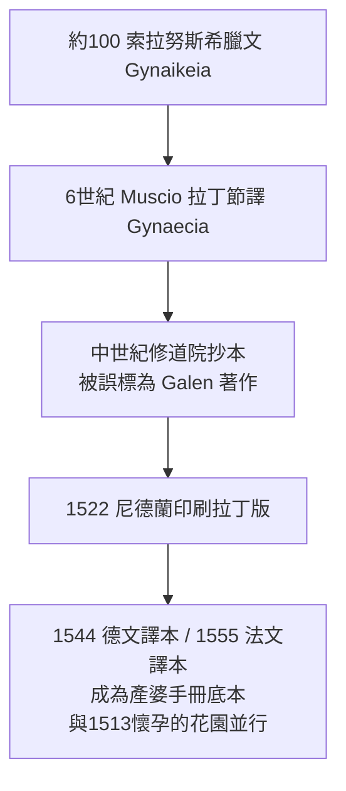

## 100 - 索拉努斯《論產婦疾病》（古代產科學的最高峰）

## 案件摘要

**本案偵破的是：在沒有麻醉、沒有消毒、沒有任何影像的古代，一個人如何僅憑雙手與觀察，寫出統治歐洲產科 1400 年的教科書。**

約西元 98–138 年間，生於以弗所、執業於羅馬的希臘醫師索拉努斯（Soranus of Ephesus）以希臘文寫成《論產婦疾病》（Gynaikeia）。全書四卷：接生的正確姿勢與手技、胎位異常的判斷與處置、新生兒評估與照護、產褥期與產後病。它比同期蓋倫的四體液空談**更接近現代產科學**——因為索拉努斯的方法論是「以手與眼驗證理論」。本案的謎題：為什麼這麼好的書被遺忘了這麼久？

## 前因 -- 為什麼會有這個案子

- **方法學派的分歧**。羅馬醫學兩大陣營：理性論（Dogmatist，蓋倫一系，重理論推演）與經驗論（Empiricist，只認經驗累積）。索拉努斯屬**方法論學派（Methodic school）**，主張以「共同特徵」（收縮/鬆弛）簡化疾病分類，重操作而非玄學。
- **產婆職業化**。羅馬帝國已有受訓、註冊的職業產婆（midwife/obstetrix），高階者甚至有行會；索拉努斯明文規定好產婆的條件：識字、受訓、手不粗鈍、指甲剪短、性格不迷信。
- **產科器械的萌芽**。羅馬外科已有鉗、鉤、產科刀；但接生主體仍是雙手——所以「手技」的標準化是唯一可行的教科書內容。

## 線索與推理 -- 數學式、程式、理論

**線索一：正確的接生姿勢是「半坐半臥」。** 索拉努斯設計產科椅（其構造敘述精確到椅面挖孔、扶手、腳蹬），讓產婦在第二產程採半坐臥——重力與骨盆出口徑線都對接生者有利：

$$ \text{產出力} = \text{子宮收縮力} + \text{腹壓} + m g \sin\theta $$

半坐臥使 $ \theta > 0 $，加上第三項重力分量。西方產科直到 17 世紀才在床上躺平接生（為了醫師方便），20 世紀又「重新發現」直立分娩的好處——索拉努斯早了 1800 年。

**線索二：判斷胎位的觸診協議。** 他指示：先腹部觸診估計子宮大小與胎兒數，再陰道內診確認胎兒先露部。若為臀位或橫位，以濕潤的手「溫和地推送胎兒、旋轉至頭位」——這是**內迴轉術的最早系統描述**。

**線索三：新生兒評分清單。** 判斷新生兒是否值得搶救的四條件：足月、哭聲有力、肌肉張力好、無畸形；搶救手段包括清理口鼻黏液、以溫水喚醒、輕彈腳底——正是艾普加評分（見 `1953-艾普加新生兒評分.md`）的古代先聲。

**線索四：書的傳播與冷凍。**

一場誤會救了它：中世紀抄寫員把 Muscio 的節譯本題獻給蓋倫，因此獲得「蓋倫」的權威光環而在修道院被反覆抄寫——**錯誤的作者標籤反而保住了正確的內容**。

## 結案 -- 後果與影響

- **1400 年的技術天花板**。從羅馬到 16 世紀，歐洲產科的「最佳實踐」幾乎沒有超越索拉努斯；1513 年《懷孕的花園》（見 `1513-懷孕的花園第一本產婆手冊.md`）的結構仍是他書的翻版。
- **產婆職業標準的創始**。「識字、受訓、不迷信」的產婆資格論，預示了 16 世紀的執照制度與官方手冊。
- **方法論的勝利**：以手驗證理論、以清單管理產程、以新生兒客觀指標決定處置——這三件事構成現代產科學的骨架，遠早於細菌學與影像學。
- **陰影面**：索拉努斯仍反對難產時剖腹（當時等於殺母），主張碎胎術保母——在母與子之間他選母親；這個「母親優先」倫理直到 20 世紀剖腹產安全化（`1882-桑格剖腹產縫合術.md`）才被技術鬆綁。
- **一句話結案**：索拉努斯證明產科學的進步不必然等技術革命——**把手教好、把觀察寫下，就能領先 1400 年**。

## 關鍵人物與文獻

- **索拉努斯（約 98–138 活躍）**——以弗所人、羅馬執業、方法論學派宗師；另著《論急慢性病》《論繃帶》。被史家稱為「古代最偉大的產科醫師」。
- **Muscio（Mustio，約 500–600）**——非洲拉丁學者，節譯《Gynaecia》，是書存世的關鍵中間人。
- **Trotula 集與薩列諾傳統**——中世紀女性醫學文本，部分材料可追溯到索拉努斯脈絡。
- 文獻——Soranus, *Gynaikeia*；Oswei Temkin 英譯 *Soranus' Gynecology*, Johns Hopkins, 1956。
- **現代註腳**——考古出土的羅馬產科椅殘件與《懷孕的花園》木刻產科椅幾乎同構：一把椅子的設計穩定了 1400 年，這本身就是一樁需要解釋的歷史謎案。
