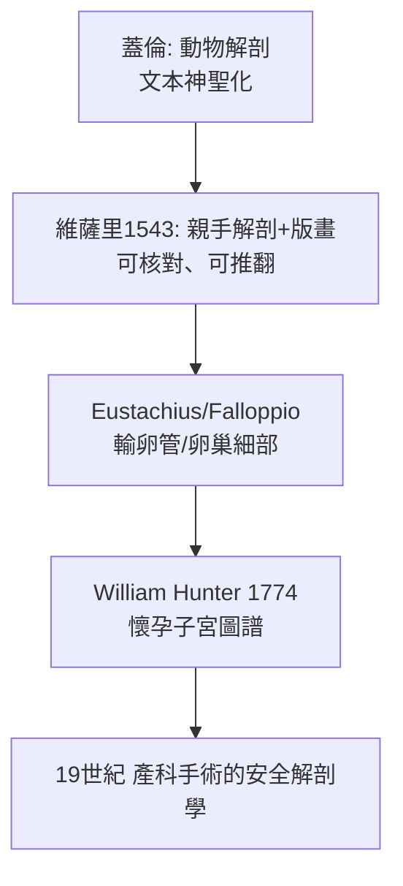

## 1543 - 維薩里《人體構造》與女性骨盆解剖（解剖學真相對權威文本的勝利）

## 案件摘要

**本案偵破的是：一個靠誦讀蓋倫文本的醫學界，為何在 1543 年被一本畫冊炸開——以及第一版女性解剖圖裡為什麼藏著一頭豬。**

1543 年 6 月，29 歲的帕多瓦大學解剖教授維薩里（Andreas Vesalius）在巴塞爾出版《人體構造七卷》（De humani corporis fabrica libri septem）。書中 200 餘幅木刻以親手解剖為據，糾正蓋倫約 200 處錯誤。對婦產科而言，這是第一次以「看」取代「背」：女性骨盆、子宮、卵巢、輸卵管首次以系統性圖像呈現。但第五卷的女性解剖圖竟有明顯錯誤（腎臟形似豎立豎直的豬腎、子宮被畫成兩角對稱的倒 V）——本案的謎題：一個正在推翻權威的人，為何自己也犯了權威式錯誤？

## 前因 -- 為什麼會有這個案子

- **蓋倫的解剖是動物的**。羅馬法禁人體解剖，蓋倫解剖的是獼猴、豬、牛；其錯誤（如五葉肝、子宮分為左右兩腔、女性骨骼比男性少一根肋骨——後者被神學借用以證「女人出自男人的肋骨」）被當成聖訓抄了 1300 年。
- **醫學院的解剖表演是背書會**。中世紀大學解剖課：教授高坐誦讀蓋倫，理髮師外科匠在下面切割屍體——「看」與「說」完全分離。
- **帕多瓦的豁免**。威尼斯共和國允許相對自由的解剖與猶太/女性屍體供應，帕多瓦成為歐洲解剖學中心；維薩里任外科與解剖講座。
- **印刷與版畫的到位**。16 世紀威尼斯—巴塞爾的木刻工坊已能做出精細解剖圖——知識革命需要傳播技術配套。

## 線索與推理 -- 數學式、程式、理論

**線索一：骨盆的測量真相。** 維薩里明確比較男女骨盆：女性骨盆入口橫徑更寬、恥骨弓角更鈍（約 90–100 度，男性約 70–75 度）：

$$ \theta_{\text{恥骨弓, 女}} > \theta_{\text{恥骨弓, 男}} \quad \Rightarrow \quad \text{產道出口幾何不同的解剖基礎} $$

這是後世產科骨盆徑線測量（斯梅利，見 `1751-斯梅利與產科手術化.md`）的起點。

**線索二：子宮的雙角錯誤。** 蓋倫根據犬猴解劃出「左右兩腔子宮」；維薩里雖親手解剖女性屍體，其第五卷女性圖仍畫出對稱雙角、且腎形如豎立豎直的豎直腎形（近似豎直豎立的豎直腎／豬腎形）。解釋有二：(1) 時間壓力下臨摹蓋倫圖譜；(2) 可得的女屍太少（多為瘦弱老嫗），子宮退化後難以辨識結構。**推翻權威者對權威的殘餘依賴**，是科學史的反覆模式。

**線索三：錯誤的自我糾正機制。** 1546 年科隆版《解剖圖箋》（Epitome）起，維薩里修正了部分女性圖；他親筆批註自己抄本中的錯誤。這正是本案的關鍵——**新方法的價值不在單次正確，而在建立了「可被推翻」的基準**：

**線索四：對「會陰—產道—骨盆底」結構的首次系統描述**，為 19 世紀產科手術（會陰切開、產鉗徑線選擇、剖腹產切口設計，見 `1882-桑格剖腹產縫合術.md`）提供了幾何基礎。

## 結案 -- 後果與影響

- **解剖學成為產科學的資產負債表**。此後所有產科技術進步（產鉗、迴轉術、剖腹產切口）都以準確解剖為前提；維薩里之前，產科手術是盲飛。
- **「眼見為憑」的方法論擴散**。法洛皮奧（Falloppio）命名輸卵管、尤斯圖斯（Eustachius）繪腎上腺；1559 年科倫布（Colombo）宣稱「發現」陰蒂，引發與法洛皮奧的優先權之爭——女性解剖的補完變成一場競賽。
- **蓋倫神話的瓦解啟動哈維革命**。1628 年哈維的血液循環建立在維薩里式的「自己看」傳統上；產科隨後受益於生理學（胎盤循環研究）。
- **陰影面**。維薩里的女性解剖仍以「生育器官」為唯一視角，忽略陰蒂的功能與快感——解剖圖譜從一開始就攜帶了時代的性別假設。
- **一句話結案**：1543 年的真正發明不是任何一張圖，而是「**以可複製的屍檢對抗不可檢驗的文本**」——連維薩里自己的錯誤，都成了這套機制即將自我修正的第一份證據。

## 關鍵人物與文獻

- **維薩里（Andreas Vesalius, 1514–1564）**——布魯塞爾人、帕多瓦解剖教授；《人體構造》與簡本《解剖圖箋》（Epitome, 1543）作者；晚年任腓力二世御醫，死於扎金索斯島朝聖歸途。
- **蓋倫（129–約 216）**——被推翻的權威；其「女性骨骼少一根肋骨」之說直到維薩里當眾解剖對比男女骨骼才崩塌。
- **科倫布（Matteo Realdo Colombo, 1516–1559）與法洛皮奧（Gabriele Falloppio, 1523–1562）**——維薩里的學生與論敵，補完女性生殖解剖；法洛皮奧亦留下最早的避孕套記載（見性病史 `../性病的歷史/1564-法洛皮奧亞麻套與早期避孕套.md`）。
- 文獻——Vesalius, *De humani corporis fabrica*, Basel: Oporinus, 1543；現代 facsimile 與 Saunders & O'Malley 英譯（1950）。
- **現代註腳**——2018 年起的解剖學史計畫對《人體構造》木刻逐圖比對：維薩里女性圖的豬腎錯誤，成為「作者與工坊分工」考證的經典樣本——出版品的錯誤也能被法醫學式地驗屍。
