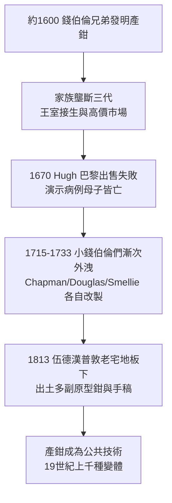

## 1620 - 錢伯倫產鉗黑箱（一件被保守近百年的祕密器械）

## 案件摘要

**本案偵破的是：一個英國家族如何在近百年間靠一件鐵器壟斷歐洲最貴的接生生意——以及這個祕密最終如何、被誰、以什麼代價打開。**

約 1600 年前後，倫敦胡格諾難民後裔錢伯倫家族（Peter Chamberlen the Elder 與其弟 Peter the Younger）發明了鏈條相接、開合夾持胎頭的產鉗（obstetric forceps）。在他們手中，許多過去必死無疑的滯產母子得以存活。但家族把器械裝入巨型木箱：產婦家屬被請出房間、樂師奏樂掩蓋金屬聲響、鉗子以布包裹運入。三代人守口如瓶近 120 年。本案的謎題：為什麼「能救命的發明」以保密為生存策略，而它的公開為何這麼晚？

## 前因 -- 為什麼會有這個案子

- **滯產的死刑**。頭盆不稱、持續性枕橫位造成的滯產，在只有雙手的年代幾乎注定難產：產婦死於衰竭、出血、感染；嬰兒死於缺氧。唯一的「技術」是碎胎術（把胎兒分解取出保住產婦）。
- **商業醫學的誕生**。17 世紀倫敦是競爭激烈的醫療市場；錢伯倫家族以「難產救星」行銷，接生王室（亨莉埃塔·瑪麗亞王后多次生產皆由錢伯倫主刀的團隊服務），財富與爵位（Peter the Younger 獲封騎士）隨之而來。
- **行會與監理的空白**。倫敦產婆受教區執照管理，但「外科介入接生」無人可管——男外科醫師攜帶祕密器械進入產房，既無法規也無倫理委員會可審。
- **法國的競爭壓力**。1670 年休·錢伯倫（Hugh Chamberlen）攜祕術赴巴黎試圖賣給太醫院與產婆巨擘 Louise Bourgeois 的後繼者，開價 1 萬里弗爾。

## 線索與推理 -- 數學式、程式、理論

**線索一：產鉗的力學原理。** 產鉗的設計是把接生者的手力轉為對胎頭兩頰的均勻夾持與牽引：

$$ F_{\text{牽引}} \ge \mu \cdot N_{\text{夾持}} \quad \text{且} \quad N \le N_{\text{顱骨安全限}} $$

鏈條與骨盆彎曲（pelvic curve）設計使夾力分散、不碎顱——這是「鐵手能救人也能殺人」的分界。錢伯倫鉗的盆腔彎與鏈接樞紐，正是它能取代碎胎術的原因。

**線索二：保密的經濟學。** 器械本體易於被工匠仿製，但**使用手技（何時可以牽、何時必須放棄）無法從成品反推**。家族壟斷的本質是壟斷「判斷力」：

```python
# 保密策略復原
def protect_secret(family_income):
    while family_income > threshold:
        keep("巨箱+樂師+布包+支開家屬")     # 物理隔離
        refuse("法國太醫院的收購提議")       # 1670
    return "秘密維持 120 年, 直到遺物出土"

# 1670 巴黎演示失敗: Hugh 以鉗救助佝僂病產婦, 母子皆亡
# 太醫院問: 「閣下能保證母子平安嗎?」Hugh 答: 「不能。」 交易破局
```

**線索三：1670 年巴黎慘案的偵探意義。** 演示失敗的病例（骨盆嚴重狹窄的佝僂產婦）暴露了產鉗的**適應症邊界**：器械救的是「胎頭已達出口而旋轉受阻」的病例，不是骨盆絕對狹窄。這個邊界要再等 200 年的骨盆測量與剖腹產（`1882-桑格剖腹產縫合術.md`）來補足。

**線索四：祕密如何流出與出土。**



## 結案 -- 後果與影響

- **產科市場的重新切割**。難產從產婆的绝境變成外科醫師的戰場；男性醫師憑器械與祕術擠入產房，產婆的職業版圖在此後兩百年持續萎縮。
- **器械產科的雙刃**。19 世紀產鉗被濫用（預防性中位產鉗），產婦會陰撕裂、膀胱陰道瘺、感染風險大增；20 世紀末循證醫學把產鉗使用率壓到 <1%，回到「審慎使用」的錢伯倫原點。
- **醫學專利與公開的倫理張力**。錢伯倫案成為「救命的知識該不該保密」的教科書案例；對照組是 1751 年斯梅利（`1751-斯梅利與產科手術化.md`）——他把改良鉗與手技公開授課，產科學因此加速一個世紀。
- **一句話結案**：產鉗黑箱證明，在沒有專利制度的年代，外科發明只能靠「保密＋孤證」變現；而醫學作為公共知識的成長速度，恰恰與祕密的存在時間成反比。

## 關鍵人物與文獻

- **錢伯倫三代（Peter Chamberlen the Elder 約 1560–1631；the Younger 1572–1626；Hugh 1630–1720）**——胡格諾裔倫敦外科醫師家族；三代主接貴族與王室產，守祕近 120 年。
- **休·錢伯倫（Hugh Chamberlen）**——1670 年巴黎出售祕術失敗的當事人；1720 年以 90 歲高齡仍在爭取產鉗利益。
- **愛德蒙·查普曼（Edmund Chapman）**——1733 年出版《論接生》（A Treatise on the Improvement of Midwifery），公開描述短直柄產鉗，一般視為祕密終結的公開節點。
- 文獻——Alec Fraser, *Sketch of the Chamberlens*, 1891；Herbert Spencer 手稿研究；1813 年伍德漢普敦（Woodham Mortimer Hall）地板下出土的「錢伯倫藏物」現藏皇家婦產科學會與埃塞克斯博物館。
- **現代註腳**——2013 年研究者以現代力學分析出土鉗：其盆腔彎角度與今日 Simpson 鉗僅差數度。守祕 120 年的設計，一公開就在兩百年內幾乎無所進展地「正確」——**好設計一旦公開，就不再需要發明者**。
