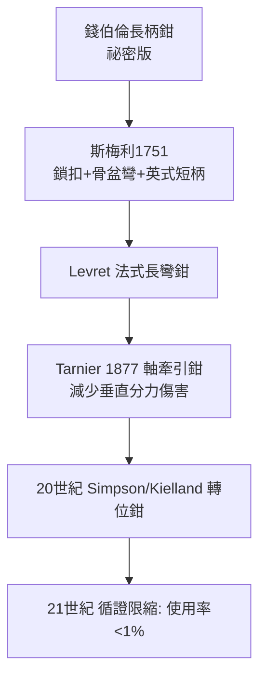

## 1751 - 斯梅利與產科手術化（從祕術到可傳授的科學）

## 案件摘要

**本案偵破的是：產科如何從「貴族買得到的祕術」變成「任何人學得會的科學」——而代價是誰付的。**

1751 年，倫敦蘇格蘭裔產科醫師威廉·斯梅利（William Smellie）出版三卷本《產科理論與實務論》（A Treatise on the Theory and Practice of Midwifery）。他在蘭貝斯的教學診所裡開放授課（近十年訓練約 900 名男學生）、訂製標準化產鉗、發明徒手旋轉胎位法、記錄胎頭徑線、留下著名產鉗圖版與操作箴言。與錢伯倫家族（見 `1620-錢伯倫產鉗黑箱.md`）的百年黑箱相反，斯梅利把一切攤在教室裡。本案的謎題：他如何讓「開放」戰勝「保密」成為新的生存策略？

## 前因 -- 為什麼會有這個案子

- **產鉗已流出，使用卻一團糟**。1730s 產鉗多樣但無標準：學徒式外科醫師濫力牽引，造成顱骨碎裂、子宮破裂。器械普及但**判斷力**未普及。
- **倫敦產科教學的真空**。18 世紀中葉，倫敦尚無系統產科教育；皇家學會不教接生，醫院產科病房未建。私立講堂（private lying-in courses）是唯一途徑。
- **斯梅利的技術積累**。1750s 之前他已行醫 15 年、自述接生 1000 例以上；他研究骨盆標本、發明「木頭與皮革的產科仿真骨盆」（phantom）供學生練習手技——產科模擬教學的發明。
- **競爭對手的挑戰**。倫敦同行（如 William Hunter 及其師弟關係的破裂）質疑其教學與收費；斯梅利以出版與圖版應戰。

## 線索與推理 -- 數學式、程式、理論

**線索一：胎頭徑線的量化。** 斯梅利測量並命名關鍵徑線——枕下前囟徑約 9.5 cm、雙頂徑約 9.25 cm——並據此判斷「產鉗能否通過」：

$$ \text{產出可行} \iff d_{\text{胎頭徑線}} < d_{\text{骨盆最小徑}} - \varepsilon_{\text{可塑形變形}} $$

胎兒顱骨縫的重疊（moulding）提供 $ \varepsilon $；超出者應改採他途。這條不等式第一次把「能不能接」變成幾何問題。

**線索二：徒手旋轉法（manual rotation）。** 對持續性枕橫/枕後位，斯梅利主張：**先試雙手內旋轉，失敗才上鉗**。他的名言「把手插進去的機會越少越好」（"Hands off" 的反面表達——他告誡學生：干預越少越好）確立了「觀望＋最小介入」的現代產科倫理。

**線索三：標準產鉗的設計疊代。**

**線索四：教學模式的複利。** 仿真骨盆＋臨床跟診＋出版圖版＝**可複製的培訓流水線**。900 名學生把倫敦產科水準拉高一個等級；皇家婦產科醫師學會（RCOG, 1929）的建立遲了 180 年，但形制已在蘭貝斯教室成形。

## 結案 -- 後果與影響

- **產科學院文化的誕生**。公開教學＋同行互評＋出版物取代祕傳；產科從市場商品變成學術專科。
- **產婆—醫師分界的固化**。教學面向男性外科醫師，產婆被排除在「科學」敘事之外；此後兩百年「醫師＝科學、產婆＝經驗」的等級被寫進制度。20 世紀末循證比較才還原：受訓產婆的常規接生結局與醫師相當甚至更佳。
- **技術倫理的先行**。「最小介入」「先徒手後器械」「保母優先還是保子優先」的辯論，在斯梅利的病例紀錄裡第一次以**逐例記載＋失敗也出版**的方式進行——他是產科負面結果透明化的先驅。
- **一句話結案**：斯梅利破解錢伯倫案的方式不是偷出鉗子，而是**證明公開比保密更賺**——當知識可以招生、出書、建立門派，祕密就失去了經濟學基礎。

## 關鍵人物與文獻

- **威廉·斯梅利（William Smellie, 1697–1763）**——蘇格蘭 Lanark 人、倫敦產科教父；著《產科理論與實務論》三卷（1751–1764）與圖版集《A Sett of Anatomical Tables》（1754）；退休後返鄉撰《人體體系與病理學注疏》。
- **威廉·亨特（William Hunter, 1718–1783）**——斯梅利昔日學生、後成論敵；1774 年出版《人類懷孕子宮的解剖學》，把「看見胎兒」推向極致。
- **Levret（André Levret, 1703–1780）**——巴黎產科醫師，獨立改良產鉗；與斯梅利的鉗型構成法英兩系。
- 文獻——Smellie, *A Treatise on the Theory and Practice of Midwifery*, London, 1751；John Blunt, *MacGillivray 評註版*；R. W. Johnstone, *William Smellie: The Master of British Midwifery*, 1952。
- **現代註腳**——2020 年代 Cochrane 綜述結論與斯梅利箴言幾乎一致：限制性產鉗使用、鼓勵自然旋轉、減少不必要的陰道檢查。250 年後的證據等級，仍在為他 1751 年的臨床直覺蓋章。
