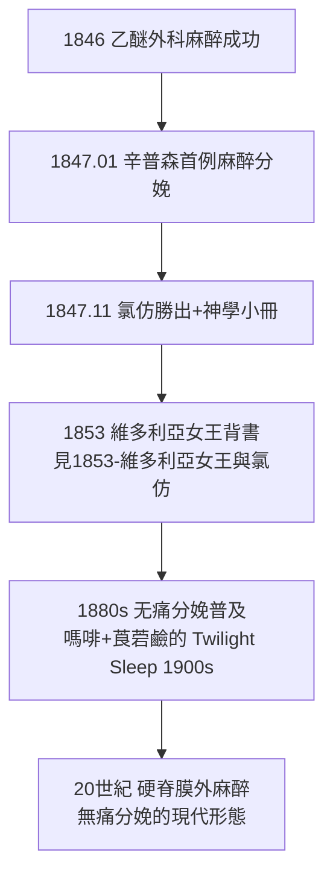

## 1847 - 乙醚與氯仿無痛分娩（分娩疼痛第一次可以「關掉」）

## 案件摘要

**本案偵破的是：一個被兩千年神學與哲學認定為「神聖詛咒、不可解除」的疼痛，如何在一年之內變成技術問題。**

1847 年 1 月 19 日，愛丁堡婦科醫師辛普森（James Young Simpson）在一位骨盆狹窄產婦身上使用乙醚吸入麻醉完成分娩——這是醫學史上第一例麻醉分娩。同年 11 月他改用更宜人的氯仿（chloroform），並發表著名小冊《答對產科麻醉的宗教反對》（Answer to the Religious Objections Against the Employment of Anaesthetic Agents），逐一駁斥「產痛是夏娃的詛咒」論。麻醉分娩自此快速擴散，並在 1853 年獲得維多利亞女王的背書（見 `1853-維多利亞女王與氯仿.md`）。本案的謎題：為什麼是婦科醫師、而不是外科醫師，完成了「疼痛去神聖化」的最後一擊？

## 前因 -- 為什麼會有這個案子

- **1846 年 10 月乙醚日**。波士頓 Mass. General Hospital，William Morton 以乙醚麻醉完成頸部腫瘤切除術（《波士頓醫學與外科雜誌》隨即報導）。消息 12 月傳抵英國。
- **分娩疼痛的絕對性**。產婦死於休克與衰竭者不少（滯產衰竭是明文死因）；但醫學界普遍認定產痛「自然且必要」——疼痛的終點（嬰兒娩出）讓人誤以為它「有益」。
- **神學反對的就緒**。「你必大大加添懷胎的苦楚」（創 3:16）被解為產痛的宇宙法則；蘇格蘭加爾文主義氛圍尤其濃烈。
- **辛普森的競爭性格**。他不是第一個想到者（產房助產士 Fanny Longbottom 才是 1847.1.19 的第一位受試產婦），但他是最快系統化、出版、反擊宗教批評的人。

## 線索與推理 -- 數學式、程式、理論

**線索一：疼痛的生理學重估。** 辛普森的論證核心：外科已接受「疼痛本身有害」（休克、代謝應激），那麼產痛憑什麼例外？

$$ \text{疼痛} \Rightarrow \text{兒茶酚胺↑} \Rightarrow \text{子宮血流↓} + \text{通氣過度} + \text{衰竭} \quad \Rightarrow \quad \text{產痛對母胎皆有生理成本} $$

這在當時仍是直覺而非證據，但方向正確——20 世紀才被應激生理學補全。

**線索二：藥物選擇的工程學。** 乙醚誘導慢、催吐、易爆（產房明火危險）；辛普森與化學家朋友 Keith 開始篩選替代品，發現氯仿（Guthrie 1831 合成、Dumas 1834 命名）氣味佳、誘導快、劑量小。他以**自身與朋友聚會吸入試藥**的方式完成「第一期臨床試驗」——某次全員昏倒於餐桌下，辛普森醒來說出那句被誤傳為「這比婚姻的懲罰好多了」的玩笑。危險性（氯仿心臟毒性）要到 20 世紀才被定價，但 1847 年它是工程上的明確勝利。

**線索三：神學反駁的邏輯手術。** 辛普森的小冊列舉：聖經中上帝使亞當沉睡取肋骨＝第一例麻醉；拉結、夏甲難產未受神罰性質疑；「讓耶和華的憐憫勝過摩西的禁令」。他甚至編了拉丁口號對付批評者。**論證品質不高，但公共傳播效果極佳**——本案偵破的關鍵不是神學，而是輿論。

**線索四：產科麻醉的適應症分層。**

## 結案 -- 後果與影響

- **疼痛的正當性被解除**。教會反對在 1850s 退潮；「產痛＝詛咒」從教義降格為比喻。這是醫學技術直接改寫倫理神學的少數案例。
- **產婦死亡率的雙面效應**。麻醉讓外科醫師更大膽地進入產房（更深的產鉗、更早的手術介入），也可能拉高了器械產科的傷害率；麻醉本身的死亡（氯仿猝死）成為 19 世紀末的爭議。無痛分娩的淨收益要到 20 世紀，在硬脊膜外麻醉與監測齊備後才穩定轉正。
- **「舒服的分娩」成為需求**。維多利亞女王三次氯仿分娩（1853、1857、1858）之後，中產階級產婦把無痛視為權利——消費者需求開始反向塑造產科服務。
- **一句話結案**：辛普森證明，**當疼痛可以被技術取消，神學就退場、生理學登場**——「自然」不再是疼痛的理由。

## 關鍵人物與文獻

- **辛普森（James Young Simpson, 1811–1870）**——愛丁堡婦科與產科教授；氯仿麻醉的推廣者；女王曾封其準男爵。墓碑自題「他讓疼痛睡著」。
- **William Morton（1819–1868）**——1846.10.16 乙醚示範的始作俑者；乙醚的專利與優先權之爭拖垮了他的晚年。
- **John Snow（1813–1858）**——麻醉劑量與給藥技術的科學化者；1853 年為女王接生時麻醉（見 `1853-維多利亞女王與氯仿.md`）；同一人亦是 1854 倫敦霍亂寬街案的流行病學偵探。
- 文獻——Simpson, *Answer to the Religious Objections Against the Employment of Anaesthetic Agents*, Edinburgh, 1847；Simpson, *Notes on the吸 ether*（1847）。
- **現代註腳**——今日全球硬脊膜外麻醉使用率在高收入國家達 30–60%；「無痛分娩」已是 WHO 建議的孕婦權利之一。1847 年那場餐桌試藥的結果，被寫進了 21 世紀的產房服務標準。
