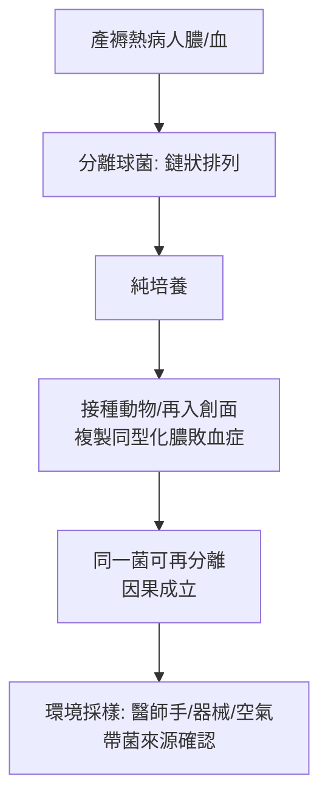

## 1879 - 巴斯德鎖定產褥熱球菌（為「屍體粒子」命名）

## 案件摘要

**本案偵破的是：一個被拒絕了 32 年的答案，如何因為兇手終於有了姓名與照片而被全盤接受。**

1879 年 5 月，路易·巴斯德（Louis Pasteur）在巴黎產科醫院（Maternité de Paris）向產科教授 Tarnier 的學生們示範：從產褥熱病人的膿液與血液中分離出一種鏈狀球菌（microcoque，今稱 A 群化膿性鏈球菌 *Streptococcus pyogenes*），培養、再接種、再致病。在場傳說有一幕名場面：巴斯德遇到老對手、產科權威 Pajot，對方堅稱產褥熱與醫師無關；巴斯德指著自己手裡的培養皿反問：「醫師——**就是那個把球菌帶進產房的東西**。」這一幕把塞麥爾維斯（見 `1847-塞麥爾維斯產褥熱之謎.md`）三十年前的推理，變成了看得見的證據。本案的謎題：為什麼「看不見的粒子」需要等到「看得見的細菌」？

## 前因 -- 為什麼會有這個案子

- **細菌理論的成熟**。1860s–1870s 巴斯德（發酵與蠶病研究）、科赫（1876 炭疽桿菌、1881 純培養與染色技術）建立了「特定微生物→特定疾病」的範式。
- **Lister 的抗菌外科（1865）**。石炭酸噴霧已證明「看不見的污染物」可控；外科與產科共用同一套原理，但產科界的接受慢了一拍。
- **產褥熱的反覆流行**。巴黎、倫敦、都柏林產院在 1860s–1870s 仍時有大流行；Tarnier 在 Maternité 已推行消毒與隔離、死亡率顯著下降（他自承受 Semmelweis 與 Lister 啟發），但**病因學**仍未定案。
- **無菌技術的門檻**。固體培養基與染色（1870s Koch 實驗室）使細菌可被分離、純化、再感染——「科赫法則」的司法程序就緒。

## 線索與推理 -- 數學式、程式、理論

**線索一：分離—培養—再接種的司法鏈。** 巴斯德的證據鏈就是科赫法則的前置版：

**線索二：菌型的一致性。** 產褥熱病人的敗血症菌與外科創傷感染、丹毒、猩紅熱併發症的菌同屬一族——這解釋了為什麼**病房間的交叉**（產科病人與外科、丹毒病人同院）會引爆流行。18 世紀 Gordon 的臨床直覺、19 世紀 Semmelweis 的「屍體粒子」、1870s Tarnier 的隔離——三段線索終於有共同的名詞：**化膿性鏈球菌**。

**線索三：傳播載體的定位。** 巴斯德指出醫師的手、器械與空氣塵埃是載體；由於球菌對熱與石炭酸敏感，**消毒＝殺菌**有了分子靶點。塞麥爾維斯的含氯石灰洗手（`1847-塞麥爾維斯產褥熱之謎.md`）因此從「經驗」升格為「殺菌工藝」：

$$ \text{洗手有效} \iff \text{消毒劑濃度} \times \text{時間} > \text{滅菌門檻} \quad \text{(今日的 } Ct \text{ 概念)} $$

**線索四：與科赫的競賽與合作。** 1879–1881 年巴斯德與科赫在炭疽、敗血症病原上並行推進；1881 年巴斯德在倫敦國際醫學會展示炭疽疫苗，科赫批評其技術——兩人競爭加速了整個細菌學產業化。產褥熱病原的確認是這場競賽的副產品之一。

## 結案 -- 後果與影響

- **產科界投降**。1880s 起，巴黎、維也納、柏林產院全面採用消毒接生；「醫師手是傳染載體」從恥辱的指控變成教科書的事實。產褥熱死亡率的斷崖式下降（見 `1885-無菌產房時代.md`）由此啟動。
- **無菌術的標準化**。Semmelweis（洗手）→ Lister（抗菌）→ Koch/Bergmann（無菌器械與蒸氣滅菌）→ 產房常規：產科在十年內補完了一整套防線。
- **抗生素的前奏**。1935 年磺胺、1943 年青黴素對產褥熱的根治（見性病史 `../性病的歷史/1943-青黴素治癒梅毒.md` 的同期技術革命），把這場疾病的死亡率再壓低一個數量級——但那已是「治療」而非「預防」的接力。
- **一句話結案**：塞麥爾維斯輸在「粒子看不見」，巴斯德贏在「球菌看得見」——**科學史證明，正確的答案需要配得上它的證據技術才能勝訴**。

## 關鍵人物與文獻

- **巴斯德（Louis Pasteur, 1822–1895）**——法國化學家與微生物學家；產褥熱病原的分離者；免疫接種（炭疽、狂犬病）的締造者。
- **Tarnier（Étienne Stéphane Tarnier, 1828–1897）**——巴黎產科教授；產院消毒與隔離的推行者，也是早產兒保溫箱的發明者之一——產科細菌學與新生兒科在他身上交會。
- **Pajot（Charles Pajot, 1816–1896）**——反對派的產科權威，名場面的被說服者（傳說成分需留意，但立場轉變屬實）。
- **科赫（Robert Koch, 1843–1910）**——細菌學方法論的建制者；1882 結核桿菌、科赫法則。
- 文獻——Pasteur 的 Maternité 講演（1879.5，經 Tarnier 筆錄流傳）；科赫《細菌學研究》（1876–1881）。
- **現代註腳**——A 群鏈球菌至今仍是全球產褥感染的主要兇手之一；「產後敗血症」仍是 WHO 母親安全議程的核心指標。1879 年那個培養皿裡的鏈，今日仍是產房防線上最需要盯住的鏈。
