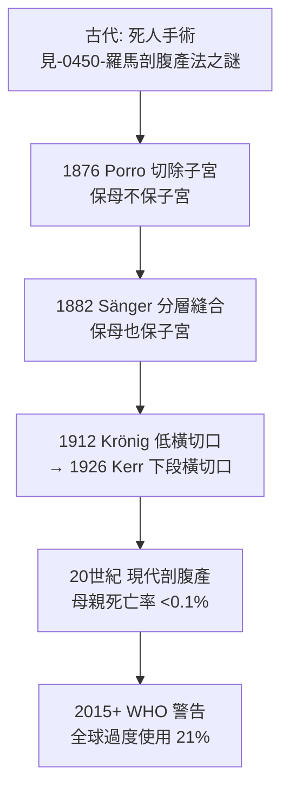

## 1882 - 桑格剖腹產縫合術（把「絕症手術」變成「可生存的手術」）

## 案件摘要

**本案偵破的是：一個自羅馬《王室法》時代起就以死亡為前提的手術（見 `-0450-羅馬剖腹產法之謎.md`），如何在 1882 年第一次具備「母親走下手術台」的技術條件。**

1882 年，德國德勒斯登產科醫師愛德華·桑格（Eduard Sänger）發表論文，確立剖腹產的標準流程：子宮體部**古典式縱切口**取出胎兒後，**以縫線分層閉合子宮切口**——此前半世紀的「剖腹產」幾乎不縫子宮，任其出血，母親死亡率接近 100%（或只能做子宮切除）。桑格的縫合術使母親存活率首次超過一半（1880s 早期系列約 50–70%），剖腹產正式進入外科醫學。本案的謎題：為什麼「縫上子宮」這個今天看來顯然的步驟，遲到了 2500 年？

## 前因 -- 為什麼會有這個案子

- **技術三缺**。剖腹產需要的東西在 1882 年前才剛湊齊：(1) 麻醉（1846–1847，見 `1847-乙醚與氯仿無痛分娩.md`）；(2) 抗菌/無菌（1865 Lister、1879 病原確認）；(3) **縫合材料與技術**——1850s–1870s 腸線、絲線與縫合針持的標準化（美國 Lembert 1826 的漿肌層內翻縫合、Halsted 1890s 的細線精縫是後續）。
- **此前的主流是碎胎術**。遇到頭盆不稱，19 世紀產科醫師的首選是穿顱術、碎胎術（毀胎保母）；剖腹產被視為「對產婦的謀殺」，多數教材明文反對。
- **歐洲的失敗病例累積**。1500s（瑞士閹豬匠 Jacob Nufer 的傳說性成功）、1790s（英國 James Barlow 的個案存活）等孤例無法複製；法國 Odier、維也納諸家統計的母親死亡率常在 75–100%。
- **Porro 的替代方案（1876）**。義大利 Eduardo Porro 主張切子宮＋切除子宮斷端外置——母親存活率提升但永久喪失生育力。桑格則要證明：子宮可以保住。

## 線索與推理 -- 數學式、程式、理論

**線索一：失敗的死因解剖。** 桑格整理既有病例：死因主要是(1) 切口出血無法控制；(2) 子宮切口癒合不良→晚期破裂；(3) 敗血症。三者都可歸因於「不縫合或縫合不當」：

$$ \text{死亡率} \downarrow \iff \text{出血控制} \land \text{切口癒合} \land \text{無感染} $$

縫合同時解決前兩項，而無菌術（同期）解決第三項——**縫合術與無菌術是相互解鎖的兩把鑰匙**。

**線索二：桑格的縫合協議。** 分層縫合：深層（含內膜）連續縫線閉合宮腔側，再漿肌層內翻縫合加固；切口選子宮體前壁縱行（古典式），避開血管區。這是**把子宮當作「可修復的肌肉器官」**的觀念轉換——此前它被當作「只能切除的出血袋」。

**線索三：適應症的重新劃界。** 桑格把剖腹產從「瀕死產婦的最後一搏」重新定義為「**頭盆不稱的預防性選擇**」——胎兒尚活、產婦狀況穩定時主動手術。這個適應症轉移是真正的革命：

**線索四：數據的說服力。** 桑格收集 1880s 前的系列報告，自我比較「縫 vs 不縫」的死亡率差異；雖然樣本小、無對照，但方向一致——加上同期 Max Sänger 的推廣，德語產科界在十年內改寫教材。

## 結案 -- 後果與影響

- **母親存活率曲線的轉折點**。1882 前剖腹產幾乎＝死刑；1900s 母親存活率 >75%；今日 <0.1%（高收入國家）。這是外科史上最大幅度的單一術式改善。
- **子宮切口的百年迭代**。1912 年 Krönig、1926 年 Kerr 的**子宮下段橫切口**（ Lower-segment transverse）出血更少、下次妊娠破裂率低，成為今日全球標準（約 90% 以上的剖腹產切口）；「古典式切口」則被限縮於早產、前置胎盤等特殊情境。
- **疤痕子宮與「一次剖、終身剖」**。桑格之後的新難題：疤痕子宮陰道分娩（VBAC）的可行性與風險——20 世紀「once a caesarean, always a caesarean」（Cragin, 1916）的金句，其實是縫合術的副產品；今日的 VBAC 率仍在 10–30% 間反覆。
- **過度使用的當代難題**。2015 年 WHO 統計全球剖腹產率 21%（部分國家 >50%），醫學必要與社會選擇的界線成為新案件——技術解決了「能不能活」，卻製造了「該不該做」。
- **一句話結案**：桑格的發明不是切口，而是縫線——**外科史的進步常不在「切得更漂亮」，而在「關得更牢」**。

## 關鍵人物與文獻

- **愛德華·桑格（Eduard Sänger, 1836–1907）**——德勒斯登產科醫師、後任萊比錫教授；1882 年發表《Klassischer Kaiserschnitt》確立古典式切口＋分層縫合；其子 Max Sänger 續推廣。
- **Eduardo Porro（1842–1902）**——米蘭產科醫師；1876 年子宮切除式剖腹產，是桑格之前的「求生方案」。
- **Ferdinand Krönig 與 Jack Kerr**——20 世紀子宮下段切口的確立者。
- 文獻——Sänger, *Zur Rehabilitierung des klassischen Kaiserchnitts*（1882）；Todman, "A History of Caesarean Section"（2007）。
- **現代註腳**——今日剖腹產是全球最常執行的腹部大手術之一，每年逾 3000 萬例；從羅馬王室法「不剖腹不得下葬」到現代產房的常規手術，這條線走了 2400 年——中間最大的跳躍，是 1882 年那排縫線。
