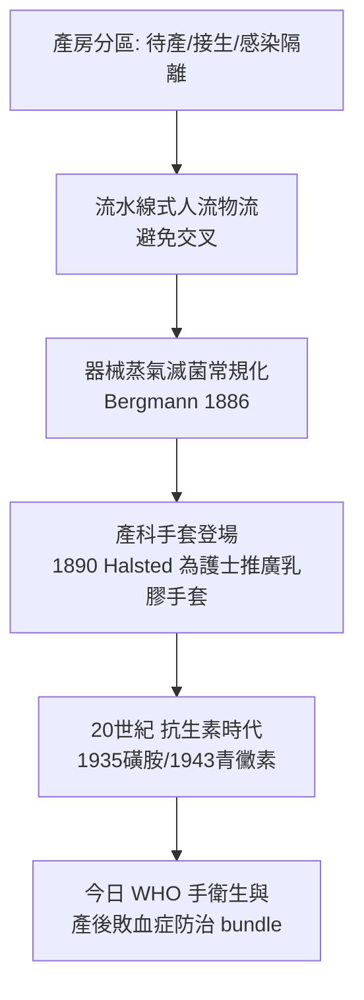

## 1885 - 無菌產房時代（塞麥爾維斯的答案終於全面兌現）

## 案件摘要

**本案偵破的是：產褥熱死亡率為什麼在 1880 年代出現斷崖式下降——以及那條曲線的每一個台階分別是誰的功勞。**

1880 年代初，科赫的細菌學方法論（1876–1881）、蒸氣滅菌與細菌培養監測在德語世界落地；柏林 Charité、維也納、倫敦、巴黎產院相繼把「消毒接生」制度化：醫護洗手＋器械滅菌＋產房分診＋感染病人隔離。到 1890 年代，歐洲主要產院的產褥熱死亡率從 19 世紀中葉的 5–20% 壓到 0.5% 以下，「醫院比在家危險」的悖論（見 `1847-塞麥爾維斯產褥熱之謎.md`）正式消失。本篇不偵破單一發明，而偵破一條曲線的構成。

## 前因 -- 為什麼會有這個案子

- **細菌學的工業化**。科赫實驗室提供了三件武器：固體培養基（可純化菌種）、細菌染色（可看見）、照片式記錄（可出版）。感染防治從「紀律」變成「可檢測的工程」。
- **醫院的信譽危機**。1860s–1870s 醫院死亡率醜聞（「醫院是通往墳墓之路」的英德諺語）迫使管理層採納無菌改革——改革的推動者常常不是醫學信仰，而是床位空置率。
- **無菌術的三代積累**：Semmelweis 的洗手（1847）→ Lister 的石炭酸抗菌（1865）→ Koch–Bergmann–Schimmelbusch 的蒸氣滅菌與無菌術（1880s）。產科是三代技術的會師地。

## 線索與推理 -- 數學式、程式、理論

**線索一：死亡率的台階解構。** 產褥熱死亡率的下降不是一條平滑曲線，而是三級台階：

| 台階 | 時期 | 干預 | 代表死亡率 |
|---|---|---|---|
| 一 | 1847–1861 | 洗手（單一機構） | 18% → 1%（維也納，制度廢止即反彈） |
| 二 | 1865–1880 | 抗菌（局部消毒） | 醫院 5–10% → 2–4% |
| 三 | 1882–1895 | 無菌＋滅菌＋隔離 | → <0.5%（多數產院） |

$$ R(t) = R_0 \cdot \prod_i (1 - e_i) \quad \text{每一層防線 } e_i \text{ 相乘, 這是 } \text{Swiss cheese 模型的祖形} $$

**線索二：培養監測的「法醫化」。** 1880s 起，產房開始對器械、敷料、醫護手、產道採樣培養；「無菌」第一次可以被**檢測**而非被宣誓——這是塞麥爾維斯時代最缺的東西：驗收標準。

**線索三：產房建築的響應。**

Halsted 發明醫用手套的原始動機是保護其洗手致敏的手術室護士（後成為其妻）——產房的防線連細節都帶著私人故事。

**線索四：居家 vs 醫院的統計反轉。** 1930s 英國調查（如 1930s 的產科調查報告）顯示醫院與居家死亡率趨同甚至醫院更佳——「醫院化」自此失去阻力，為 20 世紀分娩全面進入醫院鋪路。**無菌術是醫院化最重要的廣告**。

## 結案 -- 後果與影響

- **產婦死亡率的第一個世紀奇蹟**。英格蘭威爾斯產婦死亡率：1870s 約 5/1000；1935 年約 4.5/1000（尚有其他死因補位）——但**產褥熱這一項**從 1880s 起跌落一個數量級；1936 年磺胺、1940s 青黴素再補最後一刀。今日全球產褥感染仍占產婦死因約 10–15%，但多數可防可治。
- **無菌觀念的社會化**。「看不見的髒」進入大眾語言；產婦開始「選擇乾淨的醫院」——消費者第一次用微生物學投票。
- **制度遺產**。產科無菌常規、手衛生五時刻、手術器械滅菌追溯、感染隔離病房——今日醫院的整套感染管制，其歷史座標系的原點就是 1880 年代的產房。
- **一句話結案**：無菌產房時代證明，**殺死產褥熱的不是單一發明，而是三代技術疊乘的防線**——而每一代都在等上一代把天花板掀開。

## 關鍵人物與文獻

- **羅伯特·科赫（Robert Koch, 1843–1910）**——細菌學方法論與蒸氣滅菌標準；1905 年諾貝爾獎。
- **恩斯特·伯格曼（Ernst von Bergmann, 1836–1907）**——柏林外科教授；1886 年系統化「無菌術」（asepsis）取代「抗菌術」（antisepsis）。
- **Theodor Billroth、Curt Schimmelbusch**——滅菌器與器械常規的工程化者。
- **William Halsted（1852–1922）**——乳膠手套的推廣者（1890，Goodyear 橡膠技術配套）。
- 文獻——Bergmann & Schimmelbusch, *Asservirung und Verbandstoffe*（1890s）；R. W. A. (Royal Commission) 各國產院年度報告（1880s–1890s）。
- **現代註腳**——2020 年 COVID-19 大流行期間，全球醫院重拾 1880 年代的全部基本功（分區、隔離、滅菌、手衛生）——**現代感染管制的所有劇本，1885 年都已經寫過一遍**。
