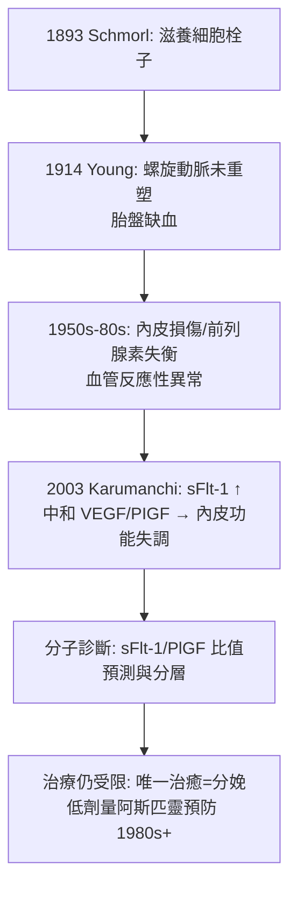

## 1893 - 子癇前症滋養細胞線索（胎盤如何成為子癇之謎的第一嫌疑人）

## 案件摘要

**本案偵破的是醫學史上持續至今的懸案之一：為什麼只有懷孕的人會得「子癇前症／子癇」（妊娠高血壓＋蛋白尿＋全身水腫，嚴重時抽搐、昏迷、死亡），而分娩後病症又會自行消失？**

1893 年，德國病理學家卡爾·施莫爾（Karl Schmorl）的遺稿發表：他在 17 名子癇死者的肺、腎、肝微血管中，發現大量**滋養細胞（trophoblast）栓子**——胎盤的細胞跑到母體全身循環。這是「子癇的胎盤起源」的第一件物證。此後一百三十年，偵探們沿著胎盤線索一路推進：1914 年的屍檢病理（Young 的子宮螺旋動脈未重塑）、1950s 的內分泌異常、2003 年的 sFlt-1（抗血管生成因子）——今日的「兩階段模型」已能把病史講完整，但治癒手段仍是「終止妊娠」。本篇偵破的是謎題的成形過程。

## 前因 -- 為什麼會有這個案子

- **古代的記錄**。埃及莎草紙、希波克拉底與蓋倫已描述孕婦抽搐；1900 年代前的解釋五花八門：月亮（eclampsia 源自希臘「閃電」）、子宮移位、乳汁倒流、神經紊亂。
- **19 世紀的臨床定義**。1840s 英國 Lever 注意到子癇病人常有蛋白尿；1897 年 Von Jacobi 等確立「高血壓＋蛋白尿＋水腫」三聯徵——診斷有了量尺，但**病因**仍是謎。
- **病理學的成熟**。屍檢顯微鏡學（魏爾嘯傳統）提供「到死者器官裡找證據」的方法——施莫爾正是這個傳統的執行者。
- **病人的哀傷背景**。19 世紀末子癇仍是產婦死亡主因之一；胎兒常因早產或胎盤缺血死亡——這是一樁「母子雙亡」的連環案。

## 線索與推理 -- 數學式、程式、理論

**線索一：施莫爾的滋養細胞栓子。** 正常懷孕也有少量滋養細胞進入母血（生理性滋養細胞血癥），但子癇死者肺微血管中的量級遠超正常——「胎盤細胞大量逃逸」首次與疾病關聯。這指向胎盤，而非子宮本身。

**線索二：1914 年 Young 的病理反推。** 英國 J. M. Young 等人屍檢發現：子癇病人的子宮螺旋小動脈**未發生理論上應有的生理性重塑**（管壁應被滋養細胞侵蝕擴張成低阻力血管），仍是厚壁小管——胎盤灌流不足：

$$ \text{螺旋動脈重塑不足} \Rightarrow \text{胎盤缺氧} \Rightarrow \text{胎盤釋放異常因子} \Rightarrow \text{母體全身內皮損傷} $$

這是「兩階段模型」的病理學草稿。

**線索三：流行病學的畫像。** 20 世紀累積的風險因子：初產、多胎、葡萄胎（純胎盤組織，子宮空洞卻早早子癇——**只有胎盤沒有胎兒也會得病**，這是胎盤起源的邏輯絕殺）、慢性高血壓、肥胖、既往子癇前症史。畫像一致指向胎盤量與植入品質。

**線索四：2003 年 sFlt-1 的分子兇器。**

sFlt-1（可溶性 fms 樣酪氨酸激酶-1）像一塊海綿，吸走促血管生成的 VEGF/PIGF，使全身內皮「失修」→ 血壓升高、腎絲球漏蛋白、腦水腫抽搐。1400 年的謎題，分子答案在 2003 年到案。

## 結案 -- 後果與影響

- **診斷與分層的現代化**。「高血壓＋蛋白尿」的臨床定義（20 世紀定案）＋sFlt-1/PlGF 檢測（2010s 上市），使「重 vs 輕」「早發 vs 晚發」可被區分；孕 11–13 週的早期篩查（超音波子宮動脈血流＋血清學＋病史）成為常規（見 `1958-超音波首窺胎兒.md` 的產檢體系）。
- **預防的化學手段**。1980s 起低劑量阿斯匹靈的高危群預防證據累積（2017 年 ASPRE 試驗：早發子癇前症風險降約 62%）；鈣補充在低攝入人群亦有效。這是 130 年來僅有的預防抓手。
- **治療的邊界仍在**。唯一根治是娩出胎盤；硫酸鎂（1920s 首用、1995 Collaborative Eclampsia Trial 證實）控制抽搐、降壓藥控制血壓，都是「爭取時間」。胎兒未足月時，醫師仍在母胎之間做艱難的天平（見 `0100-索拉努斯論產婦疾病.md` 的古老倫理）。
- **一句話結案**：子癇前症案的主嫌從 1893 年就被鎖定——**胎盤**；但把嫌疑人的「作案工具」（sFlt-1）交出來，又等了 110 年。婦產科史上最長的偵查，仍差最後一段：治癒。

## 關鍵人物與文獻

- **卡爾·施莫爾（Karl Schmorl, 1861–1932）**——德累斯頓病理學家；1893 年遺稿式發表子癇屍檢的滋養細胞研究（他本人因故延後出版，正式發表由同事完成）。
- **J. M. Young（英國病理學家）**——1914 年螺旋動脈未重塑的屍檢系列。
- **Ravi Thadhani 與 S. Ananth Karumanchi**——2003 年 NEJM 論文確認 sFlt-1 過量與子癇前症的因果關係。
- **Lever（John Lever, 1840s）**——蛋白尿與子癇關聯的臨床偵探。
- 文獻——Schmorl, *Pathologisch-anatomische Untersuchungen über die Eklampsie*, 1893；Thadhani et al., NEJM 2003；ASPRE Trial, NEJM 2017。
- **現代註腳**——2020s 試驗中的「sFlt-1 吸附血漿置換」與標靶分子研究正試圖把「唯一治療是分娩」改寫掉；若成功，將是自塞麥爾維斯以來產科最後一塊大懸案的結案陳詞。
