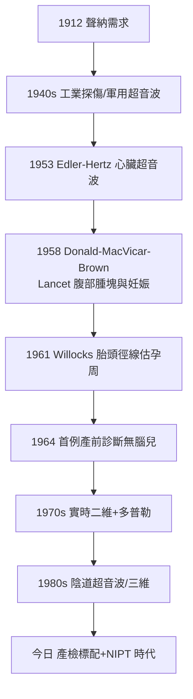

## 1958 - 超音波首窺胎兒（兩千年來第一次「看見」子宮裡的活胎）

## 案件摘要

**本案偵破的是婦產科最悠久的感官懸案：自希波克拉底以來，醫學對子宮內胎兒的一切認知都來自觸診、聽診與推理——1958 年 6 月 7 日，這一切結束了。**

當天《Lancet》刊出格拉斯哥的伊恩·唐納（Ian Donald）、John MacVicar 與 Tom Brown 的論文《Investigation of Abdominal Masses by Pulsed Ultrasound》：以脈衝式超音波（超聲波）診斷腹部腫塊，其中兩例為孕婦——胎囊、胎頭在 A 型示波器與雙向掃描上首次顯形。此後十年，唐納團隊把它發展成產科專用儀器：胎頭測量、胎位、多胎、胎盤定位、無腦畸形篩檢。胎兒從「藏在黑箱裡的病人」變成**有影像、有尺寸、有出生照的當事人**。本案的謎題：一個來自潛艇與工業探傷的軍事技術，如何被一位婦產科教授「偷渡」進產房？

## 前因 -- 為什麼會有這個案子

- **回聲定位的物理學就緒**。1912 鐵達尼號沉沒催生聲納；1920s–30s SonoGuy（Paul Langevin）的潛艇聲納、1940s 二戰雷達與超音波探傷（Sokolov 1929 的金屬探傷構想、1940s 美國 Firestone 的工業探傷儀）累積了全部硬體。
- **醫學的第一波**。1949–1950s 美國 Ludwig 與 Struthers（膽結石探測）、瑞典 Edler 與 Hertz（1953 心臟超音波）已證明人體可成像——但都是 A 型（單一聲束回波幅度），像「單點雷達」。
- **唐納的個人動機**。他是格拉斯哥婦產科教授、二戰皇家空軍軍醫（熟悉雷達），又是用 X 光判斷胎兒和腫瘤的挫敗者：孕婦不該吃輻射劑量，而骨盆 X 光判斷胎位與巨腹腫瘤（纖維瘤？囊腫？雙胎？）誤診率高。
- **產科的知識困境**。「懷孕第幾週」靠經期記憶＋子宮大小估計，誤差數週；前置胎盤的診斷要靠陰道指檢賭一把出血。**看不見，就一直在賭。**

## 線索與推理 -- 數學式、程式、理論

**線索一：回聲測距的幾何學。** 脈衝超音波的基本式：

$$ d = \frac{c \cdot t}{2}, \quad c_{\text{軟組織}} \approx 1540\ \text{m/s} $$

已知聲速與回波時間，即可算出界面深度。A 型給「一條線上的深度」，唐納團隊（與工程師 Tom Brown、物理學家參與的 Booth 公司合作）加上了**機械掃描＋亮度調製（B 型）**：把一束回波變成一張斷面圖——「看見」的本質是把時間序列轉成空間圖像。

**線索二：組織聲阻抗差異表。** 胎囊（液體，無回聲）、胎頭（骨化，強回聲）、胎盤（中等回聲）——不同聲阻抗的界面回波各異，這張「聲學解剖圖」是唐納團隊用大量臨床對照（開腹手術、屍檢驗證）建立的原創資產：

```python
obstetric_echo = {
    "胎囊":     "無回聲暗區 → 孕4-5週可見",
    "胎心搏動": "閃動回聲 → 孕6-7週可見(結束『聽見時代』的獨佔)",
    "胎頭":     "強回聲橢圓 → 頭徑測量估孕周(1961 Willocks)",
    "胎盤":     "中等回聲板 → 前置胎盤免指檢(1966-68)",
    "無腦兒":   "胎頭缺失 → 1964 首例畸形產前診斷",
}
# 1960s: 產科超音波從『會不會看』變成『怎麼量』
# 1970s: 實時(real-time)掃描 → 胎兒活動直接可見 → 胎兒成為『可觀察的病人』
```

**線索三：與 X 光的價值對比。** 超音波無輻射、可重複、可床邊；X 光有劑量、要對比劑。1960s 輻射恐懼（原子時代）與 1958 年 Alice Stewart 的兒童癌症—產前 X 光論文，共同把超音波推上「孕婦友好成像」的獨佔位。

**線索四：技術演化的幾十年。**



## 結案 -- 後果與影響

- **產前照護的全面改寫**。孕周核對、胎位、多胎、胎盤位置、羊水量、畸形篩檢（20 週結構超音波）、胎兒生長監測——今日「產檢」的每一步都有超音波。胎兒宮內治療（輸血、手術）更是不可能沒有它。
- **胎兒的社會身分**。「產檢照片」使胎兒進入家庭敘事；墮胎、產前診斷、胎兒權利的公共辯論自此有了視覺素材——技術同時餵養了醫學與政治。
- **英國的意外優勢與商業史**。NHS 體系讓格拉斯哥團隊能大樣本驗證；Nuclear Enterprises/Booth 等小公司孵化了醫用超音波產業；GE、Siemens 後來居上——**醫學影像產業的宗譜裡有一支潛艇血統**。
- **一句話結案**：1958 年的《Lancet》四頁論文，解決的是一個自希波克拉底起的感官欠債——**婦產科史上第一次，胎兒不再需要被想像**。

## 關鍵人物與文獻

- **伊恩·唐納（Ian Donald, 1910–1987）**——南非出生、格拉斯哥婦產科教授；皇家空軍軍醫出身；產科超音波之父，1977 年封爵士。
- **Tom Brown（1924–2024）**——電機工程師；與唐納共造第一台產科複合掃描儀（Doppler 與雙向掃描器）；晚年仍活躍於超音波史口述計畫。
- **John MacVicar**——格拉斯哥婦產科醫師，論文的臨床合作者。
- **Edler 與 Hertz（1953）、Ludwig 與 Struthers（1949）**——醫用超音波的先行者（心臟與膽囊）。
- 文獻——Donald, MacVicar & Brown, "Investigation of Abdominal Masses by Pulsed Ultrasound", *Lancet*, 1958;1:1188–95；Donald & Brown, "Localization Using Ultrasonic Echoes", 1961。
- **現代註腳**——今日手機大小的超音波探頭已在低資源地區普及，孕 12 週 NT 篩查＋20 週結構篩查是全球標準產檢；1958 年那張粗糙的示波器照片，是今日所有「寶寶第一張照片」的祖先。
