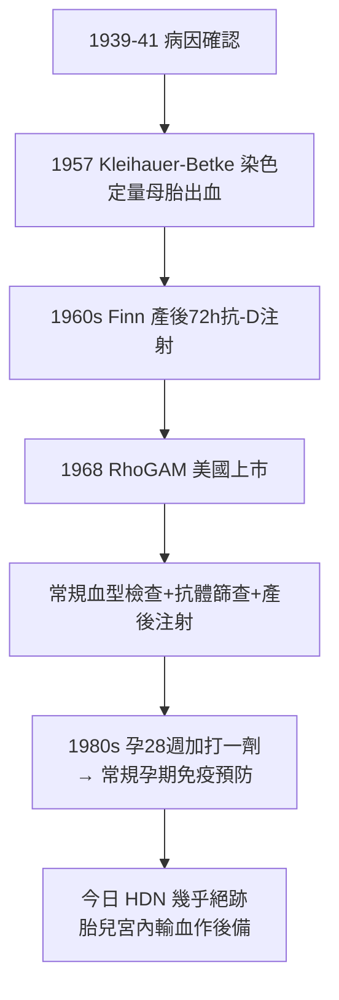

## 1968 - Rh 免疫球蛋白 RhoGAM（母胎血型戰爭的終結）

## 案件摘要

**本案偵破的是一場持續半世紀的免疫學戰爭：健康的媽媽為什麼會一次比一次危險地殺死自己的孩子——以及 1968 年的「事後疫苗」如何讓新生兒溶血症從美國每年逾萬例死亡變成幾乎絕跡。**

1939–1940 年，Landsteiner 與 Wiener 發現 Rh 血型系統（用恆河猴 rhesus 紅細胞免疫兔而製得的抗血清命名）；1940s 菲利普·萊文（Philip Levine）證明：Rh 陰性母親懷 Rh 陽性胎兒後產生的抗體，正是新生兒溶血病（HDN，erythroblastosis fetalis）的病因——母體免疫系統把胎兒紅細胞當入侵者，抗體經胎盤回攻下一胎。1960s 英國利物浦的 Cyrus Finn 做出關鍵實驗：**產後 72 小時內給 Rh 陰性母親注射抗-D 免疫球蛋白**，可在胎兒紅細胞引發免疫之前把它們清除——「騙過免疫系統，不讓它學會開火」。1968 年 RhoGAM 在美國上市。本案的謎題：為什麼「治療」的答案是「在最不可能治療的時刻——剛生產完的母親身上——打一針」？

## 前因 -- 為什麼會有這個案子

- **新生兒溶血病的恐怖**。1930s–40s，美國每年約 1 萬名新生兒死於此病；嚴重者全身水腫（胎兒水腫 hydrops fetalis）或出生後嚴重黃疸→核黃疸（膽紅素入腦）。1930s 尚無病因，僅知「生過一個病的，下一個更糟」。
- **1939–1941 的病因破案**。1939 Levine 與 Stetson 從一位生下死胎的產婦血清中發現新抗體；1940 Landsteiner–Wiener 發現 Rh 抗原；1941 Levine 證實 HDN 的 Rh 母胎不合機制——**母胎免疫衝突的病理學成立**。
- **治療的無力**。換血療法（1940s Diamond 等建立，臍靜脈換血）能救活部分嬰兒，但這是**下游搶修**；上游（阻止母親致敏）無解。
- **免疫學的時機概念就緒**。1940s–50s 免疫耐受與「初次免疫 vs 再次免疫」的概念成熟——理論上，若在初次接觸抗原時就清除抗原，免疫系統「不會記仇」。這是預防的理論窗口。

## 線索與推理 -- 數學式、程式、理論

**線索一：致敏的事件解剖。** 母親致敏多發生在**分娩時**（胎盤剝離，胎兒紅細胞進入母血）：

$$ \text{分娩出血（FMH）} \Rightarrow \text{Rh}^{-}\text{母親接觸 Rh}^{+}\text{紅細胞} \Rightarrow \text{抗-D 致敏} \Rightarrow \text{下一胎抗體經胎盤攻擊胎兒} $$

防線應設在「致敏完成之前」——即產後 72 小時內。這個時機觀念是本案的核心偵探洞察。

**線索二：Finn 的利物浦實驗（1960–1964）。** Finn 等人先用酸洗脫染色法（Kleihauer-Betke test, 1957）定量母血中的胎兒紅細胞，證實 FMH 的普遍性；再以抗-D 免疫球蛋白在產後注射，用「母血中注入 Rh+ 紅細胞→看抗體是否生成」做挑戰實驗——注射組致敏率接近 0，對照組顯著致敏：

```python
def sensibility(fmh_dose, anti_d_given_within_72h):
    if anti_d_given_within_72h:
        return "被動抗體清除胎兒紅細胞 → 免疫系統未遇抗原 → 不致敏 (~<1%)"
    return "主動免疫完成 → 永久記憶 → 下胎 HDN 風險 (>10-15%)"
# 1961-64 Liverpool 系列 → 1968 美國核准 RhoGAM → 1969 英國
```

**線索三：被動免疫的悖論之美。** 這是「用敵人的武器當疫苗」的案例：抗-D 抗體本身就能殺嬰兒，但若在**母親免疫系統看見抗原之前**由外源給予，它會把 Rh+ 紅細胞清除掉，免疫系統便「沒有東西可以記住」——**免疫學的預防性鎮壓**。

**線索四：技術的配套齊全。**



## 結案 -- 後果與影響

- **新生兒溶血病從絕症變成罕見事故**。美國 HDN 相關死亡從 1960s 每年約萬例降至今日數十例（多為漏打者）；這是**預防醫學的教科書案例**——治癒率 100%，且是「打在母親身上、救在下一胎身上」的時間差醫學。
- **母胎免疫學的建立**。胎盤作為免疫特權部位、微嵌合體（fetal microchimerism）、母胎耐受——HDN 案催生了整個「生殖免疫學」領域。
- **公共衛生流程的模板**。血型檢查＋抗體篩查＋產後注射的常規化，是「產檢套餐」裡第一套以病理機制為基礎的標準作業程序；今日 NIPT、葡萄糖耐量、B 群鏈球菌篩查皆循其「篩查→預防→監測」三段式。
- **一句話結案**：RhoGAM 的發明證明，**有些疾病的最強藥物不在病人身上，而在下一個病人還沒成為病人之前**——預防的時間差，就是全部的藥效。

## 關鍵人物與文獻

- **Karl Landsteiner（1868–1943）與 Alexander Wiener（1907–1976）**——1940 年發現 Rh 因子；Landsteiner 亦為 ABO 血型（1901）與 Polio 病毒分離（1908–9）的偵探，1930 年諾獎。
- **Philip Levine（1900–1987）**——俄裔美國免疫血液學家；1939–41 年確立 HDN 的母胎免疫機制。
- **Cyrus Finn（1921–2008）**——利物浦產科醫師；產後抗-D 注射的實驗與推廣者，被稱為「RhoGAM 之父」之一。
- **Vincent Freda、John Gorman、William Pollack**——哥倫比亞與紐約血液中心團隊，1968 年美國臨床推行。
- 文獻——Finn et al., "Immunological responses of the Rh-negative mother to her Rh-positive infant", *BMJ* 1961；Freda, Gorman & Pollack, *Transfusion* 1964；Clarke, "The prevention of Rh haemolytic disease", *Br J Haematol* 1989。
- **現代註腳**——2020s 無細胞胎兒 DNA（NIPT）已可從母血直接判斷胎兒 Rh 型，讓 Rh 陰性孕婦懷 Rh 陰性胎兒時免打針——**這場 80 年前的戰爭，正在被更早的偵測技術收尾**。
