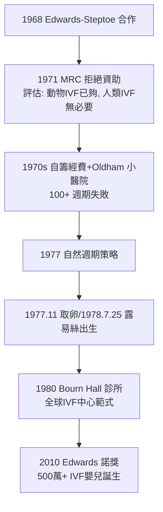

## 1978 - 試管嬰兒露易絲·布朗（人類生殖第一次脫離輸卵管）

## 案件摘要

**本案偵破的是一場持續 12 年、被官方拒絕資助、被宗教與媒體夾擊、最後由一對婦產科醫師與一位生理學家默默完成的冒險：讓人類的受精在子宮外完成。**

1978 年 7 月 25 日深夜，英國奧德姆（Oldham）總醫院，5 磅 12 英兩的女嬰露易絲·布朗（Louise Joy Brown）以剖腹產出生——她是全球第一位**體外受精（IVF）**嬰兒。背後是婦科醫師帕特里克·斯特普托（Patrick Steptoe）的腹腔鏡取卵、生理學家羅伯特·愛德華（Robert Edwards）的體外培養與受精、以及護理師Jean Purdy的胚胎學與臨床協調——三人合計失敗 100 餘個週期、數年顆粒無收，拒絕他們的英國醫學研究委員會（MRC）曾評估「不值得資助」。2010 年愛德華獨享諾貝爾生理學或醫學獎（斯特普托 1988 年已逝，Purdy 1985 年已逝）。本案的謎題：為什麼「讓卵在玻璃皿裡受精」這個簡單目標，人類走了 12 年？

## 前因 -- 為什麼會有這個案子

- **科學積累就緒**。1934 年 Pincus 的兔卵體外受精（被醜化）；1951 美籍科學家 Chang 與 Austin 各自發現**精子獲能**（capacitation）——精子需要在雌性生殖道內「待機數小時」才能穿透卵子；1959 Chang 以倉鼠完成真正的體外受精與發育到卵裂。哺乳類 IVF 的理論最後一塊拼圖到位。
- **不孕症的沉重負擔**。輸卵管堵塞占女性不孕約 1/4；當時唯一「治療」是開腹做吻合手術，成功率低。倫敦—劍橋一帶的患者組織（如 Lesley Brown 夫婦）是實際的動力。
- **倫理與宗教的前線**。1978 年之前，「試管嬰兒」是科幻與神學的常客（赫胥黎《美麗新世界》的瓶子嬰兒）；梵蒂岡與英國國教內部都有強烈反對。
- **斯特普托的腹腔鏡**。1960s 他把婦科腹腔鏡從診斷工具改造成取卵手術平台——在超音波時代之前，這是唯一能「看見」卵巢並精準取卵的方式（見 `1958-超音波首窺胎兒.md` 超音波技術的平行發展）。

## 線索與推理 -- 數學式、程式、理論

**線索一：獲能的發現是鑰匙。** 沒有獲能，體外精子永遠打不開卵子：

$$ \text{新鮮精子（未獲能）} \xrightarrow{\text{女性生殖道/培養條件}} \text{獲能精子} \xrightarrow{\text{頂體反應}} \text{受精} $$

Edwards 在 1960s 用小鼠與人卵反覆優化培養液與培養時間，1965 年首次在體外培養人卵至成熟；1968–69 年與斯特普托合作，以腹腔鏡取卵＋體外受精，第一次在顯微鏡下看到人類體外受精的成功。

**線索二：激素時鐘的把握。** 取卵必須在 LH 峰前 26–28 小時——在沒有可靠激素監測的年代，Edwards 以每日尿樣測 LH 峰（後由 Purdy 與 Edwards 用簡陋免疫法建立），配合病人住院抽血，把「取卵窗口」精確到小時。**IVF 的本質是生殖內分泌的工程化**。

**線索三：胚胎培養的逐步打通。** 1970s 團隊的成功率鏈：取卵→成熟→受精→卵裂→移植→妊娠→活產。每一步都是瓶頸；失敗 100+ 個週期中，多數死在「移植後不著床」。1977 年底的突破：放棄卵巢刺激（促性腺激素）改用**自然週期**單卵，減少內膜紊亂——Lesley Brown 的單一胚胎，就是這個戰術轉變的產物。

**線索四：失敗的科學與資助的冷漠。**

## 結案 -- 後果與影響

- **生殖醫學的工業化**。1980 Bourn Hall 診所成立，培養了全球第一批 IVF 醫師；1983 首例冷凍胚胎嬰兒、1992 ICSI（單精子顯微注射，比利時 Palermo）把男性不孕納入治療——全球今日每年數十萬 IVF 嬰兒，累計逾 1200 萬。
- **倫理與立法的誕生**。1984 Warnock 報告→1990 英國《人類受精與胚胎學法》（HFEA）：胚胎研究的 14 天界限、知情同意、監管機構——現代生殖倫理的法律框架由此案催生。今日的設計嬰兒、胚胎基因編輯之辯，全部站在 1978 年劃下的界線上。
- **女性不孕的哲學轉變**。「不生孩子＝命運」變成「不生孩子＝可診斷、可治療的醫學問題」；與 1960 年避孕藥（`1960-避孕藥恩維德.md`）合起來，女性第一次對「懷不懷孕、何時懷孕」同時擁有**做**與**不做**的技術選項。
- **陰影面**。多胎妊娠、卵巢過度刺激（OHSS）、高齡助孕的風險；生殖商業化與代孕的跨國爭議；以及被 MRC 拒絕資助所揭示的老問題——**官方體系的風險迴避與體制外醫師的孤注一擲，是醫學進步的雙軌**。
- **一句話結案**：露易絲·布朗的出生證明了一件事——**生殖不是只能自然完成的天賦，而是一條可以被工程化的流水線**；從 1978 年的單一胚胎到今日的 1200 萬嬰兒，人類把「生育」從命運欄搬到了處方欄。

## 關鍵人物與文獻

- **羅伯特·愛德華（Robert Edwards, 1925–2013）**——劍橋生理學家；人卵體外成熟與受精的先驅；2010 年諾貝爾生理學或醫學獎（「體外受精的發展」）。
- **帕特里克·斯特普托（Patrick Steptoe, 1913–1988）**——奧爾德姆婦科醫師；腹腔鏡取卵的開拓者；英國 CBE；諾獎遺珠。
- **Jean Purdy（1945–1985）**——護理師與胚胎學家；IVF 團隊的第三位創始人，長期被遺忘，2010s 被史學還原（Bourn Hall 2018 年為其立牌）。
- **Leslie 與 John Brown**——九年不孕的普通夫妻；露易絲的母親 Leslie 1978 年的勇敢成為全球頭條。
- 文獻——Steptoe & Edwards, "Birth after the reimplantation of a human embryo", *Lancet*, 1978;2:366（史上最短的四句醫學論文之一）；Edwards & Steptoe, *A Matter of Life*（1980，自傳）。
- **現代註腳**——露易絲本人於 2006 年自然受孕生下兒子，證明 IVF 子女的生育力正常；她的出生證明上有「born by caesarean section」的普通註記——**歷史的偉大時刻，常常以最平常的文件歸檔**。
