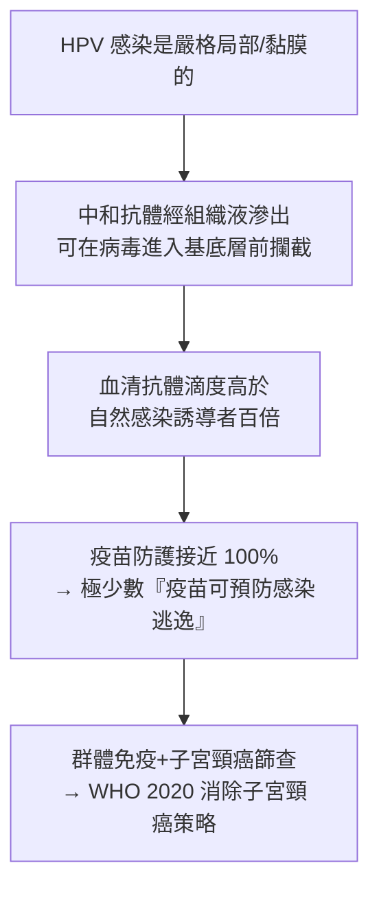

## 2006 - HPV 疫苗加衛苗 Gardasil（人類第一支防癌疫苗）

## 案件摘要

**本案偵破的是一個顛覆癌症史框架的命題：癌症可以像小兒麻痺一樣用疫苗消滅。**

2006 年 6 月 8 日，美國 FDA 核准默沙東的四價 HPV 疫苗 Gardasil（加衛苗）：針對 HPV 6/11/16/18 型的類病毒顆粒（VLP）疫苗——其中 16/18 型造成全球約 70% 子宮頸癌，6/11 型造成 90% 生殖器疣。它是人類**第一支以「預防癌症」為註冊適應症的疫苗**。背後是三段長鏈：1970s 德國病毒學家哈拉爾德·楚爾·豪森（Harald zur Hausen）逆主流而行，主張子宮頸癌的病因是 HPV 而非皰疹病毒，1983–84 年克隆出 HPV 16/18；1991 年澳洲 Ian Frazer 與中國科學家周健以 VLP 技術解決「無法大量培養病毒」的疫苗難題；2002 年 NEJM 發表雙盲試驗，疫苗對持續感染的防護 100%。2008 年楚爾·豪森獨得諾貝爾獎。本案的謎題：為什麼一種「沒有藥可治的感染」反而是最容易用疫苗擋在門外的疾病？

## 前因 -- 為什麼會有這個案子

- **子宮頸癌的公共衛生重量**。20 世紀末全球每年約 50 萬新發病例、27 萬死亡，是女性第二常見癌症；抹片篩查（Papanicolaou, 1928 發明、1950s 普及）已使高收入國家死亡率大降，但低資源地區幾乎無篩查體系——**需要的是疫苗，不是更多的抹片**。
- **流行病學的偵探背景**。1970s 主流假說是 HSV-2（皰疹病毒）致癌；zur Hausen 在子宮頸癌組織中找不到 HSV DNA，改而押注在生殖器疣常見的乳突病毒（papillomavirus）。
- **疫苗技術的攔路虎**。HPV 是嚴格種特異、只在分化的上皮角化細胞中複製的病毒——**無法像小兒麻痺那樣在細胞培養或動物身上大量繁殖**，傳統滅活/減毒疫苗路線全部不通。需要一個繞過「養病毒」的結構疫苗方案。
- **分子流行病學的工具到位**。1980s PCR 與病毒基因分型，使「特定型別→特定癌症」的流行病學因果鏈可以被精確測量。

## 線索與推理 -- 數學式、程式、理論

**線索一：zur Hausen 的排除法。** 1974–1984 年他系統地在子宮頸癌組織中搜尋 HSV-2 DNA——找不到；轉而以 HPV 探針搜尋，1983 年在子宮頸癌活檢中克隆出 HPV 16 DNA、1984 年克隆出 HPV 18：

$$ \text{HPV 16/18 DNA 存在於} > 99\% \text{ 的子宮頸癌} \quad (\text{後續meta分析}) $$

這條「分子流行病學的因果鏈」最終被walboomers 與 Meijer 等以 1000 例系列確認——被稱為「比任何致癌機制都更完美的因果證據」。

**線索二：VLP 技術——無病毒的疫苗。** 周健與 Frazer 在 1991 年發現：HPV 的 L1 衣殼蛋白在真核細胞中自行折疊成**類病毒顆粒**（virus-like particle）——外形與真病毒相同、能誘導中和抗體，但**不含 DNA、無感染力**：

$$ \text{L1 蛋白} \xrightarrow{\text{酵母/桿狀病毒表達}} \text{VLP} \xrightarrow{\text{免疫}} \text{高效中和抗體（滴度高出自然感染 10-100 倍）} $$

這是「**用病毒的外衣、不用病毒的本體**」的結構疫苗學——後續乙肝疫苗（Recombivax）與 COVID 疫苗的蛋白路線同屬此家族。

**線索三：臨床試驗的乾淨證據。** 2002 年 Koutsky 等在 NEJM 發表雙盲 RCT（2392 位 16–23 歲女性）：疫苗組 0 例 HPV 16 持續感染/相關病變，安慰劑組 41 例——**防護率 100%**（95%CI 90–100）。2005 年後四價、二價大型試驗再證實對 CIN 2/3（癌前病變）的防護 >95%。

**線索四：疫苗的機理為何如此高效。**

關鍵的物理事實：HPV 只感染上皮基底層，需要微小創口；高滴度中和抗體在組織間液中的「門崗效應」幾乎無死角——**感染路徑越簡單的病毒，疫苗越強**。

## 結案 -- 後果與影響

- **接種運動與早期效果**。2007 年澳洲全球首推全國女生接種（2013 年納入男生），生殖器疣幾乎絕跡、HPV 16/18 感染大降；2010s 瑞典、英國的子宮頸癌發生率在年輕世代斷崖下降。2020 年 WHO 發起「90-70-30」消除子宮頸癌策略（90% 女童接種、70% 女性終身篩查、90% 病變治療）。
- **癌症史的轉折**。人類第一次把「可預防癌症」列為公共衛生目標；疫苗—篩查—治療的三段防線，成為後續肝癌（乙肝疫苗）、EBV 相關癌、H. pylori 相關胃癌的「感染相關癌症」處理範本。
- **性與倫理的戰場**。疫苗以「防性傳播疾病」為本質，遭到「鼓勵亂交」的道德抵制；日本 2013 年的主動停用與爭議、美國的立法拉鋸、低中收入國家的價格與冷链障礙——**疫苗的科學效率與社會接納是兩件事**。2024 年 WHO 已有單劑方案（2022 年建議 9–14 歲單劑）以擴大覆蓋。
- **一句話結案**：Gardasil 的真正發明不是那瓶疫苗，而是一條新的因果鏈——**「感染→癌症」一旦被分子流行病學鎖定，癌症就從命運變成了免疫學的靶子**。2006 年之後，「防癌」第一次成為針頭可以完成的任務。

## 關鍵人物與文獻

- **哈拉爾德·楚爾·豪森（Harald zur Hausen, 1936–2023）**——德國病毒學家、海德堡癌症研究中心主席；2008 年諾貝爾生理學或醫學獎（獨得一半，另兩位由 HIV 發現者分享）。
- **周健（1957–1999）與 Ian Frazer**——1991 年在布里斯班以 L1 表達自組裝 VLP，是疫苗的技術核心；周健 42 歲猝逝，是疫苗史上最令人遺憾的早逝；澳洲以每年國際HPV研討會紀念他。
- **Douglas Lowy 與 John Schiller**——美國國家癌症研究所（NCI）；VLP 的獨立發明與工藝放大，Gardasil/Cervarix 的共同技術源頭。
- **Laura Koutsky**——華盛頓大學流行病學家；2002 年 NEJM 關鍵 RCT 的主持人。
- 文獻——zur Hausen, "Papillomaviruses causing cancer: evasion from host-cell control", JNCI 2000（諾獎演講改寫）；Koutsky et al., NEJM 2002；周健與 Frazer 的專利（1991–1994）分別授權默沙東與 GSK。
- **現代註腳**——2024 年全球已逾 130 國納入 HPV 疫苗計畫，累計劑次逾 5 億；而子宮頸癌的「消除」目標（本世紀末 <4/10 萬）仍需在接種率與篩查覆蓋上完成最後一躍——**2006 年開出的這支針，是迄今人類癌症預防史上最接近「根除」的一針**。
