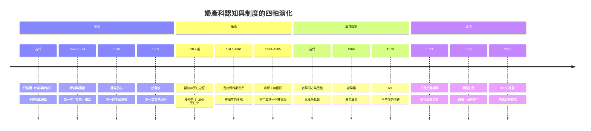

# 婦產科的歷史：從產婆的雙手、看不見的胎兒，到產房細菌學與試管嬰兒

> 本書以「推理探案」的體例，為人類婦產科學史上的每個關鍵事件寫一篇 wiki：
> 謎題是什麼（為何產婦死亡率如此之高？為何兩千年來無法看見胎兒？）？
> 偵探是誰（產婆、解剖學家、接生外科醫、細菌學家、內分泌學家、遺傳學家）？
> 線索與推理是什麼？每篇檔名以年份開頭（4 位數，負年以 `-` 開頭）。

## 雙線主軸

| 線 | 演變 |
|---|---|
| **醫學認知線** | 經驗接生 → 解剖學革命 → 器械與手術化 → 細菌學與無菌術 → 生理學與內分泌學 → 影像（超音波）→ 遺傳學與產前診斷 → 生殖工程與疫苗防癌 |
| **權力轉移線** | 產婆主導（女性空間）→ 男性醫師介入（產鉗黑箱、產科學院）→ 醫院化與麻醉 → 醫師全面接管 → 病人知情與選擇權回歸（無痛、產檢、輔助生殖） |

---

## 年表（非常詳細版）

### 第一篇：古代的雙手——接生是最古老的外科，也是最古老的謎

| 年份 | 事件 | 意義 | wiki |
|---|---|---|---|
| 約前 1900 | 埃及《克恩翁紙草》（Kahun Papyrus）記載婦科檢查、避孕藥方與妊娠診斷（以大蒜—洋蔥試驗判斷生育力） | 最早的婦產科專書 | [-0450-羅馬剖腹產法之謎](-0450-羅馬剖腹產法之謎.md) |
| 約前 500–前 300 | 希波克拉底學派描述產程、胎位異常與「產婆椅」；亞里士多德《動物志》記錄雞胚逐日發育 | 胚胎學觀察的起點 | 同上 |
| 約前 450 | 羅馬傳說：努馬王《王室法》要求死於難產的孕婦「剖腹取胎」下葬；凱撒（Caesar）之名被後世附會為「剖腹生」（caesarean）的詞源 | 「caesarean section」詞源之謎 | 同上 |
| 約 100 | 索拉努斯（Soranus）以希臘文寫成《論產婦疾病》（Gynaikeia）：正確產姿、胎位檢查、產鉗式雙手牽引、新生兒處理與產褥照護 | 古代產科學的最高峰，統治歐洲 1400 年 | [0100-索拉努斯論產婦疾病](0100-索拉努斯論產婦疾病.md) |
| 約 130–200 | 蓋倫講解卵巢（「女性的睪丸」）與輸卵管；但四體液學說把妊娠、子癇、產後病全部塞進「經血停滯」框架 | 錯誤生理學的千年統治 | 同上 |

### 第二篇：中世紀——產婆的黃金年代與黑暗指控

| 年份 | 事件 | 意義 | wiki |
|---|---|---|---|
| 5–10 世紀 | 修道院醫學保存索拉努斯與Muscio 拉丁節譯本（Gynaecia） | 古代產科知識的冷凍保存 | [0100-索拉努斯論產婦疾病](0100-索拉努斯論產婦疾病.md) |
| 1000 前後 | 阿爾巴納斯（Trota of Salerno）《實用婦科》；薩列諾醫學校興起 | 中世紀女性醫學文本的孤本 | 同上 |
| 1486 | 《女巫之錘》（Malleus Maleficarum）出版：指控產婆「殺嬰、奪陽具、獻給魔鬼」，產婆成為獵巫首批目標 | 女性身體知識被妖魔化 | [1486-女巫之錘與產婆的罪名](1486-女巫之錘與產婆的罪名.md) |
| 1513 | 德國醫師 Rösslin 出版《懷孕的花園》（Der Schwangeren Frauen und Hebammen Rosengarten）：第一本印刷產婆手冊，附胎位木刻圖 | 官方認證產婆制度的開始 | [1513-懷孕的花園第一本產婆手冊](1513-懷孕的花園第一本產婆手冊.md) |
| 1540s–1550s | 英、法、德各國跟進出版產婆手冊（Ballard 1546、Raynalde 1545 英譯《The Birth of Mankind》）；城市發給產婆執照與宣誓 | 「女性教女性」的手冊傳統 | 同上 |

### 第三篇：解剖學革命與產鉗黑箱——男性醫師的破門而入

| 年份 | 事件 | 意義 | wiki |
|---|---|---|---|
| 1543 | 維薩里《人體構造》出版：以親手解剖糾正蓋倫 200 處錯誤，含女性骨盆與生殖器官（但第 5 卷女圖仍混入豬腎） | 解剖學真相取代權威文本 | [1543-維薩里與女性骨盆解剖](1543-維薩里與女性骨盆解剖.md) |
| 1559 | Colombo 宣稱「發現」陰蒂；Falloppio 爭論優先權並命名輸卵管（法洛皮奧管） | 女性解剖地圖補完 | 同上 |
| 約 1600–1620 | 英國錢伯倫家族（Peter Chamberlen 祖孫三代）發明「鐵製產鉗」，保密近百年，以巨型木箱、蒙眼、獨處術式守祕 | 「拿得走嬰兒的鐵手」成為家族專利 | [1620-錢伯倫產鉗黑箱](1620-錢伯倫產鉗黑箱.md) |
| 1670 | 休·錢伯倫（Hugh Chamberlen）試圖把產鉗賣給法國太醫院，演示失敗（產婦死亡），法方詢問「能否保證母子平安」遭拒 | 商業保密醫學的破產 | 同上 |
| 1733 | 小錢伯倫死後三年，產鉗設計終於出版（A Treatise of Midwifery, by Edmund Chapman 相關記載；1733 年版權頁現世）；產鉗迅速普及 | 祕密終結，器械產科時代開始 | 同上 |
| 1751 | 蘇格蘭產科醫師斯梅利（William Smellie）《產科理論與實務論》：開放教學、訂製標準產鉗、發明徒手旋轉胎位法、首創胎頭徑線測量 | 產科從祕術變成可傳授的科學 | [1751-斯梅利與產科手術化](1751-斯梅利與產科手術化.md) |
| 1774 | 威廉·亨特（William Hunter）《人類懷孕子宮的解剖學》巨幅銅版畫問世 | 第一次「看見」子宮內的胎兒 | 同上 |
| 1818 | 法國醫師凱爾加拉德克（Kergaradec）用聽筒聽見胎兒心跳與臍帶雜音 | 兩千年來第一次「聽見」胎兒活著 | [1818-聽診器聽見胎心](1818-聽診器聽見胎心.md) |

### 第四篇：止痛、細菌與雙重革命——產房的四十年戰爭（1847–1885）

| 年份 | 事件 | 意義 | wiki |
|---|---|---|---|
| 1847.1 | 辛普森（James Y. Simpson）在愛丁堡自以身試乙醚後，率先將麻醉用於分娩 | 分娩疼痛第一次可以「關掉」 | [1847-乙醚與氯仿無痛分娩](1847-乙醚與氯仿無痛分娩.md) |
| 1847.11 | 塞麥爾維斯（Ignaz Semmelweis）在維也納第一產科診所推行醫師「含氯石灰洗手」：產褥熱死亡率從 18% 降到 1–2%；教友捐體解剖對照住院/居家生產數據成為經典推理 | 產褥熱之謎被偵破，但被同行圍剿 | [1847-塞麥爾維斯產褥熱之謎](1847-塞麥爾維斯產褥熱之謎.md) |
| 1848–1861 | 反對聲浪：孟格納迪（Meigs）「醫師是紳士，紳士的手不可能有毒」；塞麥爾維斯《產褥熱的病因、概念與預防》（1861）出版後遭冷暴力，1865 死於精神病院 | 「屍體粒子」超前細菌理論 30 年的悲劇 | 同上 |
| 1853.4.7 | 維多利亞女王第八胎接受斯諾（John Snow）氯仿麻醉；「無痛分娩」獲王室背書，教會反對（「你必疼痛生產」）瓦解 | 疼痛的正當性被科學推翻 | [1853-維多利亞女王與氯仿](1853-維多利亞女王與氯仿.md) |
| 1857–1861 | 普魯士調查：醫院生產死亡率數倍於居家；倫敦、巴黎醫院被迫改革 | 醫院是「死亡之屋」的羞辱 | 同上 |
| 1865 | 李斯特（Joseph Lister）石炭酸抗菌手術 | 外科感染防線建立 | 同上 |
| 1879.5 | 巴斯德在巴黎產科醫院報告：從產褥熱病人膿血中分離鏈球菌（今 A 群化膿性鏈球菌），並當場培養示範給塞麥爾維斯的老對手看 | 產褥熱病原終於鎖定 | [1879-巴斯德鎖定產褥熱球菌](1879-巴斯德鎖定產褥熱球菌.md) |
| 1882 | 桑格（Eduard Sänger）發表剖腹產「古典式切口＋子宮縫合」：剖腹產從絕症手術變成可生存的手術 | 剖腹產的現代起點 | [1882-桑格剖腹產縫合術](1882-桑格剖腹產縫合術.md) |
| 1882–1885 | 科赫提出病原學準則與蒸氣滅菌；柏林、維也納、倫敦產房全面推行消毒與無菌接生 | 無菌產房時代降臨，產褥熱死亡率跌落一個數量級 | [1885-無菌產房時代](1885-無菌產房時代.md) |
| 1886–1900 | 產婦死亡率從 19 世紀中葉醫院的 5–20% 降至 1% 以下；「醫院比在家危險」的悖論消失 | 細菌學的直接回報 | 同上 |

### 第五篇：生理學世紀——從摸得到到看得見

| 年份 | 事件 | 意義 | wiki |
|---|---|---|---|
| 1893 | 施莫爾（Karl Schmorl）遺稿發表：在子癇死者肺、腎、肝微血管中發現滋養細胞栓子；子癇前症/子癇之謎開案（後世歸納為胎盤→內皮功能失調理論） | 子癇的胎盤起源論 | [1893-子癇前症滋養細胞線索](1893-子癇前症滋養細胞線索.md) |
| 1914–1920s | 高血壓＋蛋白尿被定為子癇前症診斷金三角；1920s 內分泌學興起：胎盤促性腺激素（1927 Zondek–Aschheim hCG 妊娠試驗） | 妊娠變成可量化的激素狀態 | 同上 |
| 1953 | 維吉尼亞·艾普加（Virginia Apgar）發表新生兒一分鐘評分法（Apgar score：呼吸、脈搏、膚色、肌張力、反射） | 新生兒急救從玄學變成數字管理 | [1953-艾普加新生兒評分](1953-艾普加新生兒評分.md) |
| 1958.6 | 伊恩·唐納（Ian Donald）等在《Lancet》發表腹部超音波診斷子宮與胎兒：胎囊、胎頭、多胎可見 | 兩千年來第一次「看見」活體胎兒 | [1958-超音波首窺胎兒](1958-超音波首窺胎兒.md) |
| 1960s–1970s | 超音波普及：孕周測量、胎盤定位、胎位與畸形篩檢；1968 年 Campbell 顯示胎兒頭圍預測孕期 | 產檢革命的儀器基礎 | 同上 |
| 1960 | 避孕藥 Enovid（norethynodrel＋mestranol）獲 FDA 核准；Pincus、Rock、Katharine McCormick 的激素避孕工程完工 | 第一次把懷孕的主導權交回女性手上 | [1960-避孕藥恩維德](1960-避孕藥恩維德.md) |
| 1968 | Rh 免疫球蛋白（RhoGAM）上市：基於 1940 Landsteiner–Wiener 發現 Rh 因子、1960s 菲恩（Finn）產後注射實驗 | 母胎血型戰爭（新生兒溶血症）被終結 | [1968-Rh免疫球蛋白與新生兒溶血症](1968-Rh免疫球蛋白與新生兒溶血症.md) |
| 1972 | 彩超＋胎心監護；1970s 英國 MRC 維多利亞皇后醫院系列：產前超音波與胎齡估計標準化 | 「懷孕第幾周」從經驗變成公制 | [1958-超音波首窺胎兒](1958-超音波首窺胎兒.md) |

### 第六篇：生殖工程與疫苗防癌——1978 年之後的世界

| 年份 | 事件 | 意義 | wiki |
|---|---|---|---|
| 1978.7.25 | 露易絲·布朗（Louise Brown）在英國奧德姆出生：Steptoe 腹腔鏡取卵＋Edwards 體外受精，全球第一位試管嬰兒 | 人類生殖第一次脫離輸卵管；Edwards 2010 年諾獎 | [1978-試管嬰兒露易絲布朗](1978-試管嬰兒露易絲布朗.md) |
| 1980s–1990s | IVF 迭代：1983 首例冷凍胚胎、1992 ICSI（胞漿內單精子注射）解男性不孕 | 不孕症的技術光譜成形 | 同上 |
| 1991 | 英國 MRC 葉酸試驗（LANCET）：孕期補葉酸使神經管缺陷（脊柱裂、無腦）復發風險降 72% | 營養遺傳學的直接證據，全球強化穀物政策 | [1991-葉酸與神經管缺陷](1991-葉酸與神經管缺陷.md) |
| 1990s–2000s | 羊膜穿刺、絨毛取樣、NIPT（2011 無細胞胎兒 DNA）相繼成熟 | 產前遺傳診斷世紀 | 同上 |
| 2002 | Frazer–周健 VLP 技術的 HPV 四價疫苗雙盲試驗：100% 防護持續感染 | 疫苗設計驗收 | [2006-HPV疫苗加衛苗](2006-HPV疫苗加衛苗.md) |
| 2006.6 | FDA 核准 Gardasil（加衛苗）：人類第一支防癌疫苗，2007 澳洲全球首推全國接種 | 子宮頸癌從「第二常見女性癌症」變成可消滅疾病（WHO 2020 加速消除計畫） | 同上 |
| 2010s–2020s | 無痛分娩普及、微創剖腹產、子宮移植（2014 首例活產）、單細胞胚胎著床前基因檢測（PGT） | 生殖醫學的當前前沿 | 同上 |

---

## 核心線索：四大維度的演變

---

## 閱讀路線建議

- **經典推理線**：`1847-塞麥爾維斯產褥熱之謎` → `1879-巴斯德鎖定產褥熱球菌` → `1885-無菌產房時代`——三案連讀，是一場跨越 38 年的單一懸案。
- **感官革命線**：`1543-維薩里與女性骨盆解剖` → `1751-斯梅利與產科手術化` → `1818-聽診器聽見胎心` → `1958-超音波首窺胎兒`——「看見」的技術史。
- **疼痛線**：`1847-乙醚與氯仿無痛分娩` → `1853-維多利亞女王與氯仿`。
- **生育自主線**：`1960-避孕藥恩維德` → `1978-試管嬰兒露易絲布朗` → `2006-HPV疫苗加衛苗`。
- **胎兒偵探線**：`1893-子癇前症滋養細胞線索` → `1968-Rh免疫球蛋白與新生兒溶血症` → `1991-葉酸與神經管缺陷`。

> 每篇 wiki 互相引用，形成案卷網：任何一案的「前因」都能沿連結回溯到前一案。
