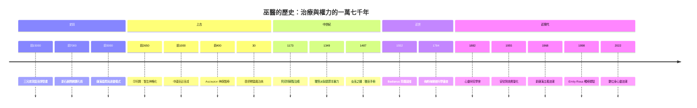

# 巫醫的歷史

> 從洞窟裡的獸首巫師，到 JAMA 上的九歲女孩——一部關於「治療」與「權力」如何在人類社會中互相纏鬥的偵探檔案。

## 雙線主軸

這本書同時追查兩條線，像一樁橫跨一萬七千年的連續案件：

| 主軸 | 路徑 | 核心問題 |
|------|------|----------|
| **治療敘事線** | 靈性解釋 → 宗教壟斷 → 科學化 | 人類如何解釋「為什麼會生病」？病因從靈魂丟失、神罰附身，一路演變到病原體與神經傳導物質——但治療的「儀式本質」從未消失。 |
| **權力鬥爭線** | 巫醫的社會地位浮沉、迫害與再正名 | 誰有資格治病？部落薩滿、神廟祭司、中世紀聖徒、獵巫時代的草藥師、梅斯梅爾的沙龍術士，直到現代的「另類療法產業」——治療者的地位永遠由當下的權力結構決定。 |

兩條線的交會點是本書的核心謎題：**巫醫「有效」嗎？** 安慰劑研究、儀式人類學與文化精神病學給出的答案出人意料——巫醫從來不是純粹的騙子，而是「期望效應的工程師」；但當儀式權威被用來解釋瘟疫、迫害邊緣女性時，它又成為史上最致命的暴力機器之一。

## 歷史年表

### 第一篇：史前與上古（前 15000 – 前 2650）

| 年份 | 事件 | 意義 | wiki |
|------|------|------|------|
| 約前 15000 | 三兄弟洞窟「巫師」壁畫繪成（法國 Ariège） | 獸首人身的复合形象，被視為人類最早對「治療專業者」的圖像記錄 | [-15000-三兄弟洞窟巫師](-15000-三兄弟洞窟巫師.md) |
| 約前 7000 | 新石器時代開顱鑽孔術（跨書：手術的歷史） | 最早的「靈性手術」——環鋸術與驅靈信仰的結合 | 連結至 [../手術的歷史/-7000-新石器開顱鑽孔術.md](../手術的歷史/-7000-新石器開顱鑽孔術.md) |
| 2018（現代） | 納米比亞岩畫經影像分析確認為 7 萬年前螳螂薩滿圖像 | 薩滿意象的史前深度被推到舊石器時代之前 | [-15000-三兄弟洞窟巫師](-15000-三兄弟洞窟巫師.md) |
| 約前 5000 | 新石器歐亞的薩滿墓葬（特殊陪葬、儀式性骨骼排列） | 薩滿作為社會角色的考古學證據 | [-5000-薩滿與逐靈儀式](-5000-薩滿與逐靈儀式.md) |
| 約前 2650 | 印何闐（Imhotep）任法老醫官、設計階梯金字塔 | 人類史上第一位「有名字的醫生」，死後神格化為醫療之神 | [-2650-印何闐神醫神格化](-2650-印何闐神醫神格化.md) |

### 第二篇：古典文明（前 1000 – 30）

| 年份 | 事件 | 意義 | wiki |
|------|------|------|------|
| 約前 1000 | 《山海經》巫彭、巫咸「操不死之藥」傳說成形 | 中國巫醫傳統的原型：巫、醫同源 | [-1000-巫彭巫咸與中國巫醫](-1000-巫彭巫咸與中國巫醫.md) |
| 前 600 左右 | 印何闐崇拜達頂峰，希臘人將其等同 Asclepius | 「醫生變神」的神格化機制跨文化重演 | [-2650-印何闐神醫神格化](-2650-印何闐神醫神格化.md) |
| 前 500 左右 | 希臘 Asclepion 神廟醫療盛行（Epidauros、Kos） | 睡夢療癒（incubation）與還願碑：史上最早的「病人見證檔案」 | [-0400-阿斯克勒庇俄斯神廟](-0400-阿斯克勒庇俄斯神廟.md) |
| 約前 400 | 扁鵲提出「六不治」，明言「信巫不信醫者不治」 | 中國醫巫分職的關鍵時刻，但祝由科仍在官方醫學存續千年 | [-1000-巫彭巫咸與中國巫醫](-1000-巫彭巫咸與中國巫醫.md) |
| 約 30 | 福音書記載耶穌治病與趕鬼 | 「魔鬼致病」神學與希臘自然醫學的張力開始主導西方 | [0030-驅魔與早期基督教治癒](0030-驅魔與早期基督教治癒.md) |

### 第三篇：中世紀（350 – 1487）

| 年份 | 事件 | 意義 | wiki |
|------|------|------|------|
| 1170–1173 | Thomas Becket 被弒後封聖，坎特伯雷墓前奇蹟紀錄暴增 | 中世紀最大規模的「治癒案例收集」——可分析的臨床資料 | [1173-貝克特朝聖治癒](1173-貝克特朝聖治癒.md) |
| 1347–1351 | 黑死病橫掃歐洲（跨書：傳染病的歷史） | 瘟疫解釋框架（神罰／投毒）引爆社會暴力 | 參閱《傳染病的歷史》之黑死病篇 |
| 1348–1349 | 鞭笞派遊行；斯特拉斯堡等地猶太人大屠殺；教宗克萊孟六世諭令保護猶太人 | 替罪羊機制的歷史標本 | [1350-鞭笞派與代罪羔羊](1350-鞭笞派與代罪羔羊.md) |
| 1484 | 教宗 Innocent VIII 諭令，授權獵巫 | 宗教裁判的司法機器啟動 | [1487-女巫之錘](1487-女巫之錘.md) |
| 1487 | Kramer《女巫之錘》（Malleus Maleficarum）出版 | 把助產士、草藥師標籤為女巫的獵巫手冊；「醫學的性別清洗」爭議 | [1487-女巫之錘](1487-女巫之錘.md) |
| 1552 | Aztec 醫師 Martin de la Cruz 完成拉丁文譯本《Badianus Codex》 | 新大陸最早的草藥圖譜；殖民醫療知識的混血與掠奪 | [1552-巴迪亞努斯藥典](1552-巴迪亞努斯藥典.md) |

### 第四篇：近世與近代（1552 – 1955）

| 年份 | 事件 | 意義 | wiki |
|------|------|------|------|
| 1630s | 金雞納樹皮（祕魯樹皮）進入歐洲藥典 | 原住民草藥知識對歐洲醫學的「反向輸血」伏筆 | [1552-巴迪亞努斯藥典](1552-巴迪亞努斯藥典.md) |
| 1760s–1784 | Mesmer 的「動物磁力」巴黎沙龍盛行；1784 法國王家委員會拆穿 | 史上第一次對療法的科學審查——「效果來自想像力」 | [1760-梅斯梅爾動物磁力](1760-梅斯梅爾動物磁力.md) |
| 1843 | Braid 提出催眠（hypnosis）概念 | 動物磁力的「去神秘化」後繼，暗示心理學的伏筆 | [1760-梅斯梅爾動物磁力](1760-梅斯梅爾動物磁力.md) |
| 1882 | 倫敦心靈研究學會（SPR）成立 | 以科學方法調查通靈與靈媒；懷疑論作為偵探方法論 | [1882-心靈研究學會](1882-心靈研究學會.md) |
| 1920s | Houdini 與靈媒的長期打假戰爭 | 魔術師成為最有效的「反巫醫偵探」 | [1882-心靈研究學會](1882-心靈研究學會.md) |
| 1955 | Beecher《The Powerful Placebo》發表於 JAMA | 安慰劑效應被命名與量化；RCT 雙盲設計成為金標準 | [1955-比徹安慰劑效應](1955-比徹安慰劑效應.md) |
| 1962 | Kefauver 修正案 | 美國藥物須證明「有效」而不只是「安全」——安慰劑對照成法律要求 | [1955-比徹安慰劑效應](1955-比徹安慰劑效應.md) |

### 第五篇：當代（1968 – 2022）

| 年份 | 事件 | 意義 | wiki |
|------|------|------|------|
| 1968 | Castaneda《The Teachings of Don Juan》出版 | 新薩滿主義浪潮的引爆點；文化挪用爭論開端 | [1968-新薩滿主義浪潮](1968-新薩滿主義浪潮.md) |
| 1980 | Michael Harner 提出「核心薩滿術」 | 薩滿技術被抽離文化脈絡、包裝成可販售課程 | [1968-新薩滿主義浪潮](1968-新薩滿主義浪潮.md) |
| 1996–1998 | 9 歲 Emily Rosa 的觸療實驗；1998 年登上 JAMA | 史上最年輕的第一作者；用單盲設計拆穿「人體能量場」 | [1998-艾蜜莉羅莎觸療實驗](1998-艾蜜莉羅莎觸療實驗.md) |
| 2007 | Kirsch 等人重新分析抗憂鬱藥試驗數據 | 效應量爭議：藥效與安慰劑差距比想像中小 | [1955-比徹安慰劑效應](1955-比徹安慰劑效應.md) |
| 2019/2023 | WHO 傳統醫學策略；ICD-11 納入傳統醫學章節 | 監管化的醫療多元主義，及其科學性爭議 | [2022-數位身心靈浪潮](2022-數位身心靈浪潮.md) |
| 2020s | Ayahuasca、psilocybin 進入精神醫學臨床試驗；冥想 App 產值十億美元級 | 巫術成分被「醫學化」與「消費品化」的雙軌進行 | [1968-新薩滿主義浪潮](1968-新薩滿主義浪潮.md)、[2022-數位身心靈浪潮](2022-數位身心靈浪潮.md) |

## Mermaid 時間軸

## 章節目錄

1. [-15000-三兄弟洞窟巫師.md](-15000-三兄弟洞窟巫師.md)——舊石器時代的獸首巫師：人類第一個治療專業者的圖像證據
2. [-5000-薩滿與逐靈儀式.md](-5000-薩滿與逐靈儀式.md)——薩滿墓葬與疾病靈性解釋學：儀式為何「有效」
3. [-2650-印何闐神醫神格化.md](-2650-印何闐神醫神格化.md)——醫生如何變成神：印何闐的死後升格
4. [-1000-巫彭巫咸與中國巫醫.md](-1000-巫彭巫咸與中國巫醫.md)——巫醫分家前的中國：祝由科的千年存續
5. [-0400-阿斯克勒庇俄斯神廟.md](-0400-阿斯克勒庇俄斯神廟.md)——神廟睡夢療癒與還願碑：史上最早的倖存者偏差
6. [0030-驅魔與早期基督教治癒.md](0030-驅魔與早期基督教治癒.md)——魔鬼致病神學的誕生
7. [1173-貝克特朝聖治癒.md](1173-貝克特朝聖治癒.md)——朝聖經濟與中世紀的「臨床資料庫」
8. [1350-鞭笞派與代罪羔羊.md](1350-鞭笞派與代罪羔羊.md)——瘟疫解釋框架如何製造暴力
9. [1487-女巫之錘.md](1487-女巫之錘.md)——獵巫手冊與「醫學的性別清洗」假說
10. [1552-巴迪亞努斯藥典.md](1552-巴迪亞努斯藥典.md)——殖民地的醫療知識混血
11. [1760-梅斯梅爾動物磁力.md](1760-梅斯梅爾動物磁力.md)——史上第一次療法科學審查
12. [1882-心靈研究學會.md](1882-心靈研究學會.md)——科學方法調查通靈：懷疑論作為偵探
13. [1955-比徹安慰劑效應.md](1955-比徹安慰劑效應.md)——巫醫效力的現代解釋框架
14. [1968-新薩滿主義浪潮.md](1968-新薩滿主義浪潮.md)——Castaneda、ayahuasca 與薩滿的消費品化
15. [1998-艾蜜莉羅莎觸療實驗.md](1998-艾蜜莉羅莎觸療實驗.md)——九歲女孩拆穿成人能量產業
16. [2022-數位身心靈浪潮.md](2022-數位身心靈浪潮.md)——TikTok 靈性、水晶經濟與監管化的醫療多元主義

## 姊妹書連結

- 《手術的歷史》：[新石器開顱鑽孔術](../手術的歷史/-7000-新石器開顱鑽孔術.md)、[帕雷火器傷革命](../手術的歷史/1545-帕雷火器傷革命.md)、[莫頓乙醚麻醉](../手術的歷史/1846-莫頓乙醚麻醉.md)
- 《傳染病的歷史》（黑死病篇，以書名參照）
- 《心理諮商的歷史》（梅斯梅爾—催眠—暗示—正念的伏線，以書名參照）
- 《生理醫學史》《性病的歷史》《公共衛生的歷史》《神經科的歷史》（跨書參照，以書名提及）
