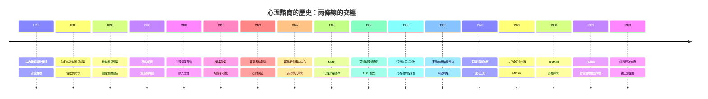

# 心理諮商的歷史

> 從解開鐵鍊到打開螢幕：一場關於「人的心可以被談話治癒嗎」的兩百年偵探案。

本書以**推理探案**的體例，追查心理治療史上十七個關鍵「案件」。每一篇都是一樁懸案：誰是兇手（疾病的真正成因）？線索是什麼（理論、數據、技術）？判決帶來什麼後果（制度、產業、下一步）？

## 雙線主軸

心理諮商的歷史可以讀成兩條交纏的線：

| 主軸 | 演變順序 | 核心問題 |
|---|---|---|
| **理論演變線** | 催眠 → 精神分析 → 行為 → 認知 → 整合 | 「心」的病，機制到底是什麼？ |
| **治療權力線** | 收容所 → 談話 → 個案權利 → 數位 | 誰有資格定義與治療「瘋狂」？ |

理論線上，治療媒介從磁力與催眠（Mesmer、Charcot），換手給談話（Breuer、Freud），再換手給可測量的行為（Wolpe），然後是可檢驗的信念（Ellis、Beck），最後走向整合各家的第三波（正念、DBT、ACT）。權力線上，病人從被鐵鍊拴住的「野獸」（Pinel 之前的比塞特），變成躺椅上的敘述者，再變成有診斷權利、有知情同意、甚至反過來推動 DSM-III 修訂的當事人，如今則成為 App 的使用者——權力又開始搬家。

## 歷史年表

### 篇一：前史與道德治療（18 世紀末–19 世紀）

| 年份 | 事件 | 意義 | Wiki |
|---|---|---|---|
| 1793 | Pinel 為比塞特醫院精神病患解開鐵鍊 | 「瘋子」變成「可治療的病人」，道德治療開端 | [1793](1793-皮內爾解鎖比塞特.md) |
| 1796 | William Tuke 創立約克療養院（York Retreat） | 英國線的道德治療：田園、勞動、尊重 | [1793](1793-皮內爾解鎖比塞特.md) |
| 1843 | Mesmer 學說沒落，催眠術（hypnotism）由 Braid 正名 | 暗示現象進入科學視野 | [1880](1880-沙可歇斯底里劇場.md) |
| 1880s | Charcot 在薩爾佩提耶講授歇斯底里 | 神經學權威為「心理成因」背書 | [1880](1880-沙可歇斯底里劇場.md) |
| 1885–86 | Freud 朝聖巴黎，隨 Charcot 學習 | 精神分析的種子 | [1880](1880-沙可歇斯底里劇場.md) |

### 篇二：精神分析世紀（1895–1945）

| 年份 | 事件 | 意義 | Wiki |
|---|---|---|---|
| 1895 | Breuer & Freud《歇斯底里研究》出版 | 「談話治療」命名，宣洩模型誕生 | [1895](1895-癔症研究與談話治療.md) |
| 1900 | Freud《夢的解析》 | 潛意識理論的總綱 | [1900](1900-夢的解析.md) |
| 1908 | 維也納精神分析學會成立；Beers《A Mind That Found Itself》 | 理論擴張與病人發聲同年發生 | [1900](1900-夢的解析.md)、[1908](1908-心理衛生運動.md) |
| 1908 | Beers 創立 Connecticut 心理衛生學會 | 心理衛生運動起點 | [1908](1908-心理衛生運動.md) |
| 1910 | 國際精神分析大會（紐倫堡）成立 | 精神分析成為國際運動 | [1900](1900-夢的解析.md) |
| 1912–13 | Jung 與 Freud 決裂 | 集體潛意識另立門戶，理論多樣化 | [1913](1913-榮格與佛洛伊德決裂.md) |
| 1921 | Rorschach《心理診斷學》 | 投射測驗誕生 | [1921](1921-羅夏墨跡測驗.md) |
| 1930 | 第一屆國際心理衛生大會（華盛頓） | 病人權利議題首次國際化 | [1908](1908-心理衛生運動.md) |
| 1935–43 | Hull、Pavlov 傳統擴散；Watson 行為主義影響臨床 | 行治療的實驗室前史 | [1958](1958-沃爾普系統減敏.md) |

### 篇三：諮商與計量的誕生（1942–1958）

| 年份 | 事件 | 意義 | Wiki |
|---|---|---|---|
| 1942 | Rogers《Counseling and Psychotherapy》 | 非指導式諮商，「當事人」取代病人 | [1942](1942-羅傑斯當事人中心.md) |
| 1943 | MMPI 出版（Hathaway & McKinley） | 效度量表偵測作答偏差，實證鍵取代直覺 | [1943](1943-明尼蘇達多相人格測驗.md) |
| 1955 | Ellis 創立理性療法（後稱 REBT） | ABC 模型，認知革命先鋒 | [1955](1955-艾利斯理情療法.md) |
| 1956 | Bateson 團隊提出雙重束縛理論 | 家族視角的起點（雖然後來被推翻） | [1965](1965-家族治療結構學派.md) |
| 1957 | Rogers 發表治療性人格改變的必要充分條件 | 真誠、無條件正向關懷、同理心的實證化 | [1942](1942-羅傑斯當事人中心.md) |
| 1958 | Wolpe《Psychotherapy by Reciprocal Inhibition》 | 行為治療正式進入診療室 | [1958](1958-沃爾普系統減敏.md) |

### 篇四：系統、認知與實證革命（1965–1989）

| 年份 | 事件 | 意義 | Wiki |
|---|---|---|---|
| 1965 | Minuchin《Families of the Slums》 | 從個人病理到系統病理 | [1965](1965-家族治療結構學派.md) |
| 1972 | Feighner 標準發表 | 操作性診斷的鋪路石 | [1980](1980-DSM-III診斷革命.md) |
| 1974 | Exner 統一羅夏計分系統 | 投射測驗的科學救亡 | [1921](1921-羅夏墨跡測驗.md) |
| 1976 | Beck《Cognitive Therapy and the Emotional Disorders》 | 認知三角、自動化思考、CBT 誕生 | [1976](1976-貝克認知治療.md) |
| 1979 | Kabat-Zinn 創立 MBSR | 佛教禪修的醫院化翻譯工程 | [1979](1979-卡巴金正念減壓.md) |
| 1980 | DSM-III 出版（Spitzer） | 操作性診斷革命，PTSD 入典 | [1980](1980-DSM-III診斷革命.md) |
| 1987–89 | Shapiro 發現眼動效應，EMD 首篇論文 | EMDR 的起點 | [1989](1989-EMDR創傷治療.md) |
| 1989 | MMPI-2 修訂 | 常模與文化偏差的再檢驗 | [1943](1943-明尼蘇達多相人格測驗.md) |

### 篇五：第三波與當代（1990s–）

| 年份 | 事件 | 意義 | Wiki |
|---|---|---|---|
| 1991 | Linehan 首篇 DBT 隨機對照試驗 | 邊緣型人格自殺行為首次有實證解方 | [1993](1993-林納翰辯證行為治療.md) |
| 1992 | MBCT 起源（Segal、Williams、Teasdale） | 正念防憂鬱復發 | [1979](1979-卡巴金正念減壓.md) |
| 1993 | Linehan《Cognitive-Behavioral Treatment of Borderline Personality Disorder》 | DBT 系統化：CBT×正念的辯證整合 | [1993](1993-林納翰辯證行為治療.md) |
| 1999 | Hayes《Acceptance and Commitment Therapy》 | 第三波：接納與價值行動 | [1993](1993-林納翰辯證行為治療.md) |
| 2000s | 網路 CBT、正念 App、遠距治療 | 治療權力線進入數位時代 | [1979](1979-卡巴金正念減壓.md) |

## 章節目錄

| # | 檔案 | 案件 |
|---|---|---|
| 1 | [1793 - 皮內爾解鎖比塞特](1793-皮內爾解鎖比塞特.md) | 道德治療的誕生與退化 |
| 2 | [1880 - 沙可歇斯底里劇場](1880-沙可歇斯底里劇場.md) | 催眠、暗示與心理成因的背書 |
| 3 | [1895 - 癔症研究與談話治療](1895-癔症研究與談話治療.md) | Anna O. 與宣洩革命 |
| 4 | [1900 - 夢的解析](1900-夢的解析.md) | 潛意識的冰山與科學性爭議 |
| 5 | [1908 - 心理衛生運動](1908-心理衛生運動.md) | 病人發聲推動制度改革 |
| 6 | [1913 - 榮格與佛洛伊德決裂](1913-榮格與佛洛伊德決裂.md) | 集體潛意識 vs 性驅力 |
| 7 | [1921 - 羅夏墨跡測驗](1921-羅夏墨跡測驗.md) | 投射假說的黃金與反噬 |
| 8 | [1942 - 羅傑斯當事人中心](1942-羅傑斯當事人中心.md) | 非指導式諮商與治療聯盟 |
| 9 | [1943 - 明尼蘇達多相人格測驗](1943-明尼蘇達多相人格測驗.md) | 效度量表偵測說謊者 |
| 10 | [1955 - 艾利斯理情療法](1955-艾利斯理情療法.md) | ABC 模型與認知革命先鋒 |
| 11 | [1958 - 沃爾普系統減敏](1958-沃爾普系統減敏.md) | 交互抑制與行為治療誕生 |
| 12 | [1965 - 家族治療結構學派](1965-家族治療結構學派.md) | 病人是家庭的症狀 |
| 13 | [1976 - 貝克認知治療](1976-貝克認知治療.md) | 認知三角與實證 CBT |
| 14 | [1979 - 卡巴金正念減壓](1979-卡巴金正念減壓.md) | 禪修的醫院化翻譯工程 |
| 15 | [1980 - DSM-III 診斷革命](1980-DSM-III診斷革命.md) | 信度優先的操作性診斷 |
| 16 | [1989 - EMDR 創傷治療](1989-EMDR創傷治療.md) | 療效包裝 vs 活性成分 |
| 17 | [1993 - 林納翰辯證行為治療](1993-林納翰辯證行為治療.md) | 接受與改變的辯證 |

## 姊妹書連結

本書與「醫學史」書系的其他卷冊互相呼應：精神藥物如何改變治療權力結構，見《藥物的歷史》；收容所與精神科的體制史，見《精神科的歷史》；腦與神經科學對「心」的解釋權之爭，見《腦科的歷史》；醫學如何在巫術與科學之間擺盪，見《巫醫的歷史》；電擊與精神外科等身體治療的興衰，見《生理醫學史》。
