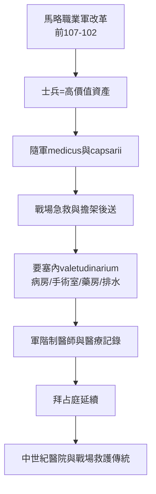

## -0102 - 羅馬軍團軍醫與傷兵醫院（帝國把「回收士兵」做成了一條生產線）

## 案件摘要

**本案偵破的是：為什麼史上第一套制度化、有固定設施、有分級後送的傷病照護系統，出現在羅馬軍團而非任何一座平民城市？**

自馬略軍事改革（約前 107–前 102 年）起，羅馬軍團編制內出現領薪的隨軍醫師（medicus）與醫助（capsarii，因攜帶繃帶盒 capsae 得名）。至帝國時代，行省要塞普遍附設 valetudinarium——專為傷病士兵建造的醫院建築群，德國、英國、敘利亞等地均有考古發掘實例：病房、手術室、藥房、隔離與盥洗設施一應俱全。**這是急診科建築學意義上的祖先**。

## 前因 -- 為什麼會有這個案子

- **職業化軍隊的會計壓力**。馬略取消財產限制後，士兵是國家的長期投資：訓練一名軍團兵成本高昂，每回收一人都是淨利——傷兵照護從慈惠變成資產管理。
- **常備駐防創造了「固定醫院」的需求**。共和國的季節性戰役只需要隨軍救護；帝國的常年在地駐軍則需要建築物——valetudinarium 是駐防制度的副產品。
- **軍醫是第一批「專科僱傭醫師」**。平民醫師是自由執業者，軍醫有軍階、有薪俸、有病歷（軍團有記錄傳統）——職業化程度超前民間。
- **工程能力可轉移**。羅馬人建水道與道路的技術（引水、排水、通風、石造空間規劃）直接用於醫院——公共衛生工程學先於臨床醫學。

## 線索與推理 -- 數學式、程式、理論

帝國軍醫體系的經濟邏輯可以用「回收投資」模型表達。訓練成本 $C$ 、戰傷人數 $n$ 、回收率 $r$ ，則軍醫體系在財務上成立的條件是：

$$ \text{淨值} = n \times r \times C - \text{醫療系統成本} > 0 $$

$$ r \uparrow \; (\text{後送+醫院}) \quad \Rightarrow \quad \text{系統成立的規模門檻下降} $$

```python
# 帝國軍醫的損益估算（示意）
def roi(n_wounded, recovery_rate, train_cost, system_cost):
    return n_wounded * recovery_rate * train_cost - system_cost

print(f"無醫院(回收率0.4): {roi(1000, 0.40, 800, 5000):+.0f}")
print(f"有醫院(回收率0.7): {roi(1000, 0.70, 800, 15000):+.0f}")
# 無醫院(回收率0.4): +315000（未計入長期戰力與士氣損失）
# 有醫院(回收率0.7): +545000
# 結論: 戰事規模夠大時, 醫院是純投資而非慈善
```



考古證據是本案最硬的證物：德國韋爾斯多夫（Vindonissa）與英國 Inchtuthil 的要塞遺址中，valetudinarium 的病房單元以走廊串聯、每間容納 2–6 床、有獨立盥洗區——這種空間語言（分房、通道、清洗）直到 19 世紀才在民用醫院重新出現。

## 結案 -- 後果與影響

- **軍民醫療差軌開始**。帝國崩潰後，valetudinarium 隨軍團消失，民用醫院要到基督教濟貧傳統（4 世紀起）才重建——但那時醫院收的是窮人與朝聖者，不是傷兵。急診式的「傷病優先照護」要等戰場傳統把它帶回來（Larrey、Letterman）。
- **軍階醫師的職業原型**。medicus ordinarius 的編制職位、專科分工（外科 medicus、獸醫 medicus），是「醫師受僱於機構」最早的成熟樣板——現代急診科醫師的僱傭結構與之同構。
- **工程即醫療**。給水、排水、通風被當作醫療設施的一部分——醫院建築學的「環境致病」直覺，比瘴氣理論早了千餘年，也比南丁格爾（見 `1863-紅十字與日內瓦公約.md`）早了近兩千年。
- **一句話結案**：羅馬證明了急診醫學的第一個支點是組織而非知識——先有「有人負責、有地方收、有流程走」的系統，才有後來兩千年的醫學內容填充。

## 案件補遺 -- 證據的界限

- **valetudinarium 的用途有爭議**。部分學者主張這些建築是兵營附屬病房而非獨立醫院；但病房單元化與盥洗設施的規格遠超普通兵舍，主流意見仍支持醫療用途。
- **醫療水準的推斷須克制**。軍團外科器械（考古出土豐富）證明技術存在，但不證明療效——止血、復位、截肢的感染死亡率仍可能高達半數以上。

## 關鍵人物與文獻

- 蓋烏斯·馬略（約前 157–前 86）——軍事改革使軍團職業化，間接催生軍醫編制。
- Celsus（約 25 年）——《論醫學》記載羅馬外科的清創、止血、復位技術，是羅馬戰傷外科的最佳文字證物。
- Galen（129–216）——曾任角鬥士醫師與皇帝隨軍醫，其創傷解剖經驗來自「非戰場的戰場」。
- 考古文獻：Vindonissa、Inchtuthil 等要塞 valetudinarium 發掘報告；Davies《Service in the Roman Army》。
